<div align="center">
  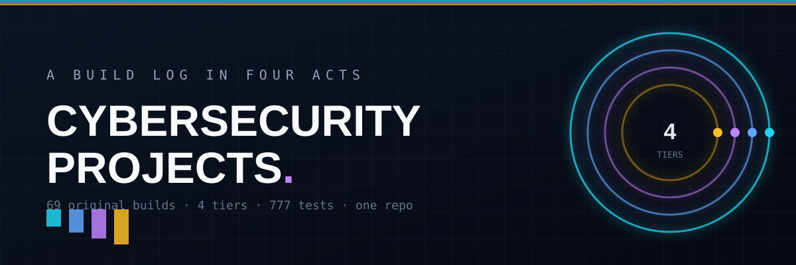
</div>

<div align="center">

# Cybersecurity Projects


> **Sixty-nine original builds, from first hash to last checklist.** Every project is written
> from an upstream synopsis, not copied — offline, deterministic, and lab-safe by design.

[Full roadmap](ROADMAP.md) · [Reference catalog](https://github.com/CarterPerez-dev/Cybersecurity-Projects)

</div>

---

## 🧭 Explore by tier

| Tier | Size | Focus |
|---|---|---|
| 🟦 **[Foundations](foundations/README.md)** | <span style="color:#22D3EE">3 projects</span> | Core primitives — hashing, headers, secrets. |
| 🔵 **[Beginner](beginner/README.md)** | <span style="color:#60A5FA">21 projects</span> | Scanners, ciphers, logs and the first blue-team tools. |
| 🟣 **[Intermediate](intermediate/README.md)** | <span style="color:#C084FC">23 projects</span> | Detection pipelines, risk analysis and offline labs. |
| 🟠 **[Advanced](advanced/README.md)** | <span style="color:#FBBF24">22 projects</span> | Crypto, anomaly detection and system-level analysis. |

Each card below links to a project with its own generated artwork, architecture diagram,
real captured CLI output, and concept notes.

---

### 🟦 Foundations — 3 projects

<table><tr><td align="center">
<td width="33%" align="center" valign="top"><a href="foundations/01-hash-identifier/README.md">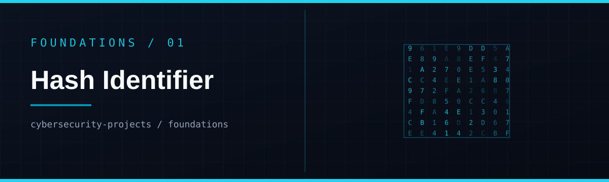</a><br /><a href="foundations/01-hash-identifier/README.md"><b>Hash Identifier</b></a><br /><sub>Identify hash formats from length and character patterns.</sub></td>
</td><td align="center">
<td width="33%" align="center" valign="top"><a href="foundations/02-http-headers-scanner/README.md">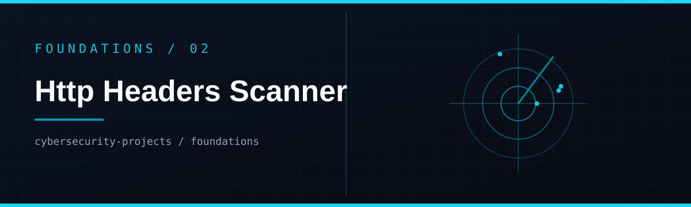</a><br /><a href="foundations/02-http-headers-scanner/README.md"><b>Http Headers Scanner</b></a><br /><sub>Audit response headers for missing security controls.</sub></td>
</td><td align="center">
<td width="33%" align="center" valign="top"><a href="foundations/03-password-manager/README.md">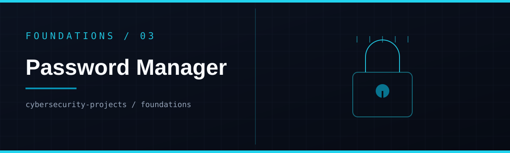</a><br /><a href="foundations/03-password-manager/README.md"><b>Password Manager</b></a><br /><sub>Encrypted local vault with Argon2id key derivation.</sub></td>

</td></tr></table>

---

### 🔵 Beginner — 21 projects

<table><tr><td align="center">
<td width="33%" align="center" valign="top"><a href="beginner/01-simple-port-scanner/README.md">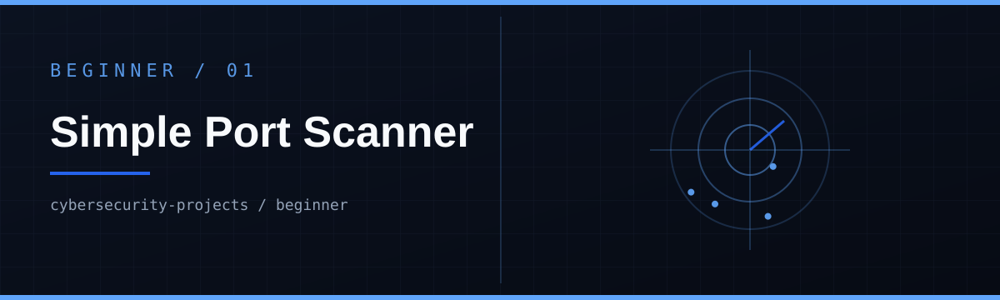</a><br /><a href="beginner/01-simple-port-scanner/README.md"><b>Simple Port Scanner</b></a><br /><sub>Probe a target range for open TCP ports.</sub></td>
</td><td align="center">
<td width="33%" align="center" valign="top"><a href="beginner/02-keylogger/README.md">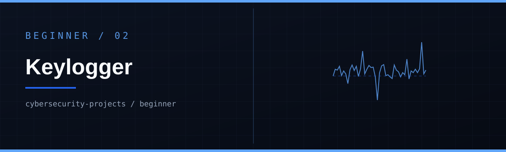</a><br /><a href="beginner/02-keylogger/README.md"><b>Keylogger</b></a><br /><sub>Educational event recorder with a clear lab boundary.</sub></td>
</td><td align="center">
<td width="33%" align="center" valign="top"><a href="beginner/03-caesar-cipher/README.md"></a><br /><a href="beginner/03-caesar-cipher/README.md"><b>Caesar Cipher</b></a><br /><sub>Rotate letters, brute-force shifts and score results.</sub></td>

</td></tr><tr><td align="center">
<td width="33%" align="center" valign="top"><a href="beginner/04-dns-lookup/README.md">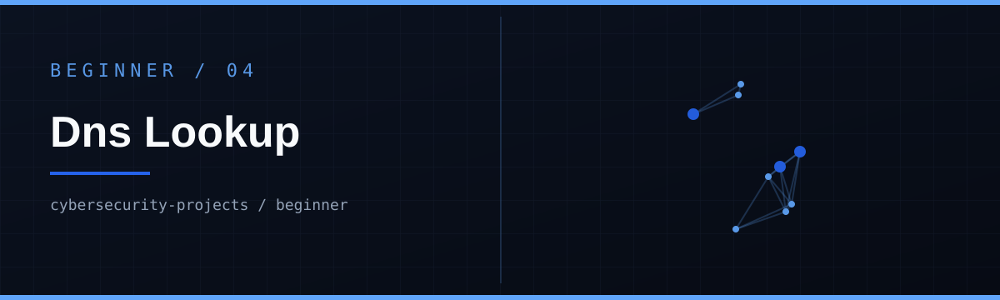</a><br /><a href="beginner/04-dns-lookup/README.md"><b>Dns Lookup</b></a><br /><sub>Query and present DNS records from the command line.</sub></td>
</td><td align="center">
<td width="33%" align="center" valign="top"><a href="beginner/05-simple-vulnerability-scanner/README.md">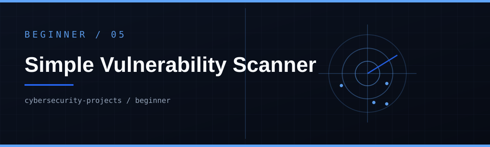</a><br /><a href="beginner/05-simple-vulnerability-scanner/README.md"><b>Simple Vulnerability Scanner</b></a><br /><sub>Rule-based checks over a synthetic host snapshot.</sub></td>
</td><td align="center">
<td width="33%" align="center" valign="top"><a href="beginner/06-network-traffic-analyzer/README.md">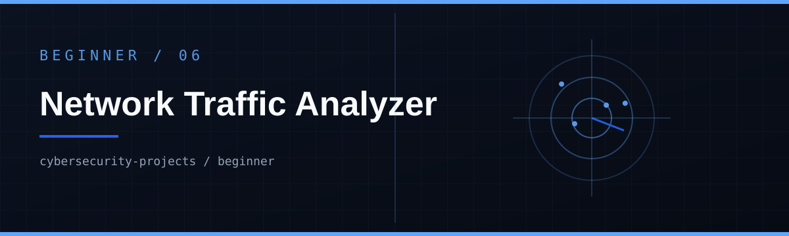</a><br /><a href="beginner/06-network-traffic-analyzer/README.md"><b>Network Traffic Analyzer</b></a><br /><sub>Parse saved capture data into flow summaries.</sub></td>

</td></tr><tr><td align="center">
<td width="33%" align="center" valign="top"><a href="beginner/07-hash-cracker/README.md">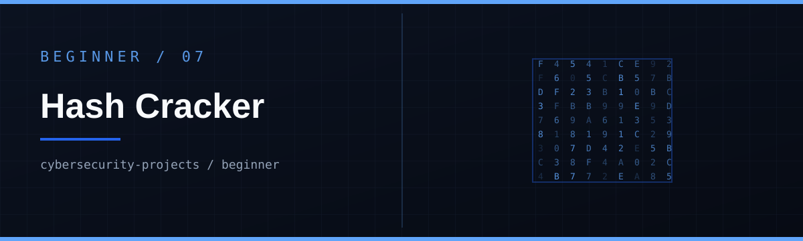</a><br /><a href="beginner/07-hash-cracker/README.md"><b>Hash Cracker</b></a><br /><sub>Bounded dictionary checks against local demo digests.</sub></td>
</td><td align="center">
<td width="33%" align="center" valign="top"><a href="beginner/08-steganography-multi-tool/README.md">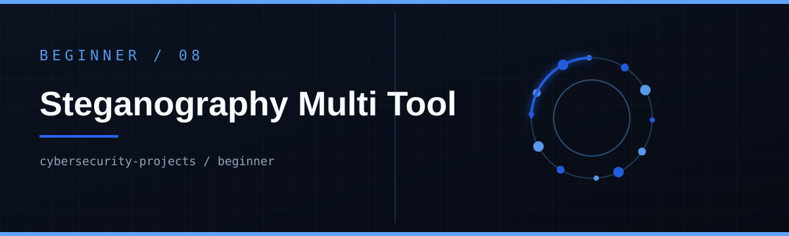</a><br /><a href="beginner/08-steganography-multi-tool/README.md"><b>Steganography Multi Tool</b></a><br /><sub>Hide and reveal payloads in images with a CLI.</sub></td>
</td><td align="center">
<td width="33%" align="center" valign="top"><a href="beginner/09-deserialization-gadget-lab/README.md">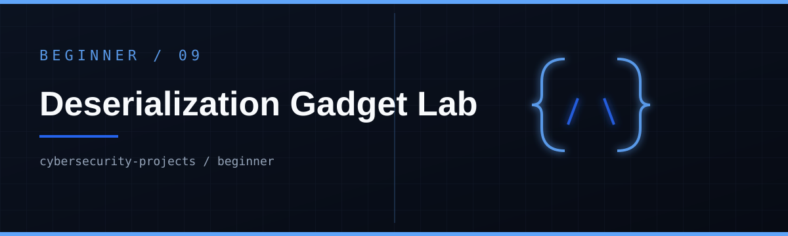</a><br /><a href="beginner/09-deserialization-gadget-lab/README.md"><b>Deserialization Gadget Lab</b></a><br /><sub>Inspect serialized object graphs safely, offline.</sub></td>

</td></tr><tr><td align="center">
<td width="33%" align="center" valign="top"><a href="beginner/10-canary-token-generator/README.md">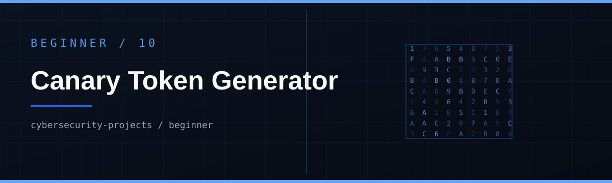</a><br /><a href="beginner/10-canary-token-generator/README.md"><b>Canary Token Generator</b></a><br /><sub>Generate harmless tripwire tokens for lab tracking.</sub></td>
</td><td align="center">
<td width="33%" align="center" valign="top"><a href="beginner/11-phishing-domain-detector-and-quishing-scanner/README.md">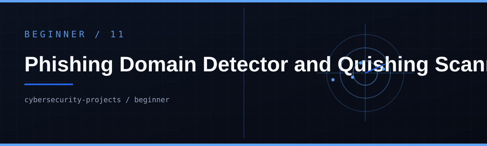</a><br /><a href="beginner/11-phishing-domain-detector-and-quishing-scanner/README.md"><b>Phishing Domain Detector and Qui…</b></a><br /><sub>Score domains and QR links for lookalike patterns.</sub></td>
</td><td align="center">
<td width="33%" align="center" valign="top"><a href="beginner/12-ssh-brute-force-detector/README.md">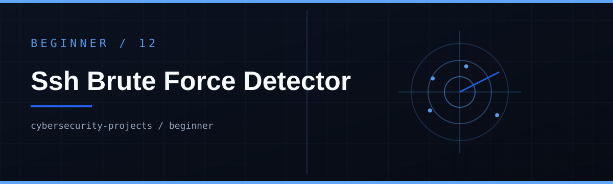</a><br /><a href="beginner/12-ssh-brute-force-detector/README.md"><b>Ssh Brute Force Detector</b></a><br /><sub>Spot repeated failed logins in synthetic auth logs.</sub></td>

</td></tr><tr><td align="center">
<td width="33%" align="center" valign="top"><a href="beginner/13-simple-c2-beacon/README.md">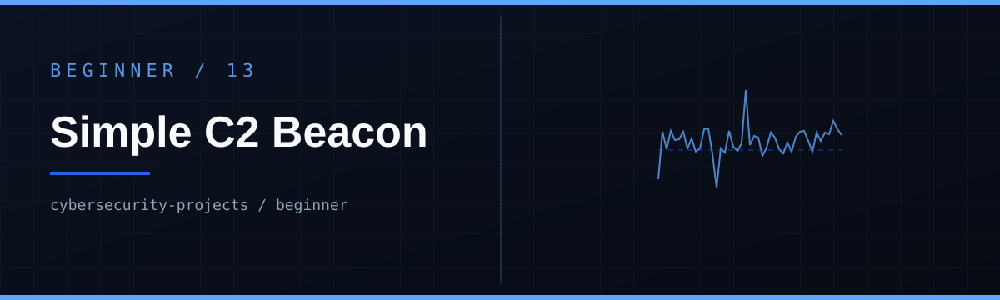</a><br /><a href="beginner/13-simple-c2-beacon/README.md"><b>Simple C2 Beacon</b></a><br /><sub>Model beacon timing and detect regular check-ins.</sub></td>
</td><td align="center">
<td width="33%" align="center" valign="top"><a href="beginner/14-base64-encoder-decoder/README.md">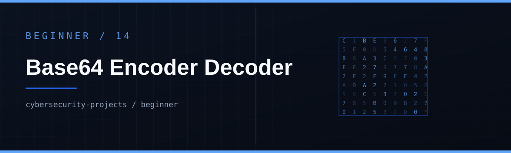</a><br /><a href="beginner/14-base64-encoder-decoder/README.md"><b>Base64 Encoder Decoder</b></a><br /><sub>Encode and decode text with validation and diagnostics.</sub></td>
</td><td align="center">
<td width="33%" align="center" valign="top"><a href="beginner/15-linux-cis-hardening-auditor/README.md">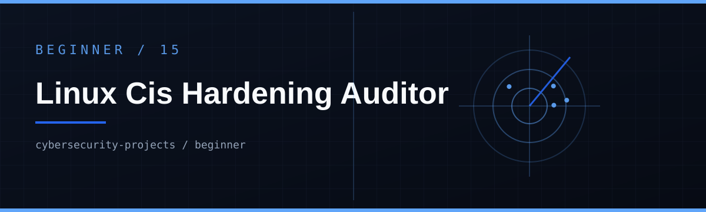</a><br /><a href="beginner/15-linux-cis-hardening-auditor/README.md"><b>Linux Cis Hardening Auditor</b></a><br /><sub>Check a config snapshot against CIS-style controls.</sub></td>

</td></tr><tr><td align="center">
<td width="33%" align="center" valign="top"><a href="beginner/16-systemd-persistence-scanner/README.md">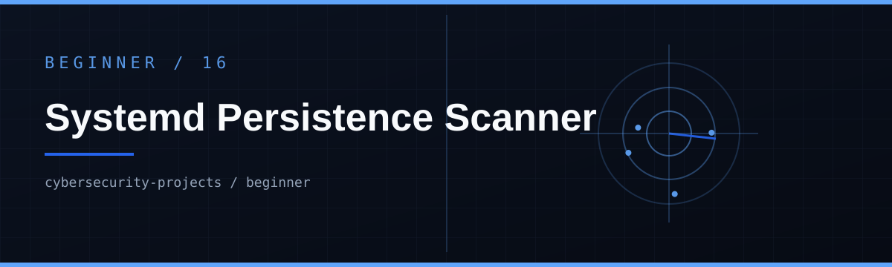</a><br /><a href="beginner/16-systemd-persistence-scanner/README.md"><b>Systemd Persistence Scanner</b></a><br /><sub>Find suspicious service and timer unit definitions.</sub></td>
</td><td align="center">
<td width="33%" align="center" valign="top"><a href="beginner/17-linux-ebpf-security-tracer/README.md">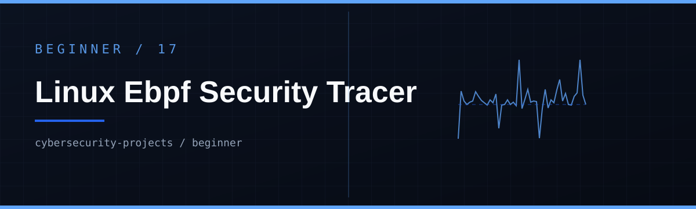</a><br /><a href="beginner/17-linux-ebpf-security-tracer/README.md"><b>Linux Ebpf Security Tracer</b></a><br /><sub>Analyze synthetic process-execution telemetry offline.</sub></td>
</td><td align="center">
<td width="33%" align="center" valign="top"><a href="beginner/18-trojan-application-detector/README.md">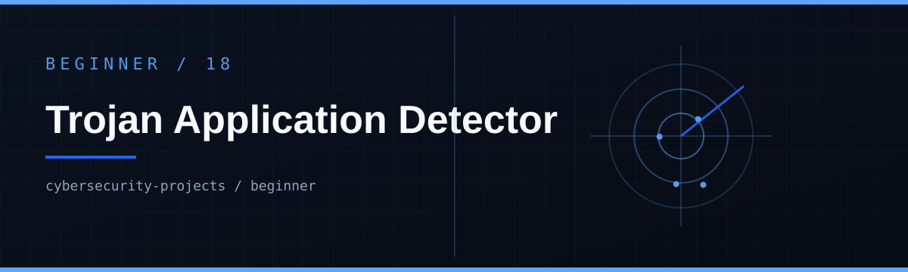</a><br /><a href="beginner/18-trojan-application-detector/README.md"><b>Trojan Application Detector</b></a><br /><sub>Static indicators of trojan-like application behaviour.</sub></td>

</td></tr><tr><td align="center">
<td width="33%" align="center" valign="top"><a href="beginner/19-dns-sinkhole/README.md">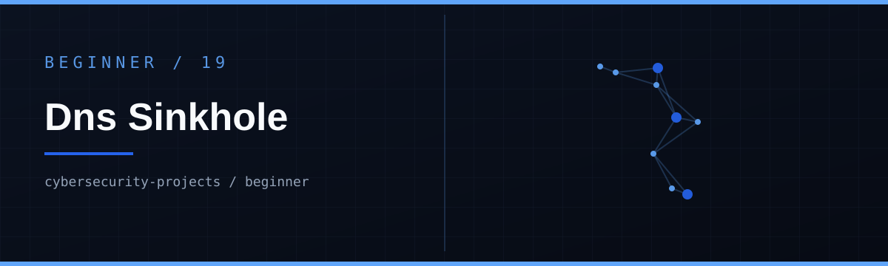</a><br /><a href="beginner/19-dns-sinkhole/README.md"><b>Dns Sinkhole</b></a><br /><sub>Idempotent hosts-file blocklists with safe dry runs.</sub></td>
</td><td align="center">
<td width="33%" align="center" valign="top"><a href="beginner/20-firewall-rule-engine/README.md">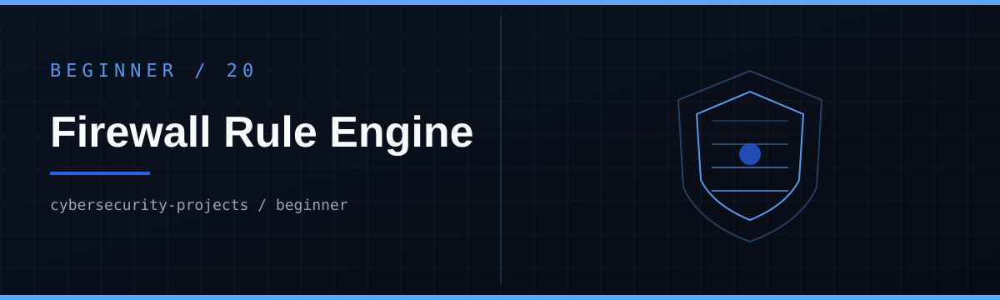</a><br /><a href="beginner/20-firewall-rule-engine/README.md"><b>Firewall Rule Engine</b></a><br /><sub>First-match packet policy with default deny.</sub></td>
</td><td align="center">
<td width="33%" align="center" valign="top"><a href="beginner/21-llm-prompt-injection-firewall/README.md">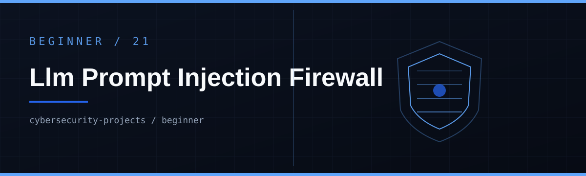</a><br /><a href="beginner/21-llm-prompt-injection-firewall/README.md"><b>Llm Prompt Injection Firewall</b></a><br /><sub>Heuristic pre-filter for untrusted prompt text.</sub></td>

</td></tr></table>

---

### 🟣 Intermediate — 23 projects

<table><tr><td align="center">
<td width="33%" align="center" valign="top"><a href="intermediate/01-security-news-scraper/README.md">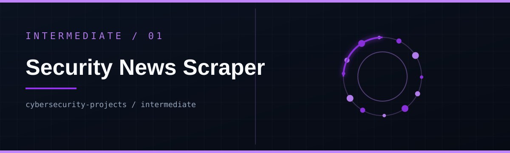</a><br /><a href="intermediate/01-security-news-scraper/README.md"><b>Security News Scraper</b></a><br /><sub>Offline RSS/Atom parsing and relevance ranking.</sub></td>
</td><td align="center">
<td width="33%" align="center" valign="top"><a href="intermediate/02-payload-obfuscation-engine/README.md">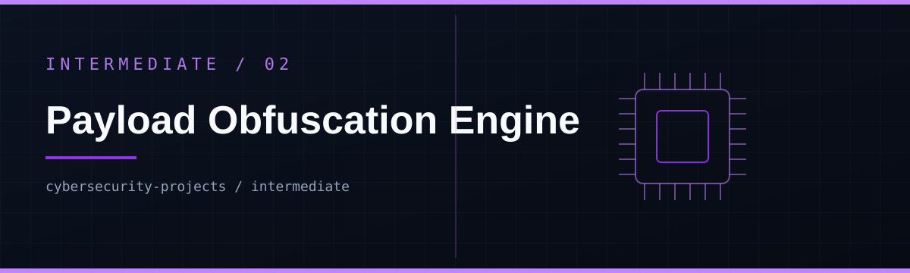</a><br /><a href="intermediate/02-payload-obfuscation-engine/README.md"><b>Payload Obfuscation Engine</b></a><br /><sub>Detect layered encoding and obfuscation in files.</sub></td>
</td><td align="center">
<td width="33%" align="center" valign="top"><a href="intermediate/03-siem-dashboard/README.md">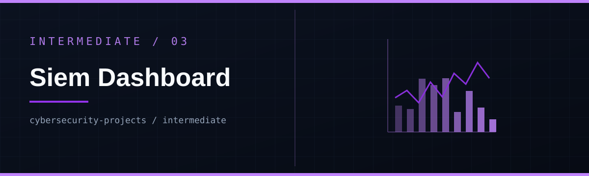</a><br /><a href="intermediate/03-siem-dashboard/README.md"><b>Siem Dashboard</b></a><br /><sub>Correlate JSONL events into counts and alerts.</sub></td>

</td></tr><tr><td align="center">
<td width="33%" align="center" valign="top"><a href="intermediate/04-token-abuse-playground/README.md">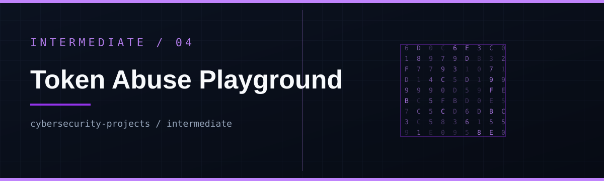</a><br /><a href="intermediate/04-token-abuse-playground/README.md"><b>Token Abuse Playground</b></a><br /><sub>Parse-only inspection of JWT-like token claims.</sub></td>
</td><td align="center">
<td width="33%" align="center" valign="top"><a href="intermediate/05-supply-chain-attack-simulator/README.md">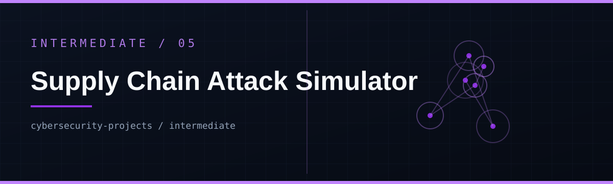</a><br /><a href="intermediate/05-supply-chain-attack-simulator/README.md"><b>Supply Chain Attack Simulator</b></a><br /><sub>Dependency-graph risk analysis and typosquat checks.</sub></td>
</td><td align="center">
<td width="33%" align="center" valign="top"><a href="intermediate/06-ddos-mitigation-tool/README.md">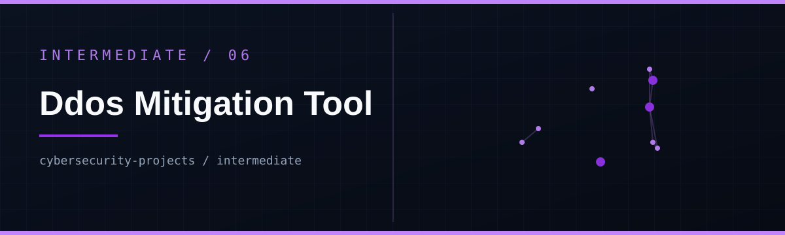</a><br /><a href="intermediate/06-ddos-mitigation-tool/README.md"><b>Ddos Mitigation Tool</b></a><br /><sub>Token-bucket and sliding-window traffic shaping.</sub></td>

</td></tr><tr><td align="center">
<td width="33%" align="center" valign="top"><a href="intermediate/07-secrets-scanner/README.md">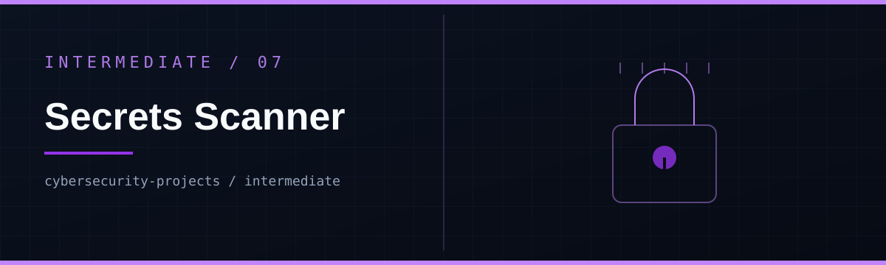</a><br /><a href="intermediate/07-secrets-scanner/README.md"><b>Secrets Scanner</b></a><br /><sub>Regex and entropy detection with suppression support.</sub></td>
</td><td align="center">
<td width="33%" align="center" valign="top"><a href="intermediate/08-api-security-scanner/README.md"></a><br /><a href="intermediate/08-api-security-scanner/README.md"><b>Api Security Scanner</b></a><br /><sub>Static OpenAPI security and authentication checks.</sub></td>
</td><td align="center">
<td width="33%" align="center" valign="top"><a href="intermediate/09-wireless-deauth-detector/README.md">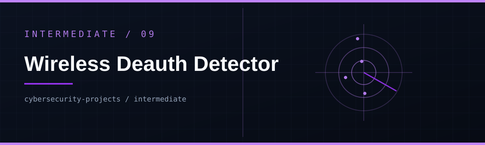</a><br /><a href="intermediate/09-wireless-deauth-detector/README.md"><b>Wireless Deauth Detector</b></a><br /><sub>Flood detection in synthetic 802.11 frame logs.</sub></td>

</td></tr><tr><td align="center">
<td width="33%" align="center" valign="top"><a href="intermediate/10-credential-enumeration-detector/README.md">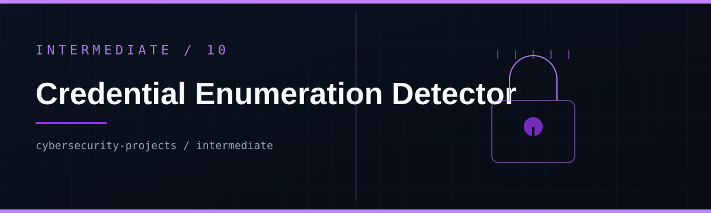</a><br /><a href="intermediate/10-credential-enumeration-detector/README.md"><b>Credential Enumeration Detector</b></a><br /><sub>Find enumeration leaks in recorded login results.</sub></td>
</td><td align="center">
<td width="33%" align="center" valign="top"><a href="intermediate/11-binary-analysis-tool/README.md">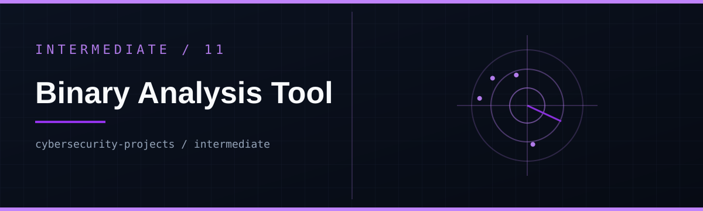</a><br /><a href="intermediate/11-binary-analysis-tool/README.md"><b>Binary Analysis Tool</b></a><br /><sub>Pure-Python ELF and PE header inspection.</sub></td>
</td><td align="center">
<td width="33%" align="center" valign="top"><a href="intermediate/12-chaos-engineering-security-tool/README.md">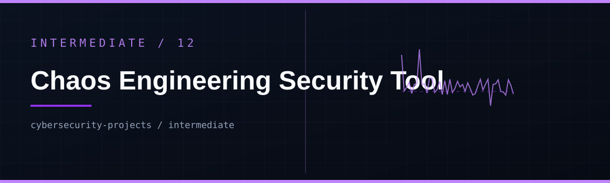</a><br /><a href="intermediate/12-chaos-engineering-security-tool/README.md"><b>Chaos Engineering Security Tool</b></a><br /><sub>Plan and simulate fault scenarios safely.</sub></td>

</td></tr><tr><td align="center">
<td width="33%" align="center" valign="top"><a href="intermediate/13-credential-rotation-enforcer/README.md">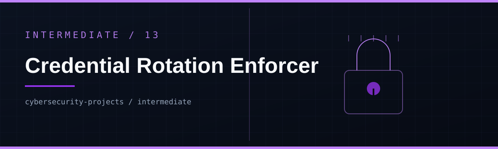</a><br /><a href="intermediate/13-credential-rotation-enforcer/README.md"><b>Credential Rotation Enforcer</b></a><br /><sub>Policy checks over rotation metadata only.</sub></td>
</td><td align="center">
<td width="33%" align="center" valign="top"><a href="intermediate/14-race-condition-detector/README.md">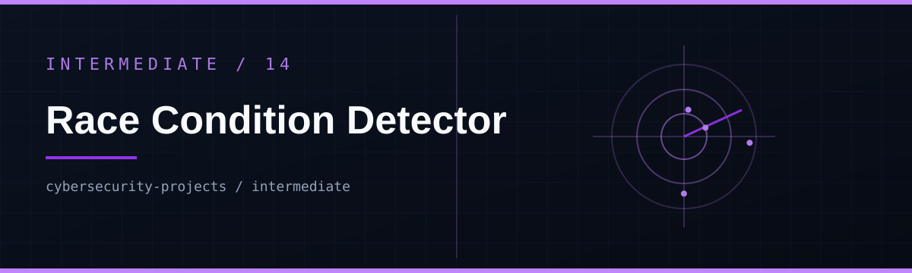</a><br /><a href="intermediate/14-race-condition-detector/README.md"><b>Race Condition Detector</b></a><br /><sub>Spot TOCTOU patterns in logs and code snapshots.</sub></td>
</td><td align="center">
<td width="33%" align="center" valign="top"><a href="intermediate/15-ja3-ja4-fingerprinting-tool/README.md">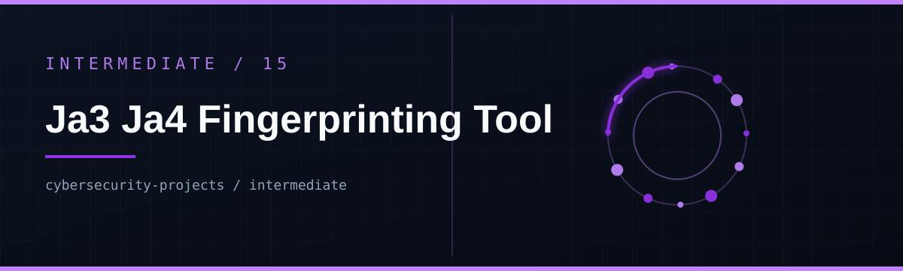</a><br /><a href="intermediate/15-ja3-ja4-fingerprinting-tool/README.md"><b>Ja3 Ja4 Fingerprinting Tool</b></a><br /><sub>Compute TLS fingerprint hashes from field lists.</sub></td>

</td></tr><tr><td align="center">
<td width="33%" align="center" valign="top"><a href="intermediate/16-mobile-app-security-analyzer/README.md">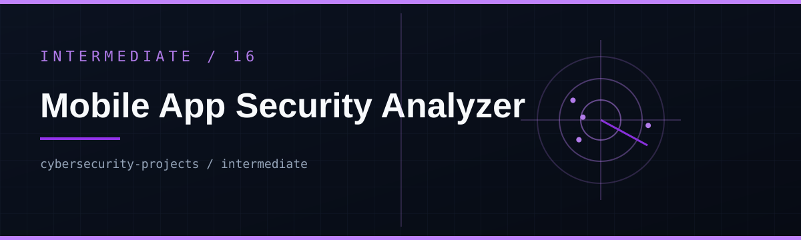</a><br /><a href="intermediate/16-mobile-app-security-analyzer/README.md"><b>Mobile App Security Analyzer</b></a><br /><sub>Manifest checks for permissions and exported components.</sub></td>
</td><td align="center">
<td width="33%" align="center" valign="top"><a href="intermediate/17-dlp-scanner/README.md">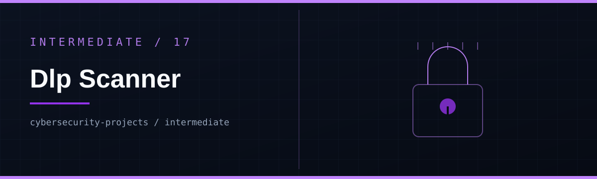</a><br /><a href="intermediate/17-dlp-scanner/README.md"><b>Dlp Scanner</b></a><br /><sub>PII and secret detection with severity and redaction.</sub></td>
</td><td align="center">
<td width="33%" align="center" valign="top"><a href="intermediate/18-nginx-edge-rule-engine/README.md">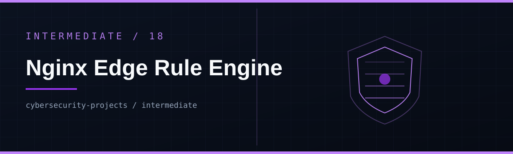</a><br /><a href="intermediate/18-nginx-edge-rule-engine/README.md"><b>Nginx Edge Rule Engine</b></a><br /><sub>Evaluate path, method, CIDR and header edge rules.</sub></td>

</td></tr><tr><td align="center">
<td width="33%" align="center" valign="top"><a href="intermediate/19-privesc-playground/README.md">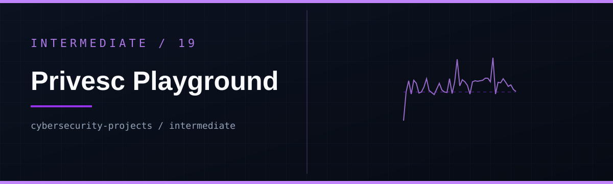</a><br /><a href="intermediate/19-privesc-playground/README.md"><b>Privesc Playground</b></a><br /><sub>Audit SUID, sudoers and writable-path risk indicators.</sub></td>
</td><td align="center">
<td width="33%" align="center" valign="top"><a href="intermediate/20-sbom-generator-and-vulnerability-matcher/README.md">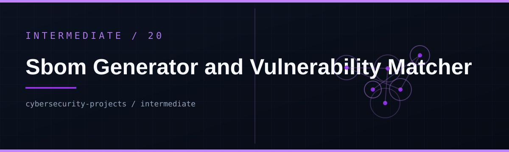</a><br /><a href="intermediate/20-sbom-generator-and-vulnerability-matcher/README.md"><b>Sbom Generator and Vulnerability…</b></a><br /><sub>CycloneDX-like SBOM with local CVE matching.</sub></td>
</td><td align="center">
<td width="33%" align="center" valign="top"><a href="intermediate/21-subdomain-takeover-scanner/README.md">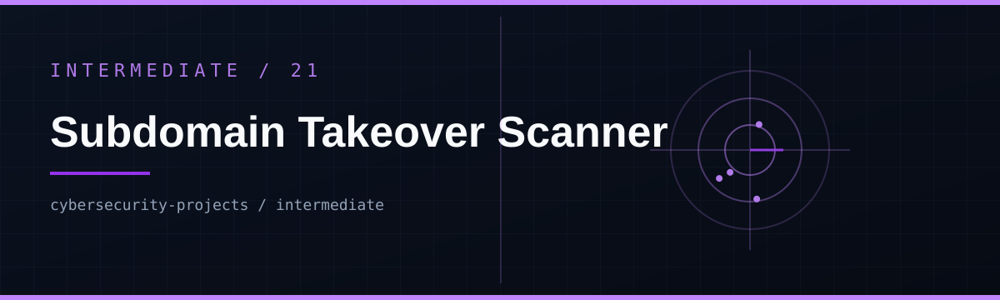</a><br /><a href="intermediate/21-subdomain-takeover-scanner/README.md"><b>Subdomain Takeover Scanner</b></a><br /><sub>Dangling CNAME analysis over a DNS snapshot.</sub></td>

</td></tr><tr><td align="center">
<td width="33%" align="center" valign="top"><a href="intermediate/22-graphql-security-tester/README.md">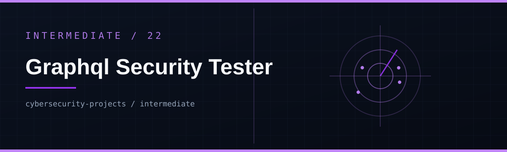</a><br /><a href="intermediate/22-graphql-security-tester/README.md"><b>Graphql Security Tester</b></a><br /><sub>Offline depth, introspection and alias-abuse checks.</sub></td>
</td><td align="center">
<td width="33%" align="center" valign="top"><a href="intermediate/23-docker-security-audit/README.md">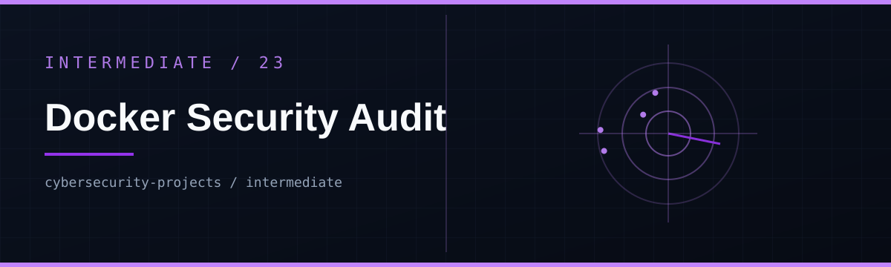</a><br /><a href="intermediate/23-docker-security-audit/README.md"><b>Docker Security Audit</b></a><br /><sub>Dockerfile policy checks with no daemon access.</sub></td>
</td><td align="center">
</td></tr></table>

---

### 🟠 Advanced — 22 projects

<table><tr><td align="center">
<td width="33%" align="center" valign="top"><a href="advanced/01-api-rate-limiter/README.md">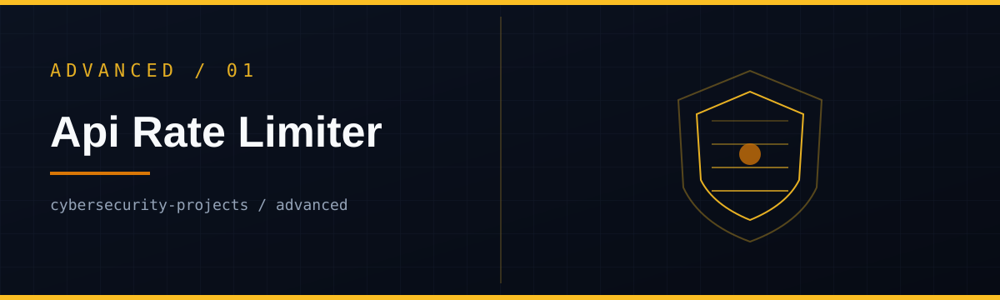</a><br /><a href="advanced/01-api-rate-limiter/README.md"><b>Api Rate Limiter</b></a><br /><sub>Token bucket and sliding window over request timestamps.</sub></td>
</td><td align="center">
<td width="33%" align="center" valign="top"><a href="advanced/02-encrypted-chat-application/README.md">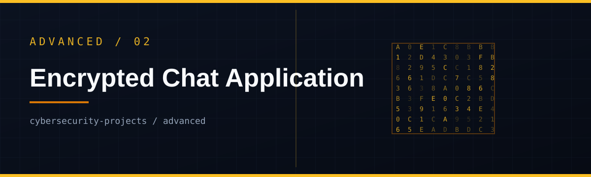</a><br /><a href="advanced/02-encrypted-chat-application/README.md"><b>Encrypted Chat Application</b></a><br /><sub>Local AES-GCM chat store with per-message nonces.</sub></td>
</td><td align="center">
<td width="33%" align="center" valign="top"><a href="advanced/03-exploit-development-framework/README.md">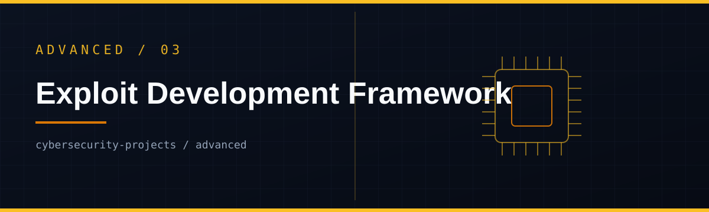</a><br /><a href="advanced/03-exploit-development-framework/README.md"><b>Exploit Development Framework</b></a><br /><sub>Defensive triage of crash traces and memory indicators.</sub></td>

</td></tr><tr><td align="center">
<td width="33%" align="center" valign="top"><a href="advanced/04-ai-threat-detection/README.md">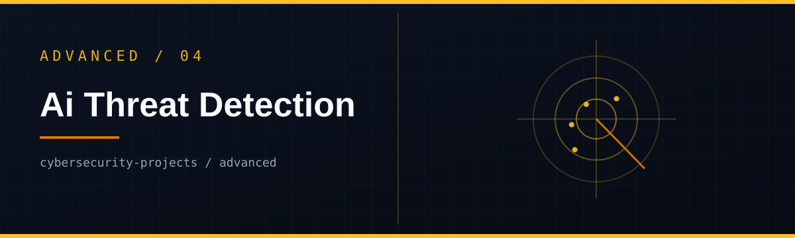</a><br /><a href="advanced/04-ai-threat-detection/README.md"><b>Ai Threat Detection</b></a><br /><sub>Transparent z-score and rule based anomaly scoring.</sub></td>
</td><td align="center">
<td width="33%" align="center" valign="top"><a href="advanced/05-zingela-stateless-scanner/README.md"></a><br /><a href="advanced/05-zingela-stateless-scanner/README.md"><b>Zingela Stateless Scanner</b></a><br /><sub>Parse saved scan output and match a local risk catalog.</sub></td>
</td><td align="center">
<td width="33%" align="center" valign="top"><a href="advanced/06-bug-bounty-platform/README.md"></a><br /><a href="advanced/06-bug-bounty-platform/README.md"><b>Bug Bounty Platform</b></a><br /><sub>Local finding tracker with CVSS-like scoring.</sub></td>

</td></tr><tr><td align="center">
<td width="33%" align="center" valign="top"><a href="advanced/07-cloud-security-compliance-dashboard/README.md"></a><br /><a href="advanced/07-cloud-security-compliance-dashboard/README.md"><b>Cloud Security Compliance Dashbo…</b></a><br /><sub>Snapshot checks for common cloud misconfigurations.</sub></td>
</td><td align="center">
<td width="33%" align="center" valign="top"><a href="advanced/08-malware-analysis-platform/README.md"></a><br /><a href="advanced/08-malware-analysis-platform/README.md"><b>Malware Analysis Platform</b></a><br /><sub>Static hashing, entropy and strings — no execution.</sub></td>
</td><td align="center">
<td width="33%" align="center" valign="top"><a href="advanced/09-quantum-resistant-encryption/README.md"></a><br /><a href="advanced/09-quantum-resistant-encryption/README.md"><b>Quantum Resistant Encryption</b></a><br /><sub>Toy Lamport one-time signatures for learning.</sub></td>

</td></tr><tr><td align="center">
<td width="33%" align="center" valign="top"><a href="advanced/10-zero-day-vulnerability-scanner/README.md"></a><br /><a href="advanced/10-zero-day-vulnerability-scanner/README.md"><b>Zero Day Vulnerability Scanner</b></a><br /><sub>Unknown-risk source patterns, no exploit claims.</sub></td>
</td><td align="center">
<td width="33%" align="center" valign="top"><a href="advanced/11-distributed-password-cracker/README.md"></a><br /><a href="advanced/11-distributed-password-cracker/README.md"><b>Distributed Password Cracker</b></a><br /><sub>Workload partitioning simulation, digest checks only.</sub></td>
</td><td align="center">
<td width="33%" align="center" valign="top"><a href="advanced/12-kernel-rootkit-detection/README.md"></a><br /><a href="advanced/12-kernel-rootkit-detection/README.md"><b>Kernel Rootkit Detection</b></a><br /><sub>Syscall-table anomaly checks over a snapshot.</sub></td>

</td></tr><tr><td align="center">
<td width="33%" align="center" valign="top"><a href="advanced/13-blockchain-smart-contract-auditor/README.md"></a><br /><a href="advanced/13-blockchain-smart-contract-auditor/README.md"><b>Blockchain Smart Contract Auditor</b></a><br /><sub>Static Solidity pattern checks, no chain access.</sub></td>
</td><td align="center">
<td width="33%" align="center" valign="top"><a href="advanced/14-adversarial-ml-detector/README.md"></a><br /><a href="advanced/14-adversarial-ml-detector/README.md"><b>Adversarial Ml Detector</b></a><br /><sub>Distribution drift and perturbation scoring.</sub></td>
</td><td align="center">
<td width="33%" align="center" valign="top"><a href="advanced/15-reverse-engineering-platform/README.md"></a><br /><a href="advanced/15-reverse-engineering-platform/README.md"><b>Reverse Engineering Platform</b></a><br /><sub>Headers, strings and imports from synthetic blobs.</sub></td>

</td></tr><tr><td align="center">
<td width="33%" align="center" valign="top"><a href="advanced/16-hsm-emulator/README.md"></a><br /><a href="advanced/16-hsm-emulator/README.md"><b>Hsm Emulator</b></a><br /><sub>Software enclave with wrapped keys and HMAC signing.</sub></td>
</td><td align="center">
<td width="33%" align="center" valign="top"><a href="advanced/17-network-covert-channel-detector/README.md"></a><br /><a href="advanced/17-network-covert-channel-detector/README.md"><b>Network Covert Channel Detector</b></a><br /><sub>Timing and size anomaly scoring over packet logs.</sub></td>
</td><td align="center">
<td width="33%" align="center" valign="top"><a href="advanced/18-automated-penetration-testing-planner/README.md"></a><br /><a href="advanced/18-automated-penetration-testing-planner/README.md"><b>Automated Penetration Testing Pl…</b></a><br /><sub>Scope-aware lab checklists — executes nothing.</sub></td>

</td></tr><tr><td align="center">
<td width="33%" align="center" valign="top"><a href="advanced/19-haskell-reverse-proxy/README.md"></a><br /><a href="advanced/19-haskell-reverse-proxy/README.md"><b>Haskell Reverse Proxy</b></a><br /><sub>First-match route evaluation without a server.</sub></td>
</td><td align="center">
<td width="33%" align="center" valign="top"><a href="advanced/20-monitor-the-situation-dashboard/README.md"></a><br /><a href="advanced/20-monitor-the-situation-dashboard/README.md"><b>Monitor the Situation Dashboard</b></a><br /><sub>Console aggregation of synthetic event feeds.</sub></td>
</td><td align="center">
<td width="33%" align="center" valign="top"><a href="advanced/21-honeypot-network/README.md"></a><br /><a href="advanced/21-honeypot-network/README.md"><b>Honeypot Network</b></a><br /><sub>Synthetic events and attacker-pattern analysis.</sub></td>

</td></tr><tr><td align="center">
<td width="33%" align="center" valign="top"><a href="advanced/22-supply-chain-security-analyzer/README.md"></a><br /><a href="advanced/22-supply-chain-security-analyzer/README.md"><b>Supply Chain Security Analyzer</b></a><br /><sub>SBOM provenance, integrity and license policies.</sub></td>
</td><td align="center">
</td></tr></table>

---

## 🛠️ Verify it yourself

```powershell
# Run every project test suite from the repository root
Get-ChildItem -Path . -Recurse -Directory -Filter tests | ForEach-Object {
  Push-Location $_.Parent.FullName
  python -m unittest discover -s tests
  Pop-Location
}

# Regenerate all hero artwork and this gallery
python tools/generate_assets.py
python tools/generate_homepage.py
```

## 🧩 Design notes

- **Original work.** The upstream catalog is a specification, not a copy source.
- **Language substitutions.** Only Python is installed here, so non-Python upstream projects are
  reimplemented in Python with the deviation stated in each project README.
- **Safety boundary.** No real malware, no production targets, no network calls in tests, and no
  fabricated evidence. Offensive synopses are rebuilt as detectors, simulators or auditors.
- **Visual system.** Every project has a deterministic, tier-coloured SVG hero generated by
  [`tools/generate_assets.py`](tools/generate_assets.py). Motifs and geometry are derived from the
  project name, so each banner is unique while the portfolio stays visually coherent.

---

<div align="center">
  <sub>Built in tier order · Foundations → Beginner → Intermediate → Advanced</sub>
</div>
