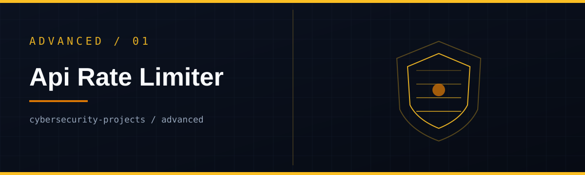
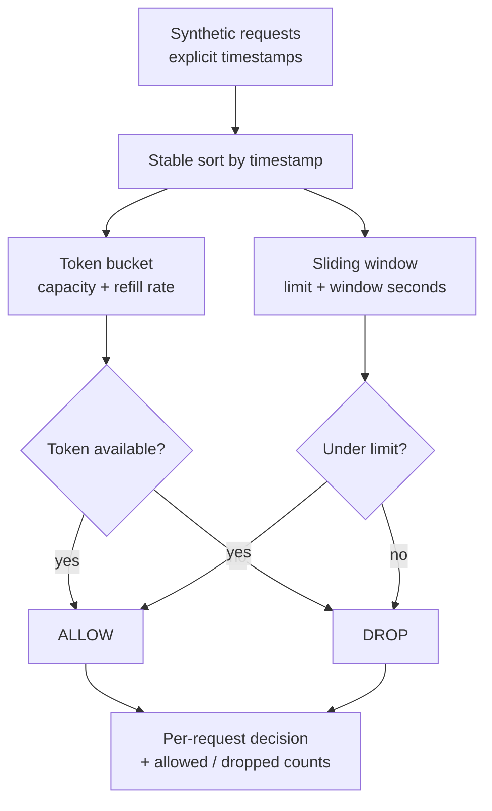

<div align="center">
  
</div>

<br />

<div align="center">

# 🪣 API Rate Limiter


> **Every request carries its own clock.** Two independent limiters decide admission from synthetic timestamps — no Redis, no sockets, no wall time.

</div>

---

## 🎯 What it does

Upstream calls for a Redis-backed API rate limiter. This build replaces Redis
with a deterministic in-process simulation over synthetic request timestamps.
There is no server, no network stack, and no external service.

Each request is a `(request_id, timestamp)` pair. The tool runs the same traffic
through two algorithms and prints a per-request decision plus aggregate counts:

- **Token bucket** — starts full at the first request time; one token is spent
  per allowed request; tokens refill at `refill_rate` per second up to capacity.
- **Sliding window** — only allowed requests enter the window; an event exactly
  `window_seconds` old is expired. Requests are processed in timestamp order
  (stable for ties).
- Dropped requests are reported but never consume tokens or window slots.

## 🧠 How it works



No clock is read: refill is mathematical, derived only from the gap between
consecutive supplied timestamps.

## 🚀 Quick start

```powershell
# Supply synthetic arrival times directly.
python rate_limiter.py --timestamps 0,0,0.5,1.0,2.0 --capacity 2 --refill-rate 1 --limit 3 --window-seconds 2

# Or generate evenly spaced synthetic traffic.
python rate_limiter.py --generate 8 --start 0 --interval 0.25 --capacity 2 --refill-rate 1 --limit 3 --window-seconds 1

# Machine-readable report.
python rate_limiter.py --generate 8 --json
```

### Real output

Captured by running the first command above:

```text
$ python rate_limiter.py --timestamps 0,0,0.5,1.0,2.0 --capacity 2 --refill-rate 1 --limit 3 --window-seconds 2
[token-bucket] allowed=4 dropped=1
   req-000 t=0        ALLOW  token available
   req-001 t=0        ALLOW  token available
   req-002 t=0.5      DROP  bucket empty
   req-003 t=1        ALLOW  token available
   req-004 t=2        ALLOW  token available
[sliding-window] allowed=4 dropped=1
   req-000 t=0        ALLOW  under limit
   req-001 t=0        ALLOW  under limit
   req-002 t=0.5      ALLOW  under limit
   req-003 t=1        DROP  window full
   req-004 t=2        ALLOW  under limit
```

## 📂 Project structure

```text
01-api-rate-limiter/
├── assets/hero.svg            # generated visual identity
├── rate_limiter.py            # models + both algorithms + CLI
├── learn/README.md            # the concepts behind the two limiters
└── tests/test_rate_limiter.py # 11 deterministic tests
```

## 🔍 Why it matters

- **Burst control and sustained control are different problems.** Running both
  algorithms side by side makes their distinct decisions visible.
- **Drops must be cheap.** A rejected request cannot consume a window slot, or a
  burst of abuse would lock out legitimate traffic.
- **Determinism makes policy testable.** Supplying timestamps instead of reading
  the wall clock turns a timing bug into a reproducible unit test.

## 🧪 Tests

```powershell
python -m unittest discover -s tests -v
```

11 tests covering deterministic generation, validation, initial bursts, refill
over synthetic time, stable ordering of ties, window boundary expiry, drop
accounting, and both CLI paths. Standard library only; offline and deterministic.

## 📚 Learn more

Read [the concept notes](learn/README.md) for token-bucket mechanics, sliding
window semantics, and why explicit timestamps matter in a simulation.

---

<div align="center">
  <sub>Part of <b>cybersecurity-projects</b> · Advanced tier · Built from a synopsis, original implementation.</sub>
</div>
