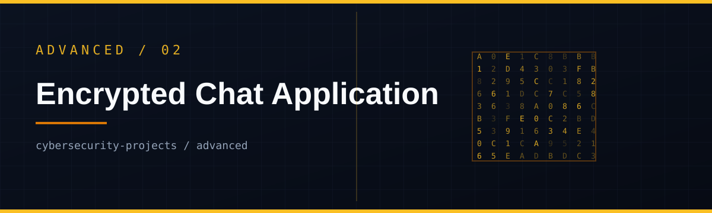
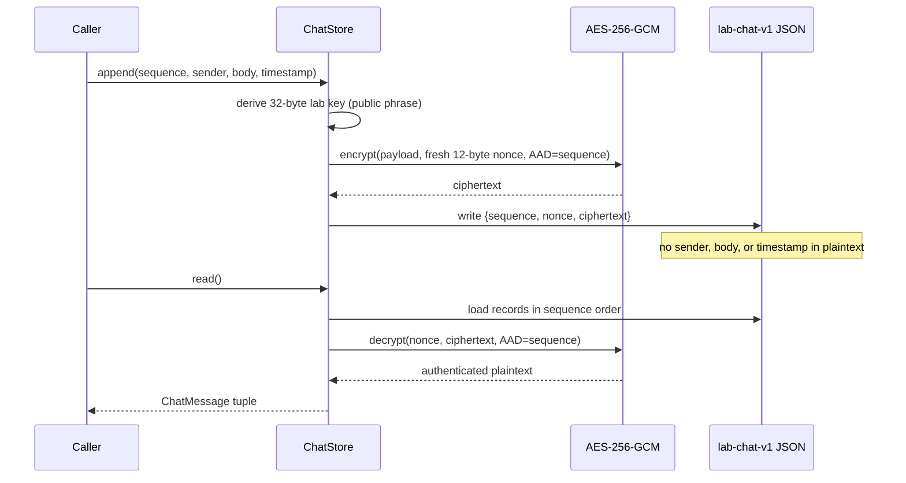

<div align="center">
  
</div>

<br />

<div align="center">

# 🔐 Encrypted Chat Application


> **Ciphertext is the only thing that lands on disk.** A local, file-backed lab that demonstrates authenticated encryption without pretending to be a messenger.

</div>

---

## 🎯 What it does

Upstream specifies a FastAPI service with a SolidJS frontend. This build is a
**local simulation only**: no server, no browser, no network calls, and no
multi-user delivery. Messages are encrypted into one local JSON file.

- **Cipher:** AES-256-GCM with a fresh 12-byte nonce per message
- **Key:** a 32-byte shared *lab* key derived from a public phrase (or loaded
  from an optional local key file); never for real credentials or messages
- **AAD:** the message sequence number, so records cannot be silently reordered
- **Storage:** base64 nonce + ciphertext only; sender, body, and timestamp are
  encrypted inside the payload

Timestamps and sequence numbers are supplied by the caller so runs are
deterministic; the tool does not read the wall clock.

## 🧠 How it works



### Scope and limitations

This is a teaching simulation, not a secure messenger. The default lab key is
public by design, there is no forward secrecy, no identity authentication, no
key rotation, and no transport. Requires `cryptography` (verified with 50.0.2).
Offline and deterministic. Keys are excluded from object representations,
stdout, and error messages.

## 🚀 Quick start

```powershell
python chat.py init chat.json
python chat.py send chat.json alice "hello lab" --sequence 1 --timestamp "2026-01-01T00:00:00Z"
python chat.py send chat.json bob "ack" --sequence 2 --timestamp "2026-01-01T00:00:05Z"
python chat.py read chat.json

# Optional local key file (generated once, never printed).
python chat.py keygen lab.key
python chat.py init keyed.json --key-file lab.key
python chat.py read keyed.json --key-file lab.key
```

Replace `chat.json` with a path under your temp directory if you want to keep the
project folder pristine.

### Real output

Captured by running the init / send / send / read sequence against a temp-path
store, followed by a small inspection snippet:

```text
$ python chat.py init "$env:TEMP\readme-chat-lab\chat.json"
created $env:TEMP\readme-chat-lab\chat.json

$ python chat.py send "$env:TEMP\readme-chat-lab\chat.json" alice "hello lab" --sequence 1 --timestamp "2026-01-01T00:00:00Z"
stored message 1 (ciphertext only)

$ python chat.py send "$env:TEMP\readme-chat-lab\chat.json" bob "ack" --sequence 2 --timestamp "2026-01-01T00:00:05Z"
stored message 2 (ciphertext only)

$ python chat.py read "$env:TEMP\readme-chat-lab\chat.json"
[1] 2026-01-01T00:00:00Z alice: hello lab
[2] 2026-01-01T00:00:05Z bob: ack

$ python -c "import pathlib,os,json; d=pathlib.Path(os.environ['TEMP'])/'readme-chat-lab'/'chat.json'; doc=json.loads(d.read_text()); print('format:', doc['format']); [print('record', r['sequence'], 'nonce_chars', len(r['nonce']), 'ciphertext_chars', len(r['ciphertext'])) for r in doc['messages']]; print('sender_in_store:', 'alice' in d.read_text())"
format: lab-chat-v1
record 1 nonce_chars 16 ciphertext_chars 144
record 2 nonce_chars 16 ciphertext_chars 136
sender_in_store: False
```

Nonce and ciphertext values are generated fresh on every `send`, so a rerun
produces different base64 strings but the same structure and guarantees.

## 📂 Project structure

```text
02-encrypted-chat-application/
├── assets/hero.svg       # generated visual identity
├── chat.py               # AES-GCM store + key handling + CLI
├── learn/README.md       # the crypto concepts behind the simulation
└── tests/test_chat.py    # 14 deterministic tests
```

## 🔍 Why it matters

- **Authenticated encryption** detects tampering: a single flipped ciphertext
  bit makes `read()` fail instead of returning corrupted text.
- **AAD binding** ties each record to its sequence number, so records cannot be
  silently reordered.
- **Secret hygiene** is enforced in code — the key is absent from `repr`, the
  store file, stdout, and error messages.

## 🧪 Tests

```powershell
python -m unittest discover -s tests -v
```

14 tests covering the public key derivation, plaintext absence in the store,
distinct nonces, tamper detection, wrong-key rejection, key-file handling,
sequence binding, duplicate rejection, and the CLI round trip.

## 📚 Learn more

Read [the concept notes](learn/README.md) for AES-GCM, nonces, additional
authenticated data, and the limits of a lab-only shared key.

---

<div align="center">
  <sub>Part of <b>cybersecurity-projects</b> · Advanced tier · Built from a synopsis, original implementation.</sub>
</div>
