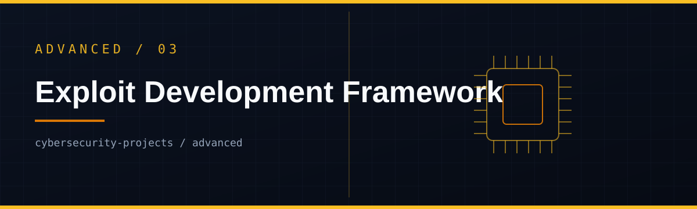
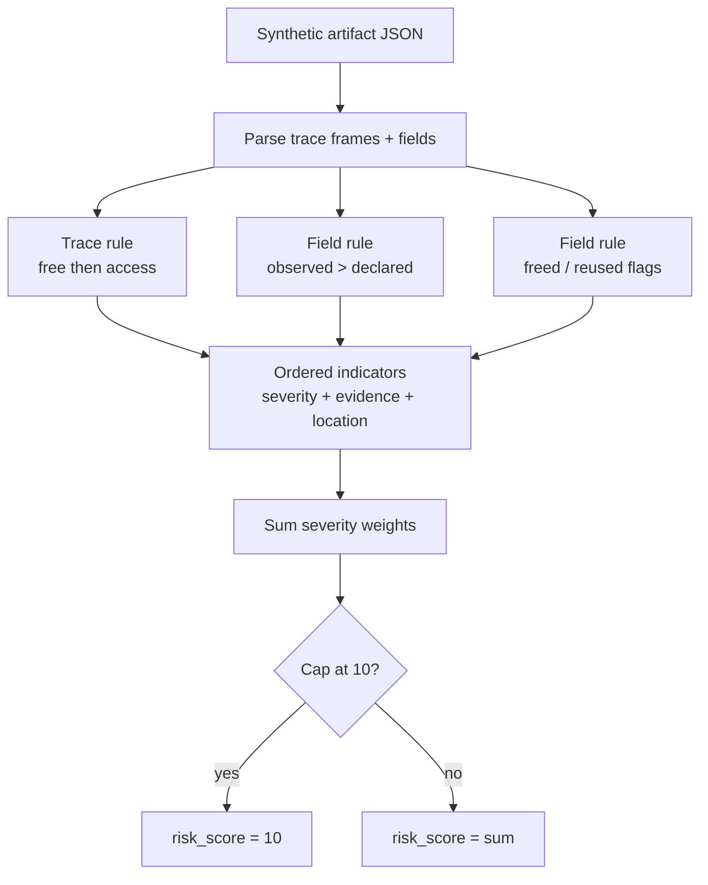

<div align="center">
  
</div>

<br />

<div align="center">

# 🔬 Exploit Artifact Analyzer


> **Read the evidence, never write the exploit.** Synthetic crash traces in, labeled memory-safety indicators and a bounded risk score out.

</div>

---

## 🎯 What it does

**Substitution:** the upstream synopsis is offensive exploit development.
This project deliberately does **not** develop, generate, or run exploits. It
is a defensive triage tool that reads synthetic crash traces and synthetic
binary-field metadata and reports memory-corruption *indicators*: buffer
overflow and use-after-free patterns.

There is no debugger, no compiler, no process attachment, no live target, and
no payload generation. All inputs are local JSON/text created for the lab.

Rules applied to each artifact:

- An address freed in an earlier frame and later read/written/dereferenced is a
  high-severity use-after-free indicator.
- `freed_before_use` or `pointer_reused` field flags produce the same class.
- An observed length greater than the declared size is an overflow indicator:
  high when no length check is recorded, medium when one is recorded.
- Risk is the capped sum of severity weights (high 3, medium 2, low 1), capped
  at 10.

## 🧠 How it works



Every finding carries a human-readable `evidence` string and a `location` such
as `trace frame 4` or `field buf`, so a reviewer can see *why* it fired.

## 🚀 Quick start

```powershell
# Built-in deterministic example.
python artifact_analyzer.py --demo

# A saved synthetic artifact file.
python artifact_analyzer.py artifacts.json --min-risk 3
python artifact_analyzer.py --demo --json
```

Example `artifacts.json`:

```json
{
  "artifacts": [
    {
      "name": "lab-crash-1",
      "crash_trace": [
        "[1] alloc(size=64) -> 0x1000",
        "[2] free(addr=0x1000)",
        "[3] read(addr=0x1000, size=8) -> SIGSEGV"
      ],
      "fields": [
        {"name": "buf", "declared_size": 64, "observed_length": 96}
      ]
    }
  ]
}
```

### Real output

Captured by running the built-in demo:

```text
$ python artifact_analyzer.py --demo
demo-synthetic-crash: risk 9/10 (3 indicator(s))
  [high] overflow @ field buf: observed 96 bytes in 64-byte field (length check absent)
  [high] use-after-free @ field ctx: field flags: pointer_reused
  [high] use-after-free @ trace frame 4: address 0x1000 freed at frame 3, accessed at frame 4
```

## 📂 Project structure

```text
03-exploit-development-framework/
├── assets/hero.svg                     # generated visual identity
├── artifact_analyzer.py                # detectors + scoring + CLI
├── learn/README.md                     # memory-safety concepts
└── tests/test_artifact_analyzer.py     # 13 deterministic tests
```

## 🔍 Why it matters

- **Triage is defensive work.** Classifying evidence helps prioritize patches
  without crossing into payload construction.
- **Explainability beats a single number.** Each indicator names the frame or
  field that produced it.
- **Severity should reflect mitigations.** The same overflow is medium when a
  length check is recorded and high when it is not.

## 🧪 Tests

```powershell
python -m unittest discover -s tests -v
```

13 tests covering trace parsing, free-then-use detection, explicit markers,
overflow severity with and without checks, field flags, score capping, JSON
loading, and both CLI paths. Standard library only; offline and deterministic.

## 📚 Learn more

Read [the concept notes](learn/README.md) for buffer overflows, use-after-free,
and what a crash trace can and cannot tell you.

---

<div align="center">
  <sub>Part of <b>cybersecurity-projects</b> · Advanced tier · Built from a synopsis, original implementation.</sub>
</div>
