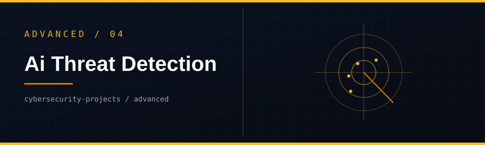
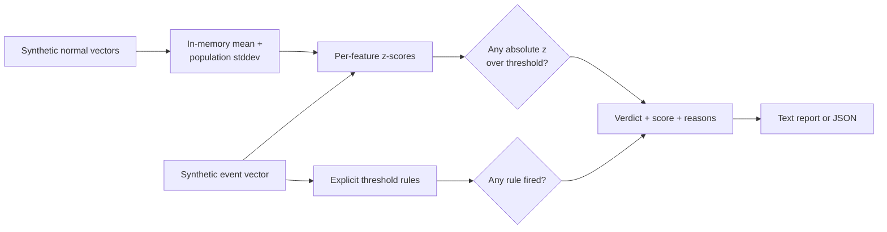

<div align="center">
  
</div>

<br />

<div align="center">

# 🧠 AI Threat Detection


> **No black box.** A baseline, a handful of z-scores, and readable rules — every flag comes with a reason you can audit.

</div>

---

## 🎯 What it does

Upstream calls for a PyTorch-style AI detector. This build uses **no PyTorch
and no machine-learning framework**. It is an explainable statistical detector
over synthetic feature vectors: in-memory z-scores plus a few explicit
threshold rules. No model file is trained, saved, or loaded.

Detection logic:

- A baseline mean and population standard deviation are computed in memory
  from at least two synthetic normal vectors.
- Each event feature gets `z = (value - mean) / stddev`. A zero standard
  deviation yields `0` for an equal value and a capped `10` otherwise.
- Default rules flag `failed_logins > 5`, `bytes_out > 500000`, and
  `admin_actions > 2`.
- An event is suspicious when any `|z| >= --z-threshold` or any rule fires.
  The reported score is the peak `|z|` plus triggered rule weights.

## 🧠 How it works



Because the baseline is derived at runtime from caller-supplied vectors, there
is no persisted model to trust and no training step to reproduce.

## 🚀 Quick start

```powershell
# Built-in synthetic baseline and events.
python threat_detector.py --demo
python threat_detector.py --demo --json --suspicious-only

# Your own synthetic JSON lists.
python threat_detector.py --baseline baseline.json --events events.json --z-threshold 2.5
```

Baseline and events share this shape:

```json
[
  {"event_id": "e1", "features": {"failed_logins": 1, "bytes_out": 1200, "admin_actions": 0}}
]
```

Optional `--rules rules.json` accepts objects such as
`{"name":"burst","feature":"failed_logins","above":5,"score":3,"reason":"login burst"}`.

### Real output

Captured by running the demo:

```text
$ python threat_detector.py --demo
normal-1: normal (score=1.00)
spike-1: SUSPICIOUS (score=2392.62)
  - failed_logins above 5
  - bytes_out above 500000
  - admin_actions above 2
  - z_score(admin_actions)=5.00 exceeds 2.5
  - z_score(bytes_out)=2385.62 exceeds 2.5
  - z_score(failed_logins)=15.00 exceeds 2.5
summary: 1 suspicious of 2 event(s)
```

## 📂 Project structure

```text
04-ai-threat-detection/
├── assets/hero.svg              # generated visual identity
├── threat_detector.py           # baseline + scoring + rules + CLI
├── learn/README.md              # statistical detection concepts
└── tests/test_threat_detector.py # 16 deterministic tests
```

## 🔍 Why it matters

- **Explainability is a feature.** Each suspicious event lists the exact rule
  and z-score that pushed it over the line.
- **Two signals are better than one.** A rule can fire even when the statistical
  baseline is quiet, and vice versa.
- **No model lifecycle.** Nothing is trained, serialized, or loaded, so the
  result depends only on the input vectors and the configured threshold.

## 🧪 Tests

```powershell
python -m unittest discover -s tests -v
```

16 tests covering baseline statistics, validation, zero-deviation handling,
above/below rules, z-score and rule-only detection, order preservation, JSON
serialization, and the CLI demo and custom-file paths. Standard library only;
offline and deterministic.

## 📚 Learn more

Read [the concept notes](learn/README.md) for z-scores, population standard
deviation, and why transparent rules are a useful complement to statistical
signals.

---

<div align="center">
  <sub>Part of <b>cybersecurity-projects</b> · Advanced tier · Built from a synopsis, original implementation.</sub>
</div>
