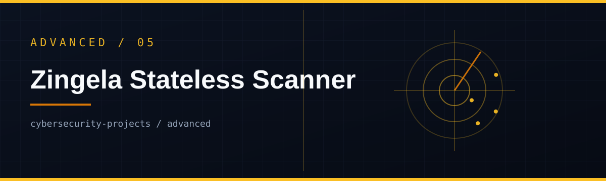
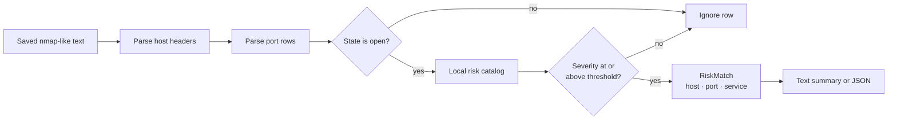

<div align="center">
  
</div>

<br />

<div align="center">

# 🧭 Zingela Stateless Scanner


> **A scanner that never scans.** Saved report text goes in; local catalog matches come out. Sockets stay closed.

</div>

---

## 🎯 What it does

Upstream specifies Zig. This build replaces Zig with Python and is entirely
**stateless and offline**: it parses a saved nmap-like text report and matches
hosts, ports, and services against a local risk catalog. It never scans, opens
sockets, invokes nmap, or contacts a target.

`Nmap scan report for name (address)` is also supported. Only `open` ports are
considered for risk matches. A catalog override is a JSON list of objects with
`service`, `severity`, `note`, and an optional `ports` list.

## 🧠 How it works



The catalog is a plain tuple of immutable `RiskEntry` values; severity ranks run
`info < low < medium < high < critical`.

## 🚀 Quick start

```powershell
python stateless_scanner.py --demo
python stateless_scanner.py saved_scan.txt --min-severity high
python stateless_scanner.py saved_scan.txt --catalog catalog.json --json
```

Expected input shape:

```text
Nmap scan report for 192.0.2.10
Host is up.
PORT    STATE  SERVICE  VERSION
22/tcp  open   ssh      OpenSSH 9.0
23/tcp  open   telnet   Linux telnetd
```

### Real output

Captured by running the built-in demo:

```text
$ python stateless_scanner.py --demo
host 192.0.2.10: 4 port(s)
host lab-host (192.0.2.20): 2 port(s)
  [LOW] 192.0.2.10:22/ssh - remote administration service
  [CRITICAL] 192.0.2.10:23/telnet - cleartext legacy remote login
  [MEDIUM] 192.0.2.10:80/http - unencrypted web service
  [HIGH] 192.0.2.20:6379/redis - in-memory store often exposed without authentication
summary: 2 host(s), 4 risk(s)
```

## 📂 Project structure

```text
05-zingela-stateless-scanner/
├── assets/hero.svg                  # generated visual identity
├── stateless_scanner.py             # parser + catalog + matcher + CLI
├── learn/README.md                  # report parsing and risk catalogs
└── tests/test_stateless_scanner.py  # 14 deterministic tests
```

## 🔍 Why it matters

- **Separation of collection and analysis.** Parsing an existing report keeps
  the analyzer auditable and repeatable.
- **Port state is signal.** Closed and filtered rows are parsed but never
  counted as risks, avoiding false positives from noise.
- **Local catalogs are replaceable.** Swapping in a JSON catalog changes policy
  without touching the parser.

## 🧪 Tests

```powershell
python -m unittest discover -s tests -v
```

14 tests covering both host header forms, port fields, comment handling,
multiple hosts, validation, catalog matching, port-specific entries, open-port
filtering, severity thresholds, JSON catalog loading, and CLI behavior. Standard
library only; offline and deterministic.

## 📚 Learn more

Read [the concept notes](learn/README.md) for nmap report structure, severity
catalogs, and the value of keeping analysis strictly offline.

---

<div align="center">
  <sub>Part of <b>cybersecurity-projects</b> · Advanced tier · Built from a synopsis, original implementation.</sub>
</div>
