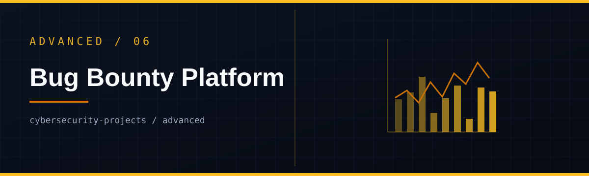
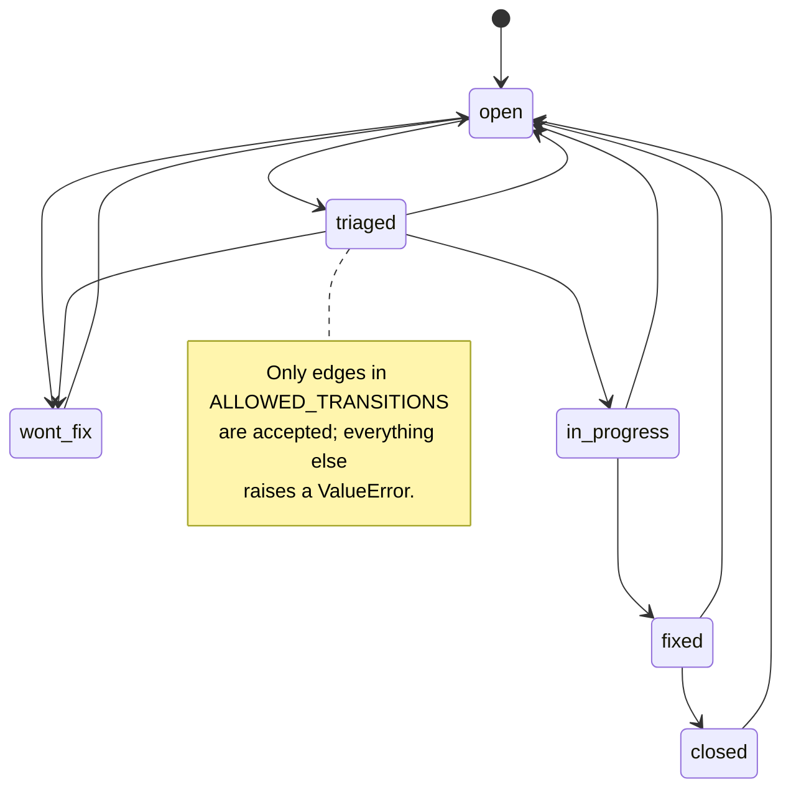

<div align="center">
  
</div>

<br />

<div align="center">

# 🐞 Bug Bounty Platform


> **Findings have a lifecycle.** Score it, triage it, move it — with every transition checked and every save atomic.

</div>

---

## 🎯 What it does

Upstream specifies FastAPI plus React. This build replaces the web stack with
a Python CLI and one local JSON file. There is no web UI, no HTTP server, no
accounts, and no network access.

Vector flags mirror the eight CVSS-like inputs: `--av`, `--ac`, `--pr`, `--ui`,
`--scope`, `--c`, `--i`, `--a` with safe lab defaults. Scores are a teaching
approximation inspired by CVSS v3.1; they are **not official CVSS scores**.

Workflow: `open -> triaged -> in_progress -> fixed -> closed`, with `wont_fix`
reachable from `open`/`triaged` and `open` reachable from most states to allow
reopening. Invalid transitions are rejected. Severity bands: 9.0+ critical,
7.0+ high, 4.0+ medium, above 0 low, 0 none.

## 🧠 How it works



Only the edges shown above are permitted; any other jump — `open -> closed`, for
example — is rejected by the guard. Scores come from a bounded formula over
eight vector metrics and are recomputed from the stored vector on every read.

## 🚀 Quick start

```powershell
python finding_tracker.py findings.json add F-001 "Reflected input" "https://lab.example/search" --description "Lab-only finding" --c high --i low
python finding_tracker.py findings.json list
python finding_tracker.py findings.json status F-001 triaged
python finding_tracker.py findings.json status F-001 in_progress
python finding_tracker.py findings.json export report.json
python finding_tracker.py findings.json list --json
```

Use a temp-path store if you want to keep the project folder clean.

### Real output

Captured by running the add / status / status / list / export sequence against a
temp-path store:

```text
$ python finding_tracker.py "$env:TEMP\readme-findings-lab\findings.json" add F-001 "Reflected input" "https://lab.example/search" --description "Lab-only finding" --c high --i low
added F-001: 8.2 (high)

$ python finding_tracker.py "$env:TEMP\readme-findings-lab\findings.json" status F-001 triaged
F-001: triaged

$ python finding_tracker.py "$env:TEMP\readme-findings-lab\findings.json" status F-001 in_progress
F-001: in_progress

$ python finding_tracker.py "$env:TEMP\readme-findings-lab\findings.json" list
F-001 [high 8.2] in_progress: Reflected input @ https://lab.example/search

$ python finding_tracker.py "$env:TEMP\readme-findings-lab\findings.json" export "$env:TEMP\readme-findings-lab\report.json"
exported 1 finding(s) to $env:TEMP\readme-findings-lab\report.json
```

## 📂 Project structure

```text
06-bug-bounty-platform/
├── assets/hero.svg                # generated visual identity
├── finding_tracker.py             # scoring + workflow + JSON store + CLI
├── learn/README.md                # CVSS-like scoring and triage states
└── tests/test_finding_tracker.py  # 13 deterministic tests
```

## 🔍 Why it matters

- **State machines prevent process drift.** An invalid jump such as
  `open -> closed` is rejected instead of silently recorded.
- **Scores are explainable inputs, not verdicts.** The teaching formula is
  deliberately labeled as approximate rather than official CVSS.
- **Atomic saves protect the record.** Writes go through a temp file and
  `os.replace`, so an interrupted run cannot corrupt the store.

## 🧪 Tests

```powershell
python -m unittest discover -s tests -v
```

13 tests covering known scores, severity bands, vector validation, transition
rules, sorted listing, duplicate IDs, persistence, status changes, report
export, and the full CLI workflow. Standard library only; offline and
deterministic.

## 📚 Learn more

Read [the concept notes](learn/README.md) for CVSS-like metrics, severity
banding, and why explicit workflow states matter in vulnerability management.

---

<div align="center">
  <sub>Part of <b>cybersecurity-projects</b> · Advanced tier · Built from a synopsis, original implementation.</sub>
</div>
