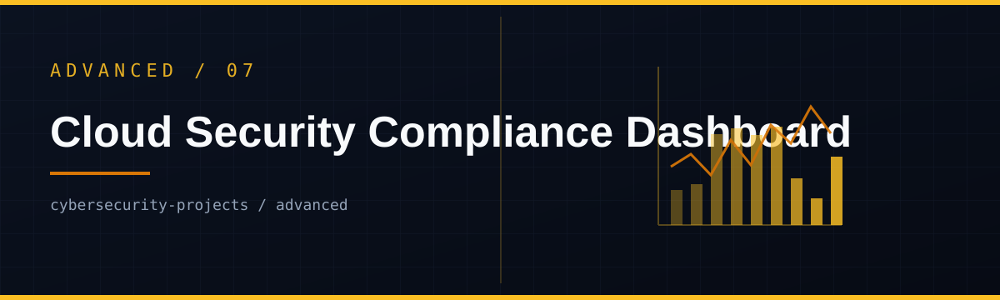
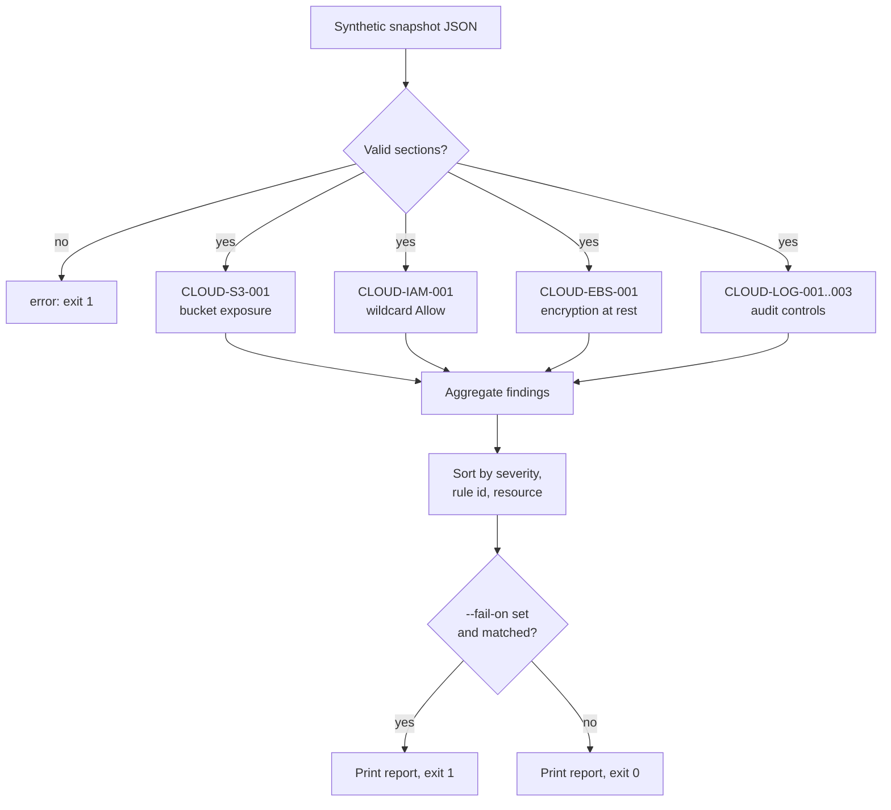

<div align="center">
  
</div>

<br />

<div align="center">

# ☁️ Cloud Security Compliance Dashboard


> **Audit the snapshot, not the cloud.** Four rule families read a synthetic JSON document and produce a deterministic, severity-ordered report.

</div>

---

## 🎯 What it does

Offline rule-based audit of a synthetic cloud configuration snapshot.

The upstream Go/React dashboard is replaced by a Python standard-library CLI.
There are no cloud SDKs, API calls, credentials, or network requests; the React
view becomes a deterministic text or JSON report.

Checks:

- `CLOUD-S3-001` — public S3 buckets (public read/write flags, public ACLs, disabled access block)
- `CLOUD-IAM-001` — over-permissive Allow statements (wildcard actions on wildcard resources, or wildcard actions for wildcard principals)
- `CLOUD-EBS-001` — volumes that do not explicitly declare encryption at rest
- `CLOUD-LOG-001..003` — missing CloudTrail, VPC flow, or S3 access logging

## 🧠 How it works



`--fail-on` exits 1 when a finding of that severity or higher exists; `none`
(the default) only reports.

### Scope and limitations

This is a teaching dashboard over caller-supplied synthetic data. It is not a
CSPM product, does not validate real cloud accounts, and cannot prove that a
resource is exploitable.

## 🚀 Quick start

```powershell
python compliance_dashboard.py snapshot.json
python compliance_dashboard.py snapshot.json --json
python compliance_dashboard.py snapshot.json --fail-on high
```

Snapshot shape:

```json
{
  "buckets": [
    {"name": "private-logs", "public_read": false, "public_write": false,
     "public_access_block": true, "acl": "private"}
  ],
  "iam_policies": [
    {"name": "readonly", "statements": [
      {"effect": "Allow", "principal": "role/reader",
       "actions": ["s3:GetObject"], "resources": ["arn:example:bucket/*"]}
    ]}
  ],
  "volumes": [{"id": "vol-1", "encrypted": true}],
  "logging": {
    "cloudtrail_enabled": true,
    "vpc_flow_logs_enabled": true,
    "s3_access_logging_enabled": true
  }
}
```

### Real output

A snapshot with a public bucket, a wildcard IAM statement, one unencrypted
volume, and two missing logging controls was written under `$env:TEMP` with
`python -c`, then audited:

```text
$ python compliance_dashboard.py "$env:TEMP\readme-cloud-lab\snapshot.json"
Cloud compliance findings: 5
  critical: 1
  high: 2
  medium: 2
  low: 0

[CRITICAL] CLOUD-IAM-001 admin[0]: Over-permissive IAM: wildcard action on wildcard resource
[HIGH] CLOUD-EBS-001 vol-2: Volume does not declare encryption at rest
[HIGH] CLOUD-S3-001 public-assets: Public exposure indicators: public read, public access block disabled
[MEDIUM] CLOUD-LOG-002 logging: VPC flow logging is missing or disabled
[MEDIUM] CLOUD-LOG-003 logging: S3 access logging is missing or disabled
```

## 📂 Project structure

```text
07-cloud-security-compliance-dashboard/
├── assets/hero.svg                   # generated visual identity
├── compliance_dashboard.py           # four checks + report + CLI
├── learn/README.md                   # compliance-rule concepts
└── tests/test_compliance_dashboard.py # 16 deterministic tests
```

## 🔍 Why it matters

- **Configuration drift is visible.** Small flag changes produce clearly
  labeled findings tied to stable rule IDs.
- **Deterministic ordering** makes output diffable between runs and safe to
  use in a pipeline.
- **Exit codes enable gating.** `--fail-on` lets a check fail without giving the
  tool any real account access.

## 🧪 Tests

```powershell
python -m unittest discover -s tests -v
```

16 tests covering clean snapshots, each severity band, IAM edge cases,
encryption flags, the three logging controls, report counts and sorting,
validation, JSON output, and `--fail-on`. Standard library only.

## 📚 Learn more

Read [the concept notes](learn/README.md) for public-access indicators,
over-permissive IAM patterns, and the difference between a finding and a proof
of exploitability.

---

<div align="center">
  <sub>Part of <b>cybersecurity-projects</b> · Advanced tier · Built from a synopsis, original implementation.</sub>
</div>
