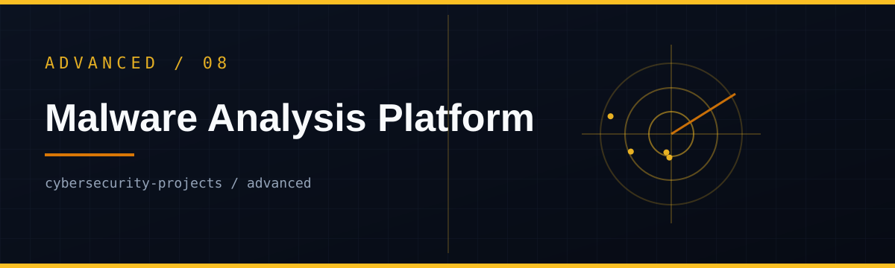
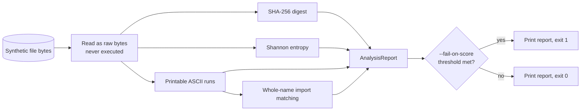

<div align="center">
  
</div>

<br />

<div align="center">

# 🧬 Malware Analysis Platform


> **Facts, not verdicts.** Hash, entropy, strings, and import names — computed from bytes that are never executed.

</div>

---

## 🎯 What it does

Offline static inspection of synthetic files: SHA-256, Shannon entropy,
printable ASCII strings, and notable import names.

The upstream Rust/Docker analysis service is replaced by a Python
standard-library CLI. No Docker sandbox is started, no file is executed or
emulated, no real malware samples are included, and no network access occurs.
The `heuristic_score` is a triage aid, not a malware verdict.

Use only files you created for the lab. The tool reads bytes from disk and never
hands them to an interpreter.

Report fields:

- `sha256` — digest of the exact bytes read
- `entropy_bits_per_byte` — Shannon entropy over the byte distribution
- `strings` — printable ASCII runs of at least the requested length
- `imports` — whole-name matches for APIs such as `socket`, `subprocess`, or `pickle`
- `heuristic_score` — bounded 0–100 summary for sorting results, not a classification

## 🧠 How it works



### Scope and limitations

High entropy does not imply encryption or malice, and ordinary software imports
many of the listed APIs. This project performs no unpacking, deobfuscation,
dynamic analysis, signature matching, or attribution.

## 🚀 Quick start

```powershell
python static_analyzer.py sample.bin
python static_analyzer.py sample.bin --json
python static_analyzer.py sample.py --min-string-length 6 --fail-on-score 50
```

Create `sample.bin` yourself; for example, write a short synthetic byte string
under `$env:TEMP` with `python -c` and point the CLI at it.

### Real output

A synthetic 65-byte sample containing the text `import socket` and
`import pickle` was written under `$env:TEMP` with `python -c`, then inspected:

```text
$ python static_analyzer.py "$env:TEMP\readme-malware-lab\sample.bin"
Static file facts (heuristics only; no execution or malware verdict):
  source: $env:TEMP\readme-malware-lab\sample.bin
  size: 65 bytes
  sha256: 60b57150fe9e3532456d9d7db330068e5f8b11e61b2d4c4b77bda869e9fcb2b9
  entropy: 4.302 bits/byte
  heuristic score: 20/100
  printable strings: 1
  notable imports: 2
    string: synthetic-lab-sample import socket import pickle lab-marker-1234
    import: socket (1) - network socket API
    import: pickle (1) - object deserialization
```

## 📂 Project structure

```text
08-malware-analysis-platform/
├── assets/hero.svg                  # generated visual identity
├── static_analyzer.py               # four fact extractors + scoring + CLI
├── learn/README.md                  # static-analysis concepts
└── tests/test_static_analyzer.py    # 15 deterministic tests
```

## 🔍 Why it matters

- **Safe by construction.** The input is only ever read as bytes; there is no
  interpreter, emulator, or sandbox to escape.
- **Facts travel well.** A digest and a byte distribution are reproducible
  observations that other tools can verify independently.
- **Scores rank, they do not decide.** Keeping the heuristic bounded and
  explicitly non-classifying avoids false authority.

## 🧪 Tests

```powershell
python -m unittest discover -s tests -v
```

15 tests covering known SHA-256 vectors, entropy edge cases, string extraction,
whole-name import matching, deterministic analysis, file-vs-memory equality,
report shape, score bounds, and CLI output and failure paths. Standard library
only.

## 📚 Learn more

Read [the concept notes](learn/README.md) for Shannon entropy, printable-string
extraction, import heuristics, and what static inspection cannot establish.

---

<div align="center">
  <sub>Part of <b>cybersecurity-projects</b> · Advanced tier · Built from a synopsis, original implementation.</sub>
</div>
