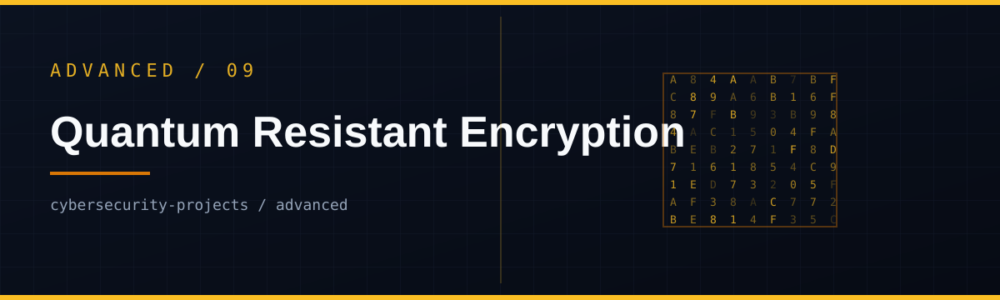
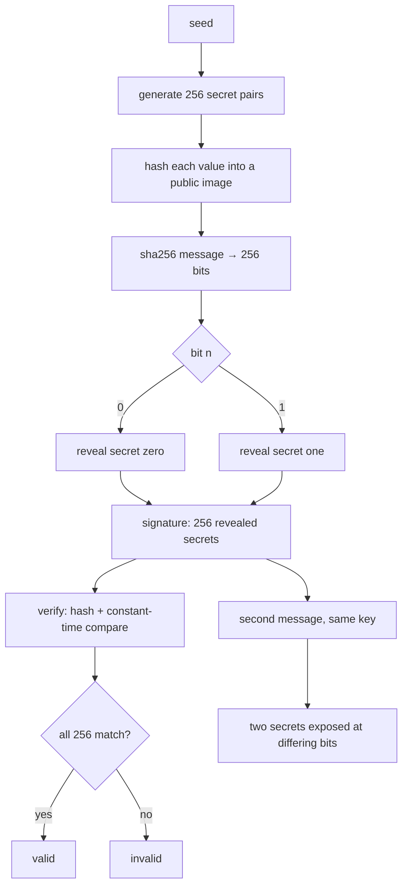

<div align="center">
  
</div>

<br />

<div align="center">

# 🔐 Quantum Resistant Encryption


> **One key, one message.** A SHA-256 Lamport one-time signature toy that makes the "one-time" rule visible — including exactly what leaks when you break it.

> **WARNING: This is a TOY implementation. It is NOT production post-quantum cryptography. A private key has a strict one-time limit: signing two different messages with the same key can reveal enough secret material to undermine that key. Never use these keys for real data, identities, or credentials.**

</div>

---

## 🎯 What it does

It builds a deterministic key pair from a seed: 256 pairs of secret 32-byte values and their SHA-256 images. Signing a message reveals **one secret per bit** of the message digest; verification hashes each revealed secret and compares it with the public image using `hmac.compare_digest`.

The `reuse-demo` command shows the whole point of the exercise: sign two different messages with the same key and count the bit positions where both secrets become public. That count is the key's security budget being spent.

## 🧠 How it works



Everything is Python's standard library: `hashlib`, `hmac`, `random`, `json`, and `argparse`. The seeded PRNG exists only to keep tests and demos reproducible.

## 🚀 Quick start

```powershell
python lamport_ots.py keygen --seed 7 --private-out private.json --public-out public.json
python lamport_ots.py sign --private private.json --message "measured once" --output signature.json
python lamport_ots.py verify --public public.json --message "measured once" --signature signature.json
python lamport_ots.py reuse-demo --seed 7 --message-a alpha --message-b beta
```

`keygen` and `reuse-demo` require a seed so demonstrations are deterministic. In any real design the seed would have to remain secret and come from a CSPRNG — which is one reason this toy must not be deployed.

### Real output

```text
$tmp = Join-Path $env:TEMP "ots-lab-09"

$ python lamport_ots.py reuse-demo --seed 7 --message-a alpha --message-b beta
reuse would reveal 133 distinct secret positions

$ python lamport_ots.py keygen --seed 7 --private-out (Join-Path $tmp "private.json") --public-out (Join-Path $tmp "public.json")
wrote toy key pair; keep the private file secret

$ python lamport_ots.py sign --private (Join-Path $tmp "private.json") --message "measured once" --output (Join-Path $tmp "signature.json")
wrote one-time signature to $env:TEMP\ots-lab-09\signature.json

$ python lamport_ots.py verify --public (Join-Path $tmp "public.json") --message "measured once" --signature (Join-Path $tmp "signature.json")
valid
```

## 📂 Project structure

```text
09-quantum-resistant-encryption/
├── assets/hero.svg              # generated visual identity
├── lamport_ots.py               # key model + signer + verifier + CLI
├── learn/README.md              # the one-time-signature concept notes
└── tests/test_lamport_ots.py    # 17 deterministic tests
```

## 🔍 Why it matters

- **Hash chains teach post-quantum intuition.** The construction is simple enough to inspect end to end, unlike a deployed signature scheme.
- **Reuse is the whole failure mode.** `reuse-demo` turns an abstract warning into a concrete number of exposed secrets.
- **Constant-time comparison** in `verify` shows why you never compare authentication material with `==`.

### Scope and limitations

- Kept in Python as specified, using only `hashlib`, `hmac`, `random`, and the rest of the standard library. No external crypto library, network call, or cryptosystem integration is used.
- The seeded PRNG exists to make tests reproducible; it is not a cryptographically secure random source.
- One key = one message. The CLI does not enforce persistent state; the caller must never reuse a key.
- No checksum, key derivation hierarchy, key rotation, or multi-signature support.
- SHA-256 itself is not the weak point here; the construction, randomness, and one-time discipline are what make this unsuitable for production.
- Real post-quantum signatures need reviewed standards such as SLH-DSA/SPHINCS+ and vetted implementations.

## 🧪 Tests

```powershell
python -m unittest discover -s tests -v
```

17 tests covering deterministic key generation, hash-image derivation, one-part-per-bit signatures, valid/tampered/truncated/wrong-key verification, reuse leakage, JSON round trips, scheme rejection, and the CLI keygen → sign → verify flow.

## 📚 Learn more

Read [the concept notes](learn/README.md) for Lamport one-time signatures, the bit-selection trick, and why key reuse destroys the construction.

---

<div align="center">
  <sub>Part of <b>cybersecurity-projects</b> · Advanced tier · Educational toy, original implementation.</sub>
</div>
