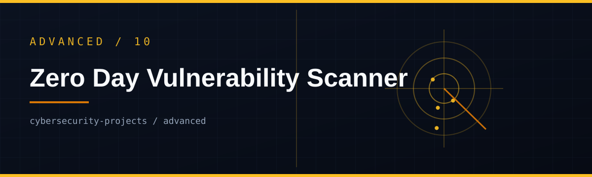
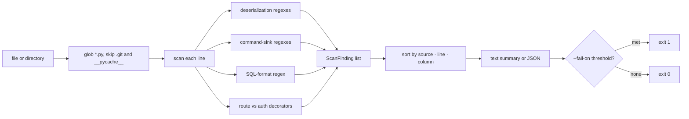

<div align="center">
  
</div>

<br />

<div align="center">

# 🔍 Unknown-Risk Code Scanner


> **A reading aid, not an oracle.** It points a flashlight at risky-looking source patterns and hands the judgement back to a human reviewer.

> **Defensive substitution for the upstream "zero-day vulnerability scanner" synopsis. This tool performs heuristic source review and does _not_ claim to find real zero-days, prove exploitability, assign CVEs, or exploit anything. It is a reading aid for synthetic source snapshots, not a vulnerability oracle.**

</div>

---

## 🎯 What it does

Point it at a source file or a directory snapshot. It walks every matching file, applies six regex rules plus a route-decorator check, and produces a deterministic report with rule IDs, severities, file positions, and the matching source line.

| Rule family | What gets flagged |
| --- | --- |
| `unsafe_deserialization` | `pickle`/`marshal` load sinks and `yaml.load` |
| `command_injection_sink` | `os.system`, `os.popen`, `subprocess` calls, `shell = True` |
| `sql_string_formatting` | f-strings, `%`, `.format()`, or `+` inside `execute`/`executemany` |
| `missing_auth_decorator` | Route handlers without a visible authentication decorator |

## 🧠 How it works



Findings are sorted by position so two runs over the same snapshot are byte-for-byte comparable. `--json` emits a structured report; `--fail-on high|critical|...` turns the scan into a simple CI gate.

## 🚀 Quick start

```powershell
python unknown_risk_scanner.py ./source_snapshot
python unknown_risk_scanner.py ./source_snapshot --pattern "*.py" --json
python unknown_risk_scanner.py app.py --fail-on high
```

Point it at code you own or a synthetic snapshot. Directory scans skip `.git` and `__pycache__`.

### Real output

```text
$snap = Join-Path $env:TEMP "risk-scan-10\source_snapshot"
# app.py contains pickle.loads(blob) and os.system("echo lab") under an unguarded route

$ python unknown_risk_scanner.py $snap
Heuristic source review only; not a zero-day claim or exploit tool.
Files scanned: 1
Findings: 3
  critical: 0
  high: 2
  medium: 1
  low: 0

[MEDIUM] RISK-AUTH-001 app.py:4:1 Route handler has no visible authentication decorator
    def admin_panel():
[HIGH] RISK-DESER-001 app.py:5:13 Unsafe object deserialization sink
    state = pickle.loads(blob)
[HIGH] RISK-CMD-001 app.py:6:5 Shell command execution sink
    os.system("echo lab")
```

With `--json --fail-on high`, the same scan reports `"total": 3` and exits with status `1`.

## 📂 Project structure

```text
10-zero-day-vulnerability-scanner/
├── assets/hero.svg                 # generated visual identity
├── unknown_risk_scanner.py         # rule engine + report + CLI
├── learn/README.md                 # notes on heuristic review
└── tests/test_unknown_risk_scanner.py  # 14 deterministic tests
```

## 🔍 Why it matters

- **Cheap first pass.** Catching obvious sinks before review saves attention for the subtle bugs.
- **Explicit disclaimers.** Every report carries the "not a zero-day claim" note so output cannot be mistaken for a verdict.
- **Position-stable findings** make diffs between two snapshots meaningful.

### Scope and limitations

- Regex matching is shallow: it misses indirect calls and can flag safe code.
- It does not build call graphs, perform taint analysis, load the code, or run exploit payloads.
- Treat every finding as a prompt for manual review.
- Standard library only; input stays local.

## 🧪 Tests

```powershell
python -m unittest discover -s tests -v
```

14 tests covering each rule family, parameterized-SQL false positives, route auth detection, sorting, report counts and disclaimer, deterministic directory scans, JSON output, and `--fail-on` exit codes.

## 📚 Learn more

Read [the concept notes](learn/README.md) for heuristic source-review patterns and why a finding is a question, not an answer.

---

<div align="center">
  <sub>Part of <b>cybersecurity-projects</b> · Advanced tier · Defensive substitution, original implementation.</sub>
</div>
