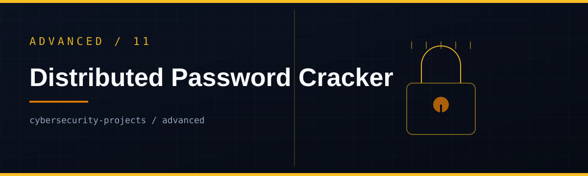
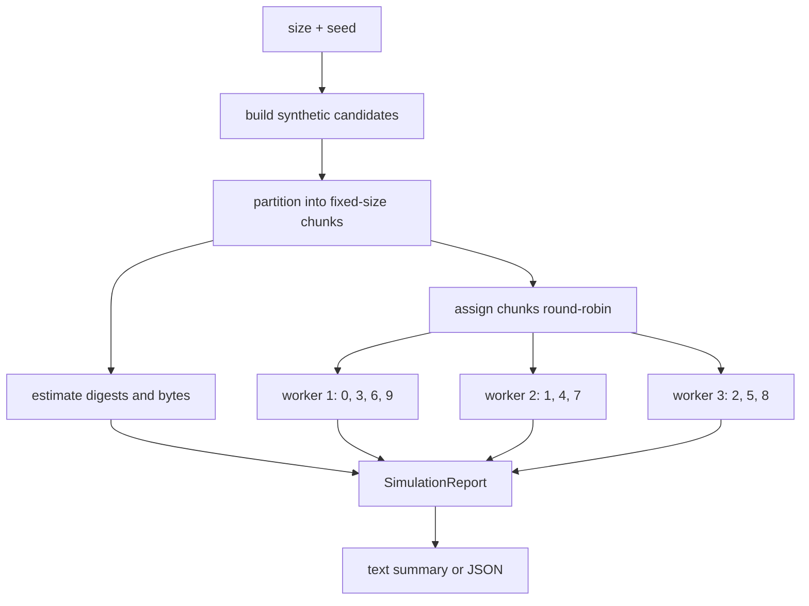

<div align="center">
  
</div>

<br />

<div align="center">

# 🧮 Password Lab Simulator


> **Arithmetic, not recovery.** A deterministic model of a partitioned workload — no target hash, no real word list, no attack.

> **Simulation only.** The upstream offensive password-cracking synopsis is replaced by a defensive lab that partitions a synthetic candidate workload and estimates bounded digest work. It does **not** recover passwords, attack real hashes, use real word lists, use GPUs, or use the network.

</div>

---

## 🎯 What it does

It generates obviously synthetic candidates such as `lab-00000-k3f9x2qa` from a seed, splits them into fixed-size chunks with explicit index ranges, assigns those chunks to workers in round-robin order, and estimates digest operations and bytes hashed. Optionally it computes digests of the synthetic candidates for demonstration — it never compares them to a target.

There is no `--hash`, `--target`, word-list path, or GPU option anywhere in the CLI.

## 🧠 How it works



Every stage is a pure function, so the same seed always produces the same partition, assignment, and estimate.

## 🚀 Quick start

```powershell
python password_lab_simulator.py --size 100 --seed 7 --chunk-size 10 --workers 3
python password_lab_simulator.py --size 100 --seed 7 --json
python password_lab_simulator.py --size 50 --algorithm sha512 --checks-per-candidate 2
```

Algorithms: `sha256`, `sha512`, `blake2b`, `blake2s`.

### Real output

```text
$ python password_lab_simulator.py --size 100 --seed 7 --chunk-size 10 --workers 3
Simulation only: partitioned password workload (no real hashes or target attacks).
seed: 7
algorithm: sha256
candidates: 100
chunks: 10
workers: 3
digest operations: 100
bytes hashed: 1800

Chunks:
  #0: [0, 10) size=10
  #1: [10, 20) size=10
  #2: [20, 30) size=10
  #3: [30, 40) size=10
  #4: [40, 50) size=10
  #5: [50, 60) size=10
  #6: [60, 70) size=10
  #7: [70, 80) size=10
  #8: [80, 90) size=10
  #9: [90, 100) size=10
Assignments:
  worker 1: chunks [0, 3, 6, 9]
  worker 2: chunks [1, 4, 7]
  worker 3: chunks [2, 5, 8]
```

## 📂 Project structure

```text
11-distributed-password-cracker/
├── assets/hero.svg                    # generated visual identity
├── password_lab_simulator.py          # model + estimator + CLI
├── learn/README.md                    # notes on workload partitioning
└── tests/test_password_lab_simulator.py  # 15 deterministic tests
```

## 🔍 Why it matters

- **Separation of concerns.** Partitioning, assignment, and estimation are independent functions you can reason about separately.
- **Determinism** makes the lab reproducible and testable without timing noise.
- **Bounded scope** is a design feature: the report cannot accidentally become an attack tool.

### Scope and limitations

- This is capacity-planning arithmetic, not a password-recovery tool.
- Timings, hardware throughput, network overhead, and real password distributions are deliberately absent.
- Do not use it to plan an attack against any system you do not own.
- Standard library only; results are reproducible from the seed.

## 🧪 Tests

```powershell
python -m unittest discover -s tests -v
```

15 tests covering deterministic candidate generation, unique synthetic values, complete non-overlapping partitions, round-robin assignment, UTF-8 byte counting, digest estimates, algorithm validation, no-target simulations, report shape, CLI output, and invalid-argument handling.

## 📚 Learn more

Read [the concept notes](learn/README.md) for chunk partitioning, round-robin scheduling, and the difference between estimating work and performing it.

---

<div align="center">
  <sub>Part of <b>cybersecurity-projects</b> · Advanced tier · Defensive simulation, original implementation.</sub>
</div>
