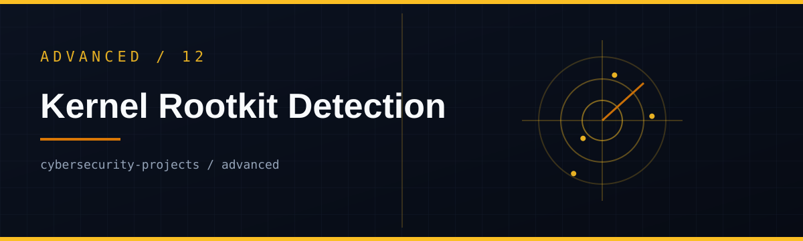
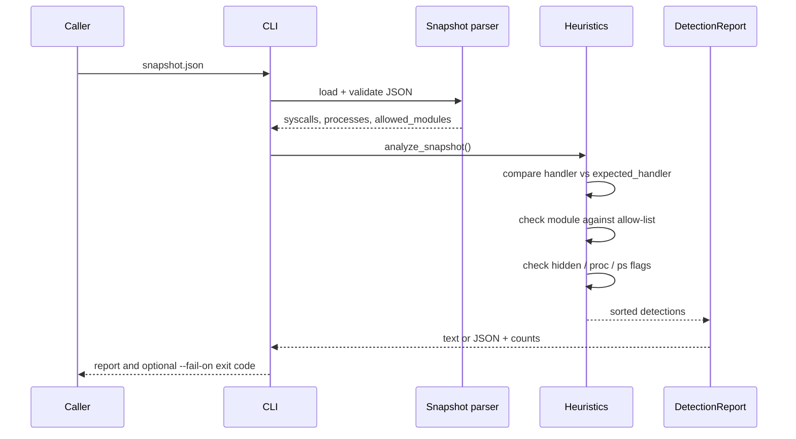

<div align="center">
  
</div>

<br />

<div align="center">

# 🛡️ Kernel Rootkit Detection


> **Expectation versus observation.** A clean syscall snapshot is a data-structure check — never a claim about a live kernel.

> **The upstream Rust project is replaced by a Python standard-library CLI. There is no kernel access: the tool never reads kernel memory, loads modules, opens `/proc`, or inspects a live system. It only parses the JSON snapshot supplied to it.**

</div>

---

## 🎯 What it does

It parses a JSON snapshot of syscall table entries, process visibility flags, and an allow-list of owning modules. Three deterministic rules compare the observed metadata with the snapshot's own expectations and emit severity-ranked detections.

| Detection | Severity | Trigger |
| --- | --- | --- |
| `KRN-HOOK-001` | critical | Handler differs from the snapshot's `expected_handler` |
| `KRN-MOD-001` | high | Syscall owner is outside `allowed_modules` |
| `KRN-PROC-001` | high / critical | Process is hidden or absent from the proc/ps views; critical when both views miss it |

## 🧠 How it works



The snapshot shape:

```json
{
  "allowed_modules": ["kernel", "ext4"],
  "syscalls": [
    {"number": 1, "name": "write", "handler": "sys_write",
     "expected_handler": "sys_write", "module": "kernel"}
  ],
  "processes": [
    {"pid": 1, "name": "init", "visible_in_proc": true,
     "listed_by_ps": true, "hidden": false}
  ]
}
```

## 🚀 Quick start

```powershell
python syscall_snapshot_analyzer.py snapshot.json
python syscall_snapshot_analyzer.py snapshot.json --json
python syscall_snapshot_analyzer.py snapshot.json --fail-on critical
```

### Real output

```text
$snap = Join-Path $env:TEMP "syscall-snapshot-12\snapshot.json"
# snapshot has a hooked write handler, a mystery.ko owner, and a hidden pid 4444

$ python syscall_snapshot_analyzer.py $snap
Synthetic syscall snapshot analysis (no kernel access).
Detections: 3
  critical: 2
  high: 1
  medium: 0
  low: 0

[CRITICAL] KRN-HOOK-001 syscall 1 write: handler '0xffffffffc0123450' differs from expected 'sys_write'
[CRITICAL] KRN-PROC-001 pid 4444 (ghost): hidden process indicators: explicit hidden flag, absent from proc view, absent from ps listing
[HIGH] KRN-MOD-001 syscall 2 open: unexpected owning module 'mystery.ko'
```

The same snapshot with `--json --fail-on critical` reports `"total": 3` and exits with status `1`.

## 📂 Project structure

```text
12-kernel-rootkit-detection/
├── assets/hero.svg                      # generated visual identity
├── syscall_snapshot_analyzer.py         # parser + rules + CLI
├── learn/README.md                      # notes on syscall-table indicators
└── tests/test_syscall_snapshot_analyzer.py  # 14 deterministic tests
```

## 🔍 Why it matters

- **Expected state is a baseline.** Most rootkit-style behaviour shows up as a mismatch between what a table says should be there and what is actually recorded.
- **Corroboration matters.** A process missing from both proc and ps is a stronger signal than one missing view.
- **Deterministic ordering** puts the most severe detections first, every time.

### Scope and limitations

- No kernel access: the tool never reads kernel memory, loads modules, opens `/proc`, or inspects a live system.
- A snapshot can be stale or forged, and a clean result does not prove a real kernel is healthy.
- This is a teaching exercise in comparing expected versus observed metadata, not a production rootkit detector.
- Standard library only; all input is supplied locally as JSON.

## 🧪 Tests

```powershell
python -m unittest discover -s tests -v
```

14 tests covering clean snapshots, hook mismatches, unexpected module owners, each hidden-process variant, deterministic detection ordering, counts and disclaimer, input validation, and CLI JSON / `--fail-on` / missing-file behaviour.

## 📚 Learn more

Read [the concept notes](learn/README.md) for syscall-table hooking, module allow-lists, and process-visibility indicators.

---

<div align="center">
  <sub>Part of <b>cybersecurity-projects</b> · Advanced tier · Python substitution, original implementation.</sub>
</div>
