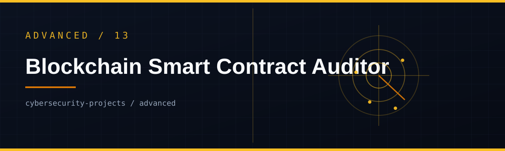
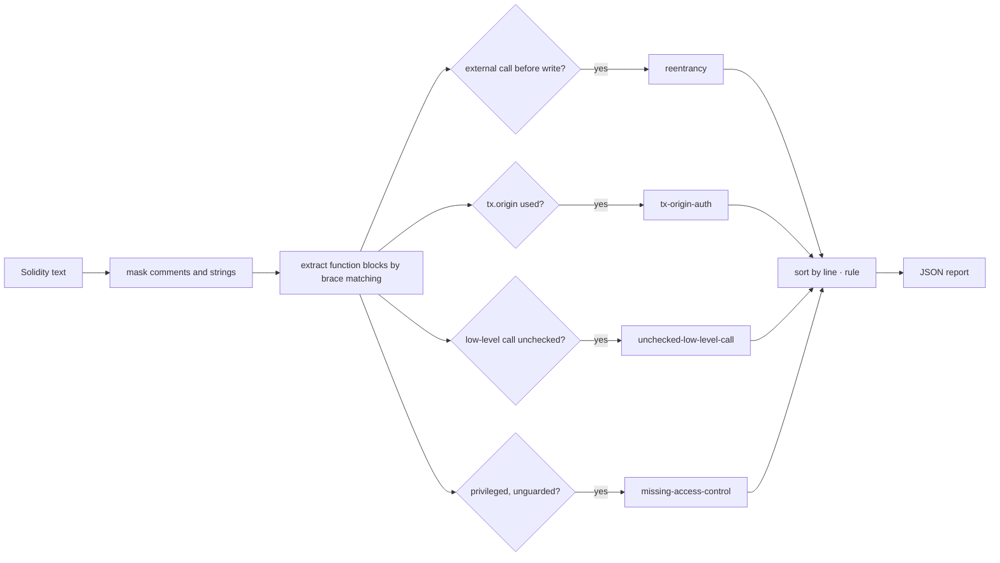

<div align="center">
  
</div>

<br />

<div align="center">

# ⛓️ Blockchain Smart Contract Auditor


> **Read before deploy.** Four well-known Solidity pitfalls, checked over plain text with no chain, compiler, or wallet in sight.

> **This is a pattern-based review aid, not a formal verifier. It cannot reason about cross-function or cross-contract state, compiler versions, or economic logic. A clean report is not a security guarantee; always combine it with manual review and proper tooling.**

</div>

---

## 🎯 What it does

It scans synthetic Solidity source text and reports four common contract pitfalls before deployment:

| Rule | Severity | Trigger |
| --- | --- | --- |
| `reentrancy` | high | External call appears before a state update in the same function. |
| `tx-origin-auth` | high | `tx.origin` is used for identity or authorisation. |
| `unchecked-low-level-call` | medium | `call` / `send` / `delegatecall` result is not checked. |
| `missing-access-control` | high | A privileged function has no owner/admin modifier or check. |

Findings carry the rule name, severity, a 1-based source line, and a message. The report also includes `functions_scanned` and `clean`.

## 🧠 How it works



Masking is equal-length, so documentation and string literals cannot create false hits and line numbers stay accurate.

## 🚀 Quick start

```powershell
python contract_auditor.py 'contract C { function f() public {} }'
python contract_auditor.py --file sample.sol
```

### Real output

```text
# $src holds this multi-line contract:
# contract Vault {
#     mapping(address => uint256) public balances;
#     function withdraw() public {
#         uint256 amount = balances[msg.sender];
#         msg.sender.call{value: amount}(payload);
#         balances[msg.sender] = 0;
#     }
# }

$ python contract_auditor.py $src
{
  "findings": [
    {
      "rule": "missing-access-control",
      "severity": "high",
      "line": 3,
      "message": "privileged function withdraw() has no owner check"
    },
    {
      "rule": "reentrancy",
      "severity": "high",
      "line": 5,
      "message": "external call precedes a state update in withdraw()"
    },
    {
      "rule": "unchecked-low-level-call",
      "severity": "medium",
      "line": 5,
      "message": "low-level call result is not checked"
    }
  ],
  "functions_scanned": 1,
  "clean": false
}
```

## 📂 Project structure

```text
13-blockchain-smart-contract-auditor/
├── assets/hero.svg                # generated visual identity
├── contract_auditor.py            # masker + rules + CLI
├── learn/README.md                # notes on contract pitfalls
└── tests/test_contract_auditor.py # 9 deterministic tests
```

## 🔍 Why it matters

- **Checks-effects-interactions** is exactly the ordering rule the reentrancy check enforces.
- **Identity checks** belong on privileged functions; `tx.origin` and missing modifiers are classic mistakes.
- **Stable line numbers** let you jump straight from a finding to the source that caused it.

### Scope and substitutions

- The upstream catalogue lists this as a synopsis-only Python/Solidity project. This implementation is original Python and **does not compile or execute Solidity**.
- No blockchain node, wallet, RPC endpoint, network call, or real credentials are used. Input is plain text; fixtures are synthetic.
- Comments and string literals are masked before scanning so line numbers stay accurate and documentation cannot create false hits.
- Standard library only; the analyzer is pure and offline.

## 🧪 Tests

```powershell
python -m unittest discover -s tests -v
```

9 tests covering clean contracts, reentrancy, `tx.origin`, checked versus unchecked low-level calls, access control, comment/string masking, deterministic ordering, and the source loader plus CLI.

## 📚 Learn more

Read [the concept notes](learn/README.md) for reentrancy ordering, `tx.origin` pitfalls, and low-level call handling.

---

<div align="center">
  <sub>Part of <b>cybersecurity-projects</b> · Advanced tier · Offline static analysis, original implementation.</sub>
</div>
