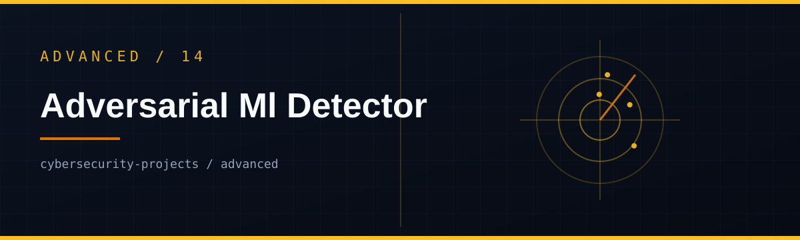
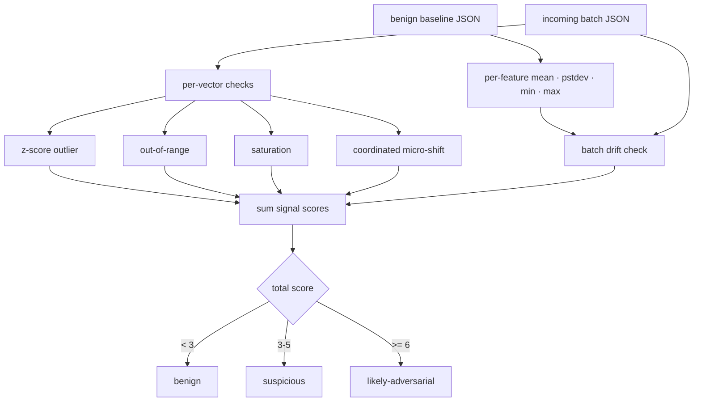

<div align="center">
  
</div>

<br />

<div align="center">

# 🧠 Adversarial ML Detector


> **Triage, not a classifier.** Five transparent statistics flag odd-looking vectors; no model is trained, queried, or attacked.

> **The upstream catalogue lists an _Adversarial ML Attacker_ synopsis. That offensive tool is replaced here with a _defensive_ detector: it reads synthetic feature vectors and flags patterns associated with adversarial perturbation and distribution drift. There is no model, no TensorFlow, no gradient access, and no attack generation.**

</div>

---

## 🎯 What it does

It derives a deterministic clean baseline from local JSON vectors, then scores an incoming batch using five signals:

| Signal | Rule |
| --- | --- |
| `z-score-outlier` | A feature is more than 3 standard deviations from the clean baseline mean. |
| `out-of-range-feature` | A feature lies outside the baseline min/max with a small tolerance. |
| `saturated-features` | Three or more features are pinned to 0 or 1 when the baseline rarely saturates. |
| `coordinated-small-perturbation` | Every feature shifts by a tiny amount (≤ 0.15) in the same direction. |
| `distribution-drift` | A batch mean shifts by more than 3 standard errors from the baseline. |

Scores combine into `benign` (< 3), `suspicious` (3–5), or `likely-adversarial` (≥ 6).

## 🧠 How it works



Both JSON files are lists of records like `{"id": "sample-1", "values": [0.1, 0.2, 0.3]}`. `identifier`/`features` are also accepted.

## 🚀 Quick start

```powershell
python adversarial_detector.py --baseline baseline.json --input batch.json
python adversarial_detector.py --baseline baseline.json --input batch.json --z-threshold 2.5
```

### Real output

```text
$baseline = Join-Path $env:TEMP "adv-ml-14\baseline.json"
$input = Join-Path $env:TEMP "adv-ml-14\batch.json"
# baseline: six four-feature records; input: one clean record and one with feature 0 = 5.0

$ python adversarial_detector.py --baseline $baseline --input $input
{
  "detections": [
    {
      "identifier": "odd-1",
      "signal": "out-of-range-feature",
      "detail": "feature 0: 5.000 outside observed range",
      "score": 2
    },
    {
      "identifier": "odd-1",
      "signal": "z-score-outlier",
      "detail": "feature 0: z=99.24",
      "score": 3
    }
  ],
  "drift": [],
  "score": 5,
  "verdict": "suspicious"
}
```

## 📂 Project structure

```text
14-adversarial-ml-detector/
├── assets/hero.svg                  # generated visual identity
├── adversarial_detector.py          # baseline + signals + CLI
├── learn/README.md                  # notes on perturbation signals
└── tests/test_adversarial_detector.py  # 10 deterministic tests
```

## 🔍 Why it matters

- **Transparent signals.** Every detection names the feature and the arithmetic behind it.
- **Batch-level drift** catches a shift that no single vector would reveal.
- **Defensive by design:** this project detects suspicious inputs rather than crafting them.

### Scope and substitutions

- Original Python implementation; no third-party packages, network, or model calls.
- Vectors are synthetic and generated in code or supplied as local JSON. Statistics use `statistics.fmean`/`pstdev`, so results are deterministic.
- These are transparent heuristics, not a trained classifier. A determined attacker can stay inside the rules; use the output as a triage signal alongside proper monitoring and access control.

## 🧪 Tests

```powershell
python -m unittest discover -s tests -v
```

10 tests covering both key styles for records, deterministic baselines, clean vectors, z-score and range signals, saturation, coordinated perturbation, batch drift, benign verdicts, validation errors, and the CLI.

## 📚 Learn more

Read [the concept notes](learn/README.md) for z-scores, saturation, coordinated perturbations, and batch drift.

---

<div align="center">
  <sub>Part of <b>cybersecurity-projects</b> · Advanced tier · Defensive substitution, original implementation.</sub>
</div>
