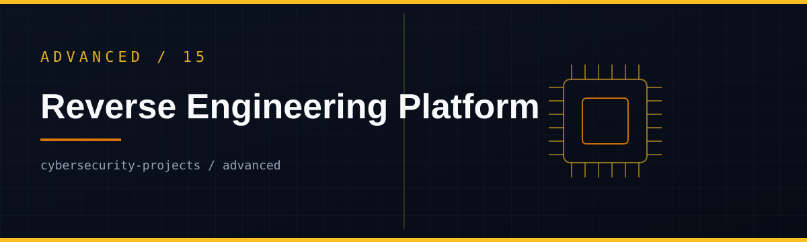
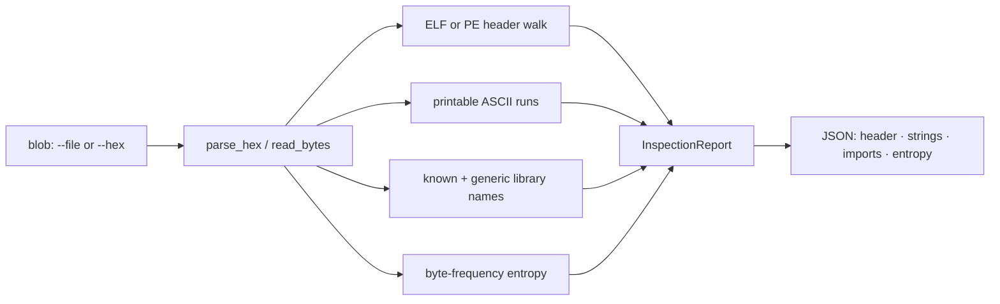

<div align="center">
  
</div>

<br />

<div align="center">

# 🔬 Reverse-Engineering Platform


> **Bytes, never executed.** A read-only triage view of a synthetic blob: header, strings, import hints, and entropy.

> **The upstream project is specified in C. Only Python is used here, so the native binary tooling is replaced with a _read-only static inspector_ for synthetic byte blobs. No sample executes, no debugger attaches, and no host process is touched.**

</div>

---

## 🎯 What it does

It reports four things about a blob supplied as a file or a hex string:

- **Header** — ELF or PE recognition, magic bytes, architecture/bitness, and declared section entries.
- **Strings** — printable ASCII runs with their byte offsets (length and count are capped).
- **Imports** — known `kernel32.dll`, `libc.so`, `libcrypto.so`, etc., plus generic `.dll`/`.so`/`.dylib` names found in strings.
- **Entropy** — Shannon entropy of the bytes, rounded to three decimals; a crude packed/unpacked signal.

Output is JSON. `--file` and `--hex` are mutually exclusive.

## 🧠 How it works



Every stage is pure parsing: no `subprocess`, no execution, no network, and no interpretation of the bytes as code.

## 🚀 Quick start

```powershell
python binary_inspector.py --file sample.bin
python binary_inspector.py --hex 7f454c4602010100000000000000000002003e00
python binary_inspector.py --file sample.bin --min-string-length 6
```

### Real output

```text
$blob = Join-Path $env:TEMP "bin-inspect-15\sample.bin"
# synthetic 256-byte ELF64 x86-64 blob with libcrypto.so.3, kernel32.dll and hello world strings

$ python binary_inspector.py --file $blob
{
  "header": {
    "format": "ELF",
    "magic": "7f454c46",
    "architecture": "x86-64 (64-bit)",
    "sections": [
      {
        "name": "section-0",
        "offset": 64,
        "size": 256
      }
    ]
  },
  "strings": [
    {
      "offset": 128,
      "value": "libcrypto.so.3"
    },
    {
      "offset": 143,
      "value": "kernel32.dll"
    },
    {
      "offset": 156,
      "value": "hello world"
    }
  ],
  "imports": [
    {
      "library": "kernel32.dll",
      "evidence": "string@143"
    },
    {
      "library": "libcrypto.so",
      "evidence": "string@128"
    },
    {
      "library": "libcrypto.so.3",
      "evidence": "string@128"
    }
  ],
  "entropy": 1.538,
  "size": 256
}
```

## 📂 Project structure

```text
15-reverse-engineering-platform/
├── assets/hero.svg                 # generated visual identity
├── binary_inspector.py             # header parser + strings + CLI
├── learn/README.md                 # notes on static triage
└── tests/test_binary_inspector.py  # 10 deterministic tests
```

## 🔍 Why it matters

- **Safe first look.** Static facts give you context before any deeper, isolated analysis.
- **String offsets** preserve evidence location instead of dumping an untraceable list.
- **Entropy** is a cheap, if crude, hint about packing or obfuscation.

### Scope and substitutions

- C → Python substitution is explicit: no compiler, linker, or native disassembler is required.
- Blobs are synthetic and supplied locally. This is a lab-style triage helper, not malware analysis of real samples and not a payload builder.
- Standard library only; no network or subprocess use.
- Header parsing covers common ELF/PE fields, not every optional header or packed/obfuscated layout. Imports are inferred from string evidence rather than a full import-table walk. Treat the report as a starting point for manual review.

## 🧪 Tests

```powershell
python -m unittest discover -s tests -v
```

10 tests covering ELF and PE headers, unknown formats, printable strings, import inference, entropy extremes, extraction caps, empty-blob determinism, hex parsing, and both CLI input modes.

## 📚 Learn more

Read [the concept notes](learn/README.md) for header layouts, string extraction, import evidence, and Shannon entropy.

---

<div align="center">
  <sub>Part of <b>cybersecurity-projects</b> · Advanced tier · Python substitution, original implementation.</sub>
</div>
