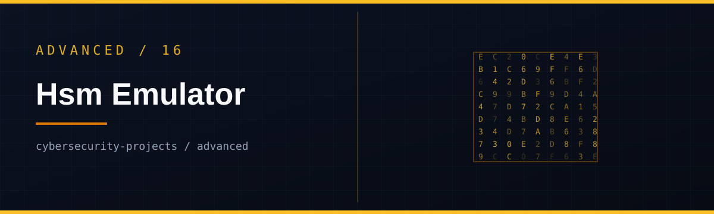
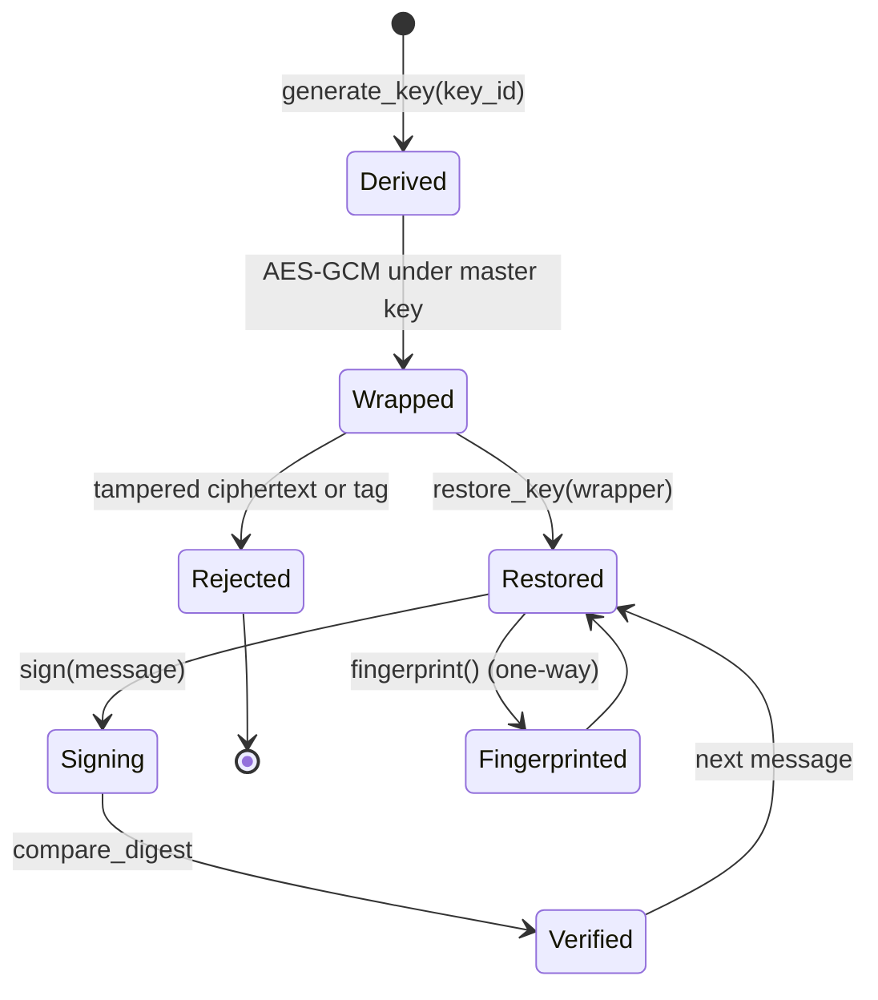

<div align="center">
  
</div>

<br />

<div align="center">

# 🔑 Hardware Security Module Emulator


> **No export, by construction.** Keys are wrapped under a master key and stay private to the emulator; only ciphertext, tags, signatures, and one-way fingerprints come out.

> **The upstream project is specified in Zig. It is reimplemented here as a _software HSM simulator_ in Python: keys are derived from a synthetic master key, wrapped with AES-GCM, and used for HMAC-SHA-256 signing. Plaintext key bytes never leave the `HSM` object. No hardware, device driver, PKCS#11 provider, network, or real credential is used.**

</div>

---

## 🎯 What it does

The `HSM` object derives a key from a master key and a key id, stores the plaintext privately, and returns an AES-GCM wrapper containing only `nonce`, `ciphertext`, and `tag`. `sign()` produces a detached HMAC-SHA-256 signature; `verify()` checks it with `hmac.compare_digest`. `restore_key()` unwraps into a fresh emulator and returns only the key id.

| Operation | Result |
| --- | --- |
| `generate_key(key_id)` | `WrappedKey` — no plaintext field |
| `restore_key(wrapped)` | key id string; key lives only in private storage |
| `sign(key_id, message)` | detached HMAC signature |
| `fingerprint()` / `master_fingerprint()` | one-way SHA-256 identifiers |

## 🧠 How it works



The master key defaults to a fixed **synthetic lab constant**. Nonces are derived deterministically from the key id so tests are reproducible.

## 🚀 Quick start

```python
from hsm_emulator import HSM

hsm = HSM()
wrapped = hsm.generate_key("lab-key-1")     # no plaintext returned
signature = hsm.sign("lab-key-1", b"hello")
assert hsm.verify("lab-key-1", b"hello", signature)
```

```powershell
python hsm_emulator.py generate --key-id lab-key-1 --out wrapped.json
python hsm_emulator.py sign --wrapped wrapped.json --message hello
python hsm_emulator.py verify --wrapped wrapped.json --message hello --signature <hex>
```

Wrappers and signatures are JSON with hex-encoded byte fields.

### Real output

```text
$wrapped = Join-Path $env:TEMP "hsm-lab-16\wrapped.json"

$ python hsm_emulator.py generate --key-id lab-key-1 --out $wrapped
{
  "key_id": "lab-key-1",
  "nonce": "a4d299d5f93093cf00dca4ad",
  "ciphertext": "f8db5c44e941125e33131de1e01c5b0a643a69103b32da288fb838b807bde7e5",
  "tag": "99f5f9888a805b0f02fb02873eef6f97",
  "algorithm": "AES-GCM-256"
}

$ python hsm_emulator.py sign --wrapped $wrapped --message hello
{
  "key_id": "lab-key-1",
  "signature": "a52b8b9735e56e175d5f6b42e3d813082b309908183466e743e07d85ca4fedc9",
  "algorithm": "HMAC-SHA-256"
}

$ python hsm_emulator.py verify --wrapped $wrapped --message hello --signature a52b8b9735e56e175d5f6b42e3d813082b309908183466e743e07d85ca4fedc9
{
  "valid": true
}
```

## 📂 Project structure

```text
16-hsm-emulator/
├── assets/hero.svg           # generated visual identity
├── hsm_emulator.py           # HSM class + wrapper + CLI
├── learn/README.md           # notes on wrapping and signing
└── tests/test_hsm_emulator.py  # 10 deterministic tests
```

## 🔍 Why it matters

- **Wrapped key material** models how real HSMs keep plaintext keys behind an API boundary.
- **Authenticated wrapping** means a modified wrapper fails on restore instead of yielding a wrong key.
- **One-way identifiers** let you compare keys without revealing them.

### Scope and substitutions

- Zig → Python substitution is explicit. No hardware, device driver, PKCS#11 provider, network, or real credential is used.
- The default master key is a fixed **synthetic lab constant**. Supply your own 32-byte key only for further lab experiments; never reuse it for real data.
- AES-GCM comes from the installed `cryptography` package (permitted for this project). HMAC and hashing use the standard library. Deterministic key derivation and nonces keep tests reproducible; production systems should use a true random source and a real HSM.
- No key export command exists. A wrapper contains only nonce, ciphertext, and tag.
- This is an emulator for learning key-wrapping and signing workflows. It offers no tamper resistance, secure element, role model, or audit logging. Do not treat it as a security boundary.

## 🧪 Tests

```powershell
python -m unittest discover -s tests -v
```

10 tests covering wrapper shape, deterministic wrapping, no plaintext leakage, sign/verify, tampered-wrapper rejection, restore without plaintext, input validation, one-way fingerprints, serialization round trips, and the generate → sign → verify CLI flow.

## 📚 Learn more

Read [the concept notes](learn/README.md) for key wrapping with AES-GCM, detached HMAC signatures, and what a real HSM adds on top.

---

<div align="center">
  <sub>Part of <b>cybersecurity-projects</b> · Advanced tier · Python substitution, original implementation.</sub>
</div>
