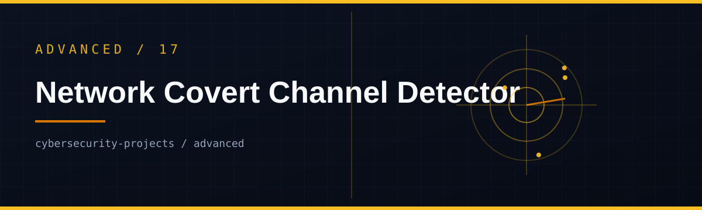
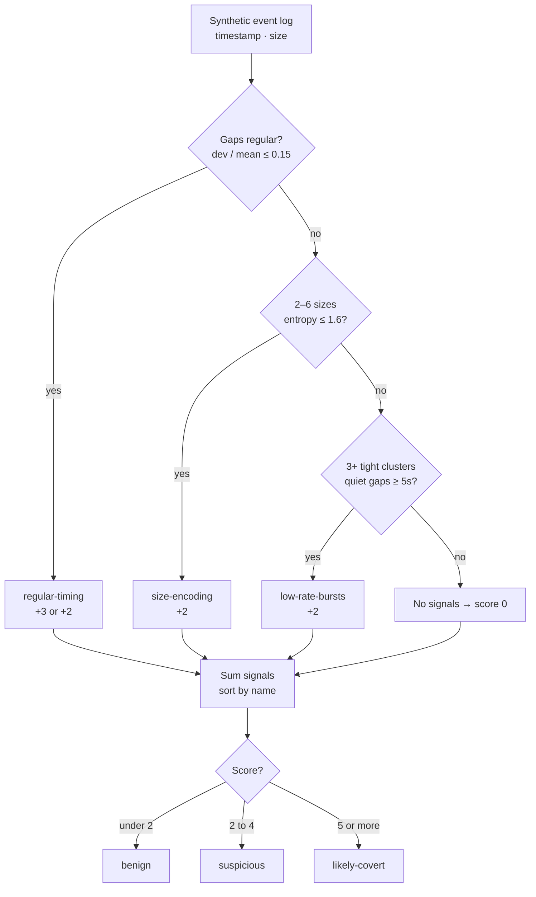

<div align="center">
  
</div>

<br />

<div align="center">

# 📡 Network Covert Channel Detector


> **Read the rhythm, not the payload.** Three timing-and-size heuristics score how much a synthetic packet log resembles a covert channel — nothing is ever sent, captured, or encoded.

</div>

---

## 🎯 What it does

The upstream catalogue lists a **Network Covert Channel** synopsis in Rust. This project deliberately replaces it with a **detector**, not a sender. It reads synthetic packet timing/size logs and scores how much they resemble known covert-channel patterns. There is no encoder, transmitter, socket, capture, or live target.

| Signal | Rule | Score |
| --- | --- | --- |
| `regular-timing` | At least five gaps with mean absolute deviation / mean gap ≤ 0.05 (or ≤ 0.15 for a weaker hit). | 3 / 2 |
| `size-encoding` | Eight or more packets using 2–6 recurring sizes with size entropy ≤ 1.6 bits. | 2 |
| `low-rate-bursts` | Three or more tight clusters (≤ 0.5 s inside) separated by ≥ 5 s quiet gaps. | 2 |

Total score maps to `benign` (< 2), `suspicious` (2–4), or `likely-covert` (≥ 5). Signals are sorted by name so output is stable.

## 🧠 How it works



Each detector is a pure function over the parsed events. `parse_events` accepts `timestamp`/`t` and `size`/`bytes` aliases and enforces positive sizes and non-decreasing timestamps.

## 🚀 Quick start

```powershell
python covert_channel_detector.py --demo
python covert_channel_detector.py --file events.json
```

`events.json` is a list of `{"timestamp": 0.0, "size": 512}` records. `t` and `bytes` are accepted as aliases. Optional `source` and `destination` fields are copied into the assessment input but do not affect scoring.

### Real output

```text
$ python covert_channel_detector.py --demo
{
  "benign": {
    "signals": [],
    "score": 0,
    "verdict": "benign",
    "events_analyzed": 12
  },
  "covert-pattern": {
    "signals": [
      {
        "name": "regular-timing",
        "score": 3,
        "detail": "11 gaps, mean-dev/mean=0.000"
      },
      {
        "name": "size-encoding",
        "score": 2,
        "detail": "2 recurring sizes, entropy=1.00 bits"
      }
    ],
    "score": 5,
    "verdict": "likely-covert",
    "events_analyzed": 12
  }
}
```

## 📂 Project structure

```text
17-network-covert-channel-detector/
├── assets/hero.svg                         # generated visual identity
├── covert_channel_detector.py              # signals + scoring + CLI
├── learn/README.md                         # the concept notes
└── tests/test_covert_channel_detector.py   # 10 deterministic tests
```

## 🔍 Why it matters

- **Rhythm is a signal.** Perfectly regular timing and a tiny size alphabet leak structure even when payloads look harmless.
- **Triage, not conviction.** Scores separate noise from patterns worth a second look.
- **Defensive substitution.** Rust → Python and offensive → defensive are both explicit; no sender exists to misuse.

### Scope and substitutions

- Rust → Python and offensive → defensive substitutions are both explicit.
- Only synthetic logs are used. No packet is generated on a network and no covert channel is implemented.
- Standard library only; all functions are pure and deterministic.

### Limitations

Legitimate traffic can be regular or bursty (heartbeats, batch jobs), so scores are triage hints, not proof. Correlate with endpoint context before acting.

## 🧪 Tests

```powershell
python -m unittest discover -s tests -v
```

10 tests, offline: aliases and validation, each heuristic, negative cases, combined scoring, demo stability, and the CLI.

## 📚 Learn more

Read [the concept notes](learn/README.md) for covert-channel signals, threshold reasoning, and why synthetic-only analysis keeps the tool safe.

---

<div align="center">
  <sub>Part of <b>cybersecurity-projects</b> · Advanced tier · Defensive substitution, original implementation.</sub>
</div>
