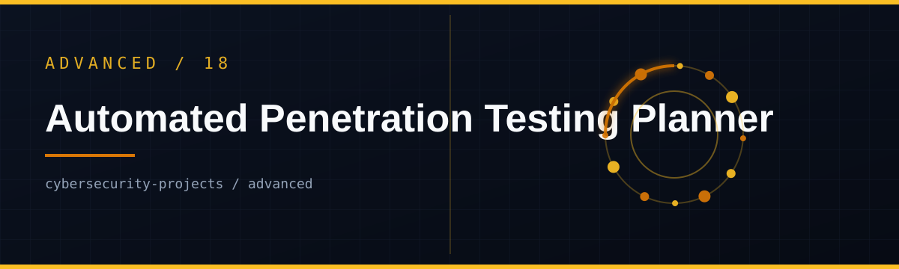
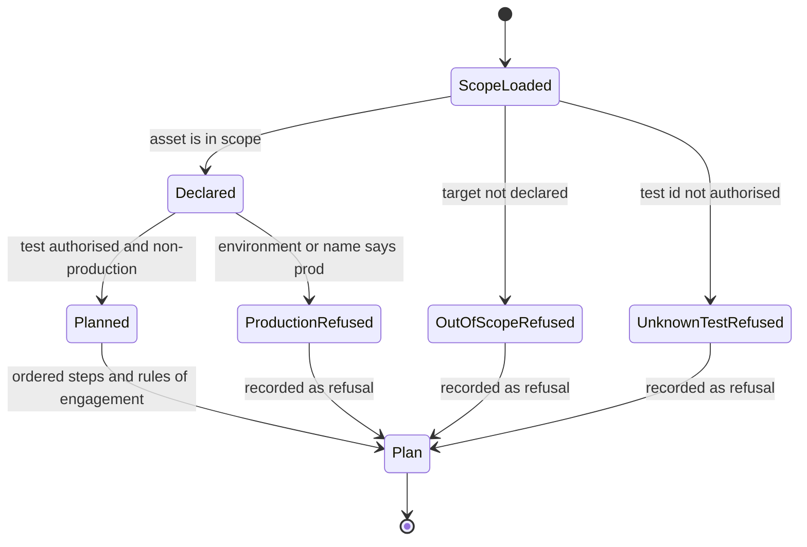

<div align="center">
  
</div>

<br />

<div align="center">

# 🗺️ Automated Penetration Testing Planner


> **Authorisation first. Execution never.** A declared lab scope becomes an ordered checklist; everything outside that scope becomes a documented refusal.

</div>

---

## 🎯 What it does

This is a **defensive lab planner**, not a penetration-testing executor. It reads a JSON scope of owned lab/staging assets and explicitly authorised tests, then emits an ordered plan with a checklist for each test. Out-of-scope targets, production assets, and unknown or unauthorised test ids are refused with a reason.

**No test is executed.** There is no command runner, scanner, exploit, payload, network call, or contact with any target.

`recon`, `configuration-review`, `vulnerability-scan`, and `credential-audit` each have a safe, read-only checklist. Any other category receives a generic authorisation/read-only/documentation checklist. Credential-audit steps explicitly require synthetic lab accounts.

## 🧠 How it works



An asset is refused when its `environment` is `production`/`prod`/`live`, or when its name contains `prod`, `production`, or `live`. Tests must reference a declared asset. Output is JSON with `steps` (ordered checklist items), `refusals`, and a fixed `rules_of_engagement` list. `--validate-only` reports validity, step count, and refusals.

### Scope document

```json
{
  "assets": [
    {"name": "lab-web-01", "network": "10.10.0.0/24", "owner": "blue-team", "environment": "lab"},
    {"name": "staging-api", "network": "10.20.0.0/24", "owner": "blue-team", "environment": "staging"},
    {"name": "prod-db", "network": "10.30.0.0/24", "owner": "ops", "environment": "production"}
  ],
  "tests": [
    {"id": "T01", "title": "Service inventory", "category": "recon", "asset": "lab-web-01"},
    {"id": "T02", "title": "Config baseline", "category": "configuration-review", "asset": "staging-api"},
    {"id": "T03", "title": "Safe scan", "category": "vulnerability-scan", "asset": "lab-web-01"},
    {"id": "T04", "title": "Production port check", "category": "recon", "asset": "prod-db"}
  ]
}
```

## 🚀 Quick start

```powershell
python lab_planner.py --scope scope.json
python lab_planner.py --scope scope.json --test T01 --target lab-web-01
python lab_planner.py --scope scope.json --validate-only
```

### Real output

```text
$ python lab_planner.py --scope $env:TEMP\planner_scope.json
{
  "steps": [
    {
      "order": 1,
      "test_id": "T01",
      "title": "Service inventory",
      "asset": "lab-web-01",
      "category": "recon",
      "checklist": [
        "Confirm written authorisation and the asset owner.",
        "List only in-scope hosts, ports, and services from local records.",
        "Record each observation with its source and timestamp."
      ]
    },
    {
      "order": 2,
      "test_id": "T02",
      "title": "Config baseline",
      "asset": "staging-api",
      "category": "configuration-review",
      "checklist": [
        "Export the configuration read-only from the lab asset.",
        "Compare settings against the agreed hardening baseline.",
        "Document deviations without changing the system."
      ]
    },
    {
      "order": 3,
      "test_id": "T03",
      "title": "Safe scan",
      "asset": "lab-web-01",
      "category": "vulnerability-scan",
      "checklist": [
        "Use safe, non-intrusive checks only.",
        "Exclude denial-of-service and intrusive plugins.",
        "Review every finding manually before recording it."
      ]
    }
  ],
  "refusals": [
    {
      "target": "T04",
      "reason": "test targets a production asset and is refused"
    }
  ],
  "rules_of_engagement": [
    "Written authorisation must be on file before any test activity.",
    "Only owned lab or staging assets declared in scope may be examined.",
    "No exploitation, payload delivery, credential guessing, or production traffic is permitted.",
    "Stop on instability, preserve notes offline, and report every observation."
  ]
}

$ python lab_planner.py --scope $env:TEMP\planner_scope.json --validate-only --target prod-db
{
  "valid": false,
  "steps": 0,
  "refusals": [
    {
      "target": "prod-db",
      "reason": "production target refused"
    },
    {
      "target": "T04",
      "reason": "test targets a production asset and is refused"
    }
  ]
}
```

## 📂 Project structure

```text
18-automated-penetration-testing-planner/
├── assets/hero.svg            # generated visual identity
├── lab_planner.py             # scope validation + plan builder + CLI
├── learn/README.md            # the concept notes
└── tests/test_lab_planner.py  # 10 deterministic tests
```

## 🔍 Why it matters

- **Refusal is a feature.** A plan that silently includes production is worse than no plan at all.
- **Rules travel with the plan.** The four rules of engagement are attached to every output.
- **Checklists constrain behaviour.** Read-only, non-intrusive steps keep the exercise inside its lane.

### Scope and substitutions

- Original Python implementation; synopsis-only upstream project. Standard library only.
- Deterministic and offline: no live targets, real credentials, subprocess calls, sockets, or external tools.
- The inputs are synthetic scope documents; the output is a planning artefact only.

### Limitations

The planner cannot verify that authorisation is genuine or that an asset is truly owned; it only applies the rules encoded in the supplied scope. A plan is a starting point for human review, not permission to act.

## 🧪 Tests

```powershell
python -m unittest discover -s tests -v
```

10 tests, deterministic and offline: scope validation, ordering, filters, every refusal class, a no-execution import guard, rules of engagement, and the CLI.

## 📚 Learn more

Read [the concept notes](learn/README.md) for scoping discipline, rules of engagement, and why planning artefacts are safer than executors.

---

<div align="center">
  <sub>Part of <b>cybersecurity-projects</b> · Advanced tier · Defensive lab planner, original implementation.</sub>
</div>
