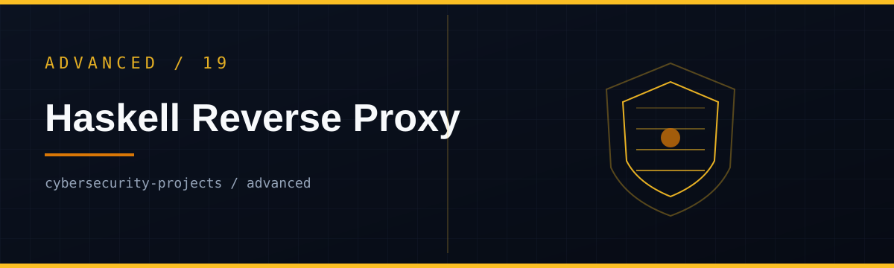
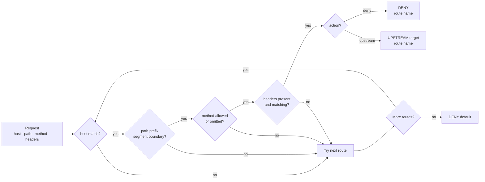

<div align="center">
  
</div>

<br />

<div align="center">

# 🚦 Reverse Proxy Route Evaluator


> **Decide the route. Never carry the traffic.** JSON rules choose an upstream or a deny — and no socket is ever opened.

</div>

---

## 🎯 What it does

The upstream project is a reverse proxy written in Haskell. This build is a **Python substitution that implements only a config-driven proxy ROUTE EVALUATOR**. It parses JSON routing rules for host, path, method, and headers, then selects an upstream or a deny decision. **It evaluates rules; it does not proxy traffic.** There are no sockets, listeners, HTTP clients, or servers.

### Routing semantics

- Routes are evaluated in order; the first match decides.
- `action` is `upstream` or `deny`; anything else is rejected. No match is a default `deny` with rule `default`.
- `host`: `*` or omission matches any host; names are case-insensitive and a client port is ignored when the route omits one.
- `path`: prefix match with a segment boundary, so `/api` matches `/api` and `/api/users` but not `/apixel`. `/` matches everything.
- `methods`: omission or an empty list means any method.
- `headers`: every listed header must be present; names are case-insensitive and value `*` means presence only.
- Only a matched `upstream` route exposes an upstream target in the decision.

## 🧠 How it works



`routes.json` may be a list or an object with a `routes` key:

```json
{
  "routes": [
    {
      "name": "api",
      "action": "upstream",
      "host": "app.local",
      "path": "/api",
      "methods": ["GET", "POST"],
      "headers": {"X-Tenant": "alpha", "X-Flag": "*"},
      "upstream": "backend-a:8080"
    },
    {"name": "admin-block", "action": "deny", "host": "app.local", "path": "/admin"},
    {"name": "site", "action": "upstream", "path": "/", "upstream": "backend-b:8080"}
  ]
}
```

## 🚀 Quick start

```powershell
python route_evaluator.py routes.json --host app.local --path /api/users --method GET --header "X-Tenant=alpha" --header "X-Flag=any"
python route_evaluator.py routes.json --host app.local --path /admin
```

### Real output

```text
$ python route_evaluator.py $env:TEMP\proxy_routes.json --host app.local --path /api/users --method GET --header "X-Tenant=alpha" --header "X-Flag=any"
UPSTREAM backend-a:8080 (api)

$ python route_evaluator.py $env:TEMP\proxy_routes.json --host app.local --path /admin
DENY (admin-block)
```

## 📂 Project structure

```text
19-haskell-reverse-proxy/
├── assets/hero.svg              # generated visual identity
├── route_evaluator.py           # rule model + matcher + CLI
├── learn/README.md              # the concept notes
└── tests/test_route_evaluator.py  # 9 deterministic tests
```

## 🔍 Why it matters

- **Order is policy.** A broad catch-all route placed too early can shadow a specific deny.
- **Default deny** turns a missing rule into a safe decision.
- **Matching is observable.** Printing the rule name makes configuration debugging possible without touching a network.

### Substitution notes

The Haskell proxy implementation and its networking stack are replaced by pure Python rule evaluation. The CLI reads local JSON and prints a decision; it never forwards a request.

## 🧪 Tests

```powershell
python -m unittest discover -s tests
```

9 tests, standard library only: host/path/method/header matching, segment boundaries, first-match deny, default deny, wildcard and case handling, route loading validation, and the CLI.

## 📚 Learn more

Read [the concept notes](learn/README.md) for proxy routing semantics, first-match tables, and what a safety-only substitution keeps — and leaves out.

---

<div align="center">
  <sub>Part of <b>cybersecurity-projects</b> · Advanced tier · Python substitution, original implementation.</sub>
</div>
