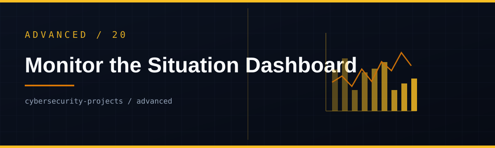
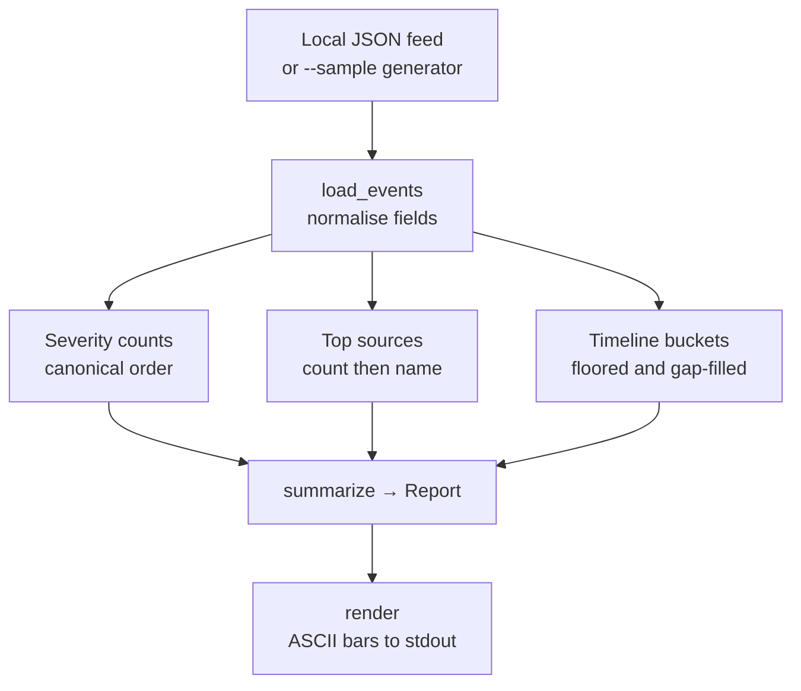

<div align="center">
  
</div>

<br />

<div align="center">

# 📊 Monitor the Situation Dashboard


> **A console-sized picture of a synthetic security feed.** Events go in; severity, sources, and a gap-filled timeline come out — as plain text.

</div>

---

## 🎯 What it does

The upstream project is a Go/React situation dashboard. This build substitutes a **Python command-line dashboard** that aggregates synthetic event feeds into a console report. **No live data sources, listeners, or web server are used.** Input is a local JSON file or the built-in deterministic sample generator.

The report prints severity counts with ASCII bars, top event sources ranked by count, and timeline buckets with empty periods shown as zero. `--sample` generates 48 reproducible synthetic events with a fixed seed; use `--top` and `--bucket-minutes` to adjust aggregation.

### Aggregation semantics

- Severity names are normalized to lowercase and ordered `critical`, `high`, `medium`, `low`, `info`; unknown values sort after these by name.
- Sources are sorted by descending count, then alphabetically, so ties are deterministic.
- Timestamps accept ISO-8601 forms, including trailing `Z`. Buckets are floored to `--bucket-minutes` boundaries and filled from the first to the last event bucket.
- `elevated` is the total of `critical` and `high` events.

## 🧠 How it works



`events.json` can be a list or an object with an `events` key:

```json
{
  "events": [
    {"timestamp": "2026-01-12T08:01:00", "source": "auth-gateway", "severity": "high", "category": "auth", "message": "threshold crossed"},
    {"timestamp": "2026-01-12T08:14:00Z", "source": "ids-edge-01", "severity": "low", "category": "network", "message": "policy matched"}
  ]
}
```

## 🚀 Quick start

```powershell
python dashboard.py --sample
python dashboard.py events.json --top 3 --bucket-minutes 30
```

### Real output

```text
$ python dashboard.py --sample --top 3 --bucket-minutes 30
=== SITUATION DASHBOARD ===
Events: 48 | Elevated (critical/high): 17

Severity:
  critical  ###########          6
  high      #################### 11
  medium    ################     9
  low       #################### 11
  info      #################### 11

Top sources:
  1. backup-job       #################### 13
  2. auth-gateway     ###############      10
  3. ids-edge-01      ###############      10

Timeline (30m buckets):
  08:00  #################### 10
  08:30  #################### 10
  09:00  #################### 10
  09:30  #################### 10
  10:00  ################     8
```

## 📂 Project structure

```text
20-monitor-the-situation-dashboard/
├── assets/hero.svg          # generated visual identity
├── dashboard.py             # event model + summarizer + renderer + CLI
├── learn/README.md          # the concept notes
└── tests/test_dashboard.py  # 9 deterministic tests
```

## 🔍 Why it matters

- **Determinism builds trust.** The same feed always produces the same bars, ranks, and buckets.
- **Gaps are visible.** Empty timeline buckets are drawn as zero instead of silently disappearing.
- **No telemetry leaves the machine.** The sample is synthetic and the only output is stdout.

### Substitution notes

Go services and the React web UI are replaced by a single Python CLI writing plain text to stdout. Synthetic feeds stand in for live telemetry; nothing is collected from hosts or the network.

## 🧪 Tests

```powershell
python -m unittest discover -s tests
```

9 tests, standard library only: canonical severity ordering, unknown-value sorting, deterministic source ties, top-N limits, bucket flooring and gap filling, rendering sections, sample determinism, input wrappers, and the CLI.

## 📚 Learn more

Read [the concept notes](learn/README.md) for event aggregation, timeline bucketing, and the trade-offs of a text-only dashboard.

---

<div align="center">
  <sub>Part of <b>cybersecurity-projects</b> · Advanced tier · Go/React → Python CLI substitution, original implementation.</sub>
</div>
