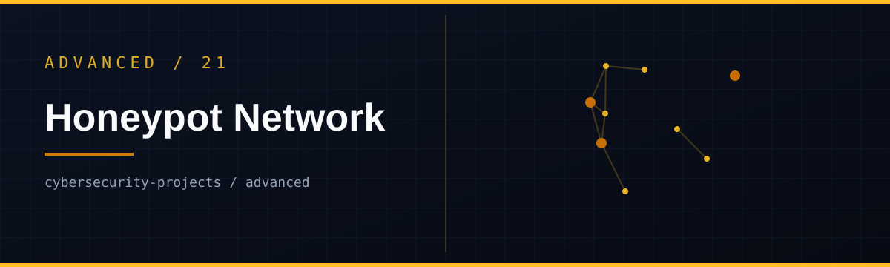
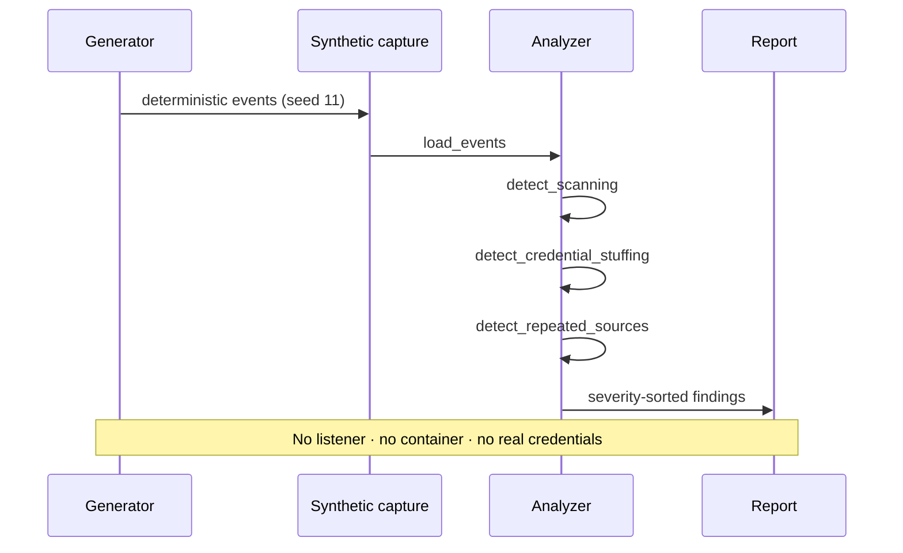

<div align="center">
  
</div>

<br />

<div align="center">

# 🍯 Honeypot Network


> **A decoy you can study without ever standing one up.** Synthetic events are generated, analyzed, and reported — no listener, no container, no real credential.

</div>

---

## 🎯 What it does

The upstream project is a Go/React/Docker honeypot network. This build substitutes a **Python simulator and analyzer**. It generates synthetic honeypot events and analyzes them for scanning, credential stuffing, and repeated source IPs. **There is no real listener, no container, no live target, and no real credential.** The offensive-sounding behaviors are represented only as simulated event records for defensive detection practice.

All example addresses come from documentation ranges (`192.0.2.0/24`, `198.51.100.0/24`, `203.0.113.0/24`). Usernames are labels like `user-001`, and credential material is labeled only as `wordlist-a` or `wordlist-b` — never an actual secret.

### Detectors

- **Scanning**: at least N distinct destination ports from one source inside a sliding time window.
- **Credential stuffing**: at least N distinct synthetic usernames tried against one source with a low success ratio.
- **Repeated source**: one source producing at least N events overall.

Findings are sorted by severity, then kind, then source IP for stable output.

## 🧠 How it works



`sample` analyzes a deterministic capture containing three planted patterns. `sample --json` prints the raw synthetic events. `analyze` accepts thresholds such as `--scan-ports`, `--scan-window`, `--stuffing-usernames`, and `--repeated-events`.

`capture.json` can be a list or an object with an `events` key:

```json
{
  "events": [
    {"timestamp": "2026-02-03T09:00:00", "source_ip": "198.51.100.23", "service": "tcp-probe", "port": 4000, "event_type": "connect"},
    {"timestamp": "2026-02-03T09:04:00", "source_ip": "203.0.113.44", "service": "ssh", "port": 22, "event_type": "auth_failure", "username": "user-001", "credential_label": "wordlist-a"}
  ]
}
```

## 🚀 Quick start

```powershell
python honeypot.py sample
python honeypot.py sample --json
python honeypot.py analyze capture.json
```

### Real output

```text
$ python honeypot.py sample
=== HONEYPOT ANALYSIS (simulated) ===
Events: 46 | Sources: 6 | Findings: 5
[high] credential-stuffing 203.0.113.44
    8 usernames tried, 0 successes, labels=['wordlist-a']
[high] scanning 198.51.100.23
    5 distinct ports within 300s
[medium] repeated-source 192.0.2.77
    10 events observed from one source
[medium] repeated-source 198.51.100.23
    10 events observed from one source
[medium] repeated-source 203.0.113.44
    8 events observed from one source
```

## 📂 Project structure

```text
21-honeypot-network/
├── assets/hero.svg         # generated visual identity
├── honeypot.py             # event generator + detectors + CLI
├── learn/README.md         # the concept notes
└── tests/test_honeypot.py  # 10 deterministic tests
```

## 🔍 Why it matters

- **Detection practice without exposure.** The attack-shaped behaviours are records, not actions.
- **Thresholds are explicit.** Ports, windows, usernames, and event counts are all tunable knobs.
- **Safe by construction.** Documentation ranges and label-only credentials make accidental harm impossible.

### Substitution notes

Go services, React UI, and Docker networking are replaced by pure Python event generation and analysis. No port is bound, no packet is sent, and no real username/password pair is handled.

## 🧪 Tests

```powershell
python -m unittest discover -s tests
```

10 tests, standard library only: generator determinism, planted-pattern detection, scanning window and port thresholds, stuffing success-ratio and username guards, repeated-source threshold, severity ordering, input/render wrappers, and the CLI.

## 📚 Learn more

Read [the concept notes](learn/README.md) for deception telemetry, detector thresholds, and how to study attacker patterns without deploying a real honeypot.

---

<div align="center">
  <sub>Part of <b>cybersecurity-projects</b> · Advanced tier · Simulation-only substitution, original implementation.</sub>
</div>
