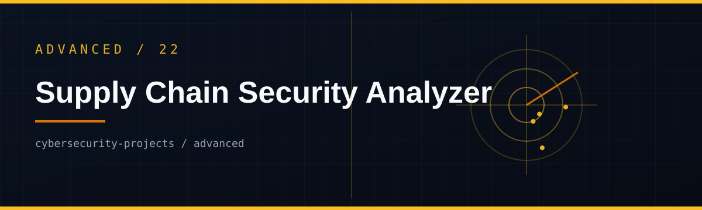
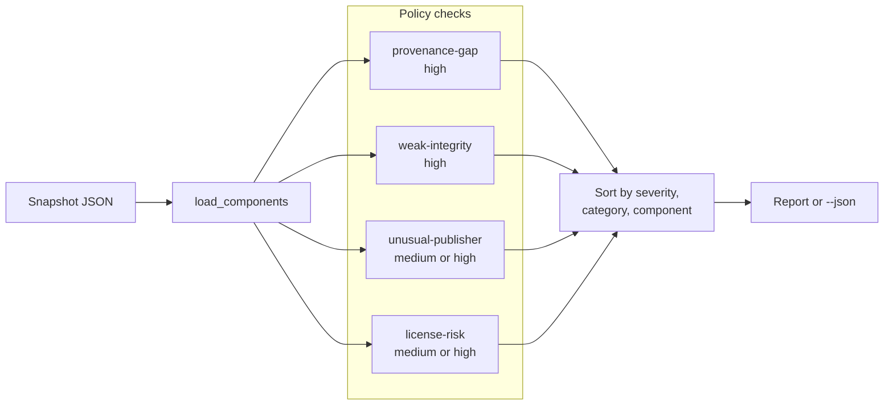

<div align="center">
  
</div>

<br />

<div align="center">

# 🔗 Supply Chain Security Analyzer


> **Trust, but verify the snapshot — offline.** Four policy checks grade a local SBOM without ever resolving a dependency or calling a registry.

</div>

---

## 🎯 What it does

The upstream project is written in Go. This build is a **Python substitution** that analyzes a local SBOM/dependency snapshot for provenance gaps, weak integrity hashes, unusual publishers, and license risks. **It is fully offline: no network calls, no registry lookups, and no package installation.**

| Check | Severity | Trigger |
| --- | --- | --- |
| `provenance-gap` | high | No build attestation is recorded. |
| `weak-integrity` | high | No hash, a weak algorithm (`md5`, `sha1`, `sha224`), an unknown algorithm, or a malformed digest. |
| `unusual-publisher` | medium (high for `unknown`/`anonymous`) | Publisher is missing or outside the trusted allowlist. |
| `license-risk` | medium for missing/unknown, high for restricted licenses such as AGPL-3.0 or SSPL-1.0 | License metadata fails the policy. |

Findings are sorted by severity, category, and component for stable reports. `--trusted-publisher` and `--restricted-license` replace the built-in lists when supplied; `--allow-missing-provenance` disables that check. `--json` emits findings as JSON for further processing.

## 🧠 How it works



`snapshot.json` can be a list or an object with a `components` key:

```json
{
  "components": [
    {
      "name": "web-ui",
      "version": "1.2.3",
      "publisher": "Acme Security",
      "license": "MIT",
      "hashes": ["sha256:aaaaaaaaaaaaaaaaaaaaaaaaaaaaaaaaaaaaaaaaaaaaaaaaaaaaaaaaaaaaaaaa"],
      "provenance": "signed-build-attestation"
    },
    {"name": "legacy-lib", "version": "0.9", "publisher": "unknown", "license": "AGPL-3.0", "hashes": ["md5:bbbbbbbbbbbbbbbbbbbbbbbbbbbbbbbb"]}
  ]
}
```

## 🚀 Quick start

```powershell
python supply_chain.py snapshot.json
python supply_chain.py snapshot.json --json
python supply_chain.py snapshot.json --trusted-publisher "Internal Build" --allow-missing-provenance
```

### Real output

```text
$ python supply_chain.py $env:TEMP\sbom_snapshot.json
=== SUPPLY CHAIN REVIEW ===
Components: 2 | Findings: 4
[high] license-risk legacy-lib
    restricted license AGPL-3.0
[high] provenance-gap legacy-lib
    no build provenance attestation recorded
[high] weak-integrity legacy-lib
    weak hash algorithm md5
[medium] unusual-publisher legacy-lib
    publisher is missing
```

## 📂 Project structure

```text
22-supply-chain-security-analyzer/
├── assets/hero.svg              # generated visual identity
├── supply_chain.py              # component model + checks + CLI
├── learn/README.md              # the concept notes
└── tests/test_supply_chain.py   # 9 deterministic tests
```

## 🔍 Why it matters

- **Provenance is a control.** A component without a build attestation cannot be traced back to its source.
- **Hash strength matters.** An `md5` digest is not an integrity guarantee.
- **Policy is portable.** Trusted publishers and restricted licenses are inputs, not hard-coded truths.

### Substitution notes

The Go implementation is replaced by a pure Python policy checker over a static JSON snapshot. It does not resolve dependencies, contact package registries, or execute package code.

## 🧪 Tests

```powershell
python -m unittest discover -s tests
```

9 tests, standard library only: clean components, provenance gaps, weak and malformed hashes, publisher override, license risks, deterministic sorting, input wrappers, and the JSON CLI.

## 📚 Learn more

Read [the concept notes](learn/README.md) for SBOM policy checks, integrity attestations, and why offline analysis is a safe starting point.

---

<div align="center">
  <sub>Part of <b>cybersecurity-projects</b> · Advanced tier · Go → Python substitution, original implementation.</sub>
</div>
