

  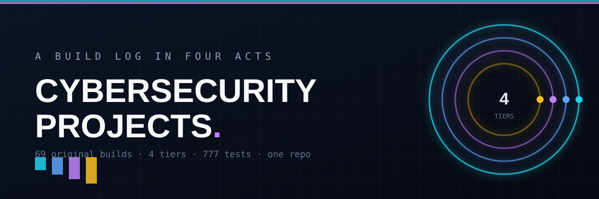

# 🟠 Advanced

> Crypto, anomaly detection and system-level analysis.

---

## All advanced projects

| Project | Banner | What it does |
|---|---|---|
| [Api Rate Limiter](01-api-rate-limiter/README.md) | 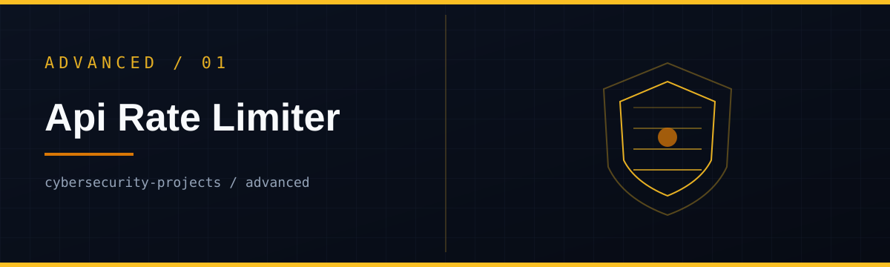 | Token bucket and sliding window over request timestamps. |
| [Encrypted Chat Application](02-encrypted-chat-application/README.md) | 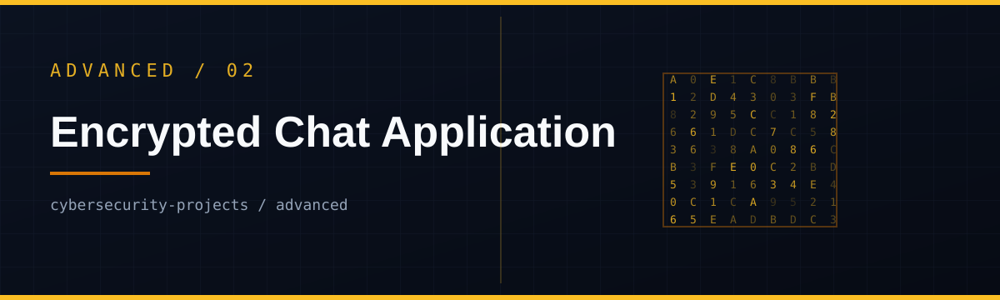 | Local AES-GCM chat store with per-message nonces. |
| [Exploit Development Framework](03-exploit-development-framework/README.md) | 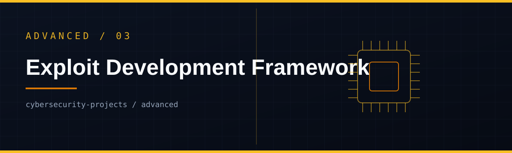 | Defensive triage of crash traces and memory indicators. |
| [Ai Threat Detection](04-ai-threat-detection/README.md) | 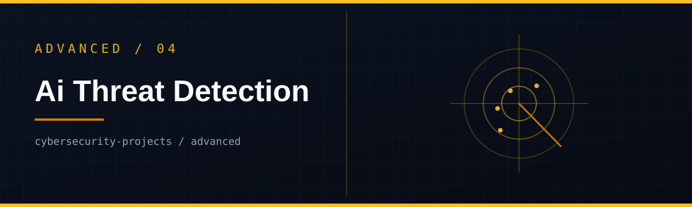 | Transparent z-score and rule based anomaly scoring. |
| [Zingela Stateless Scanner](05-zingela-stateless-scanner/README.md) | 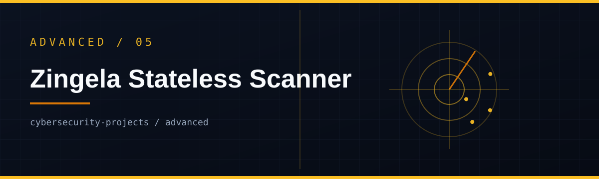 | Parse saved scan output and match a local risk catalog. |
| [Bug Bounty Platform](06-bug-bounty-platform/README.md) | 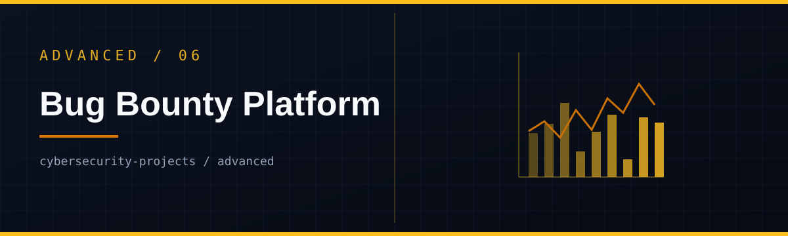 | Local finding tracker with CVSS-like scoring. |
| [Cloud Security Compliance Dashbo…](07-cloud-security-compliance-dashboard/README.md) | 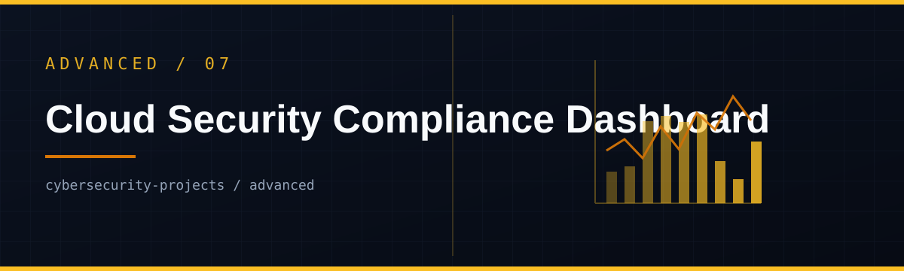 | Snapshot checks for common cloud misconfigurations. |
| [Malware Analysis Platform](08-malware-analysis-platform/README.md) | 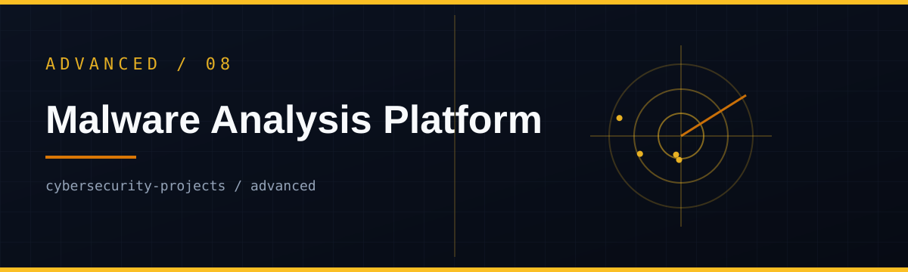 | Static hashing, entropy and strings — no execution. |
| [Quantum Resistant Encryption](09-quantum-resistant-encryption/README.md) | 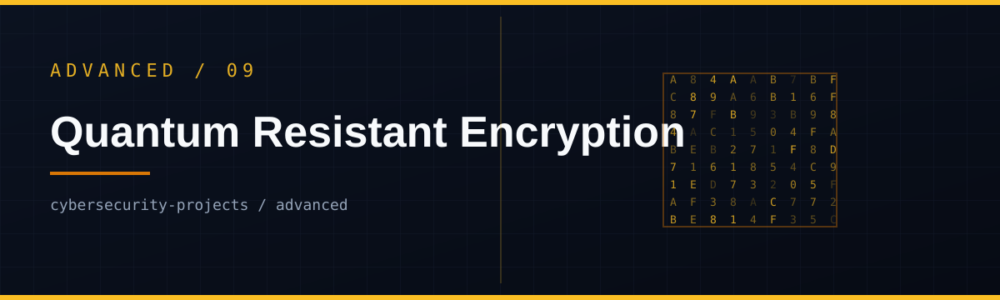 | Toy Lamport one-time signatures for learning. |
| [Zero Day Vulnerability Scanner](10-zero-day-vulnerability-scanner/README.md) | 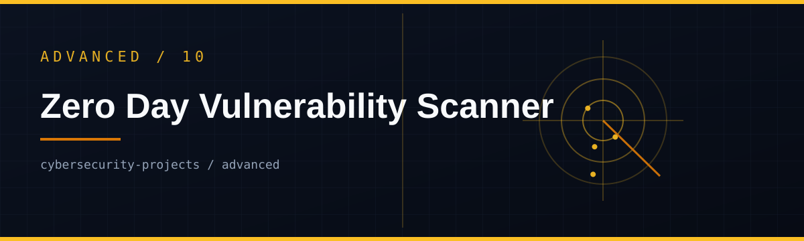 | Unknown-risk source patterns, no exploit claims. |
| [Distributed Password Cracker](11-distributed-password-cracker/README.md) | 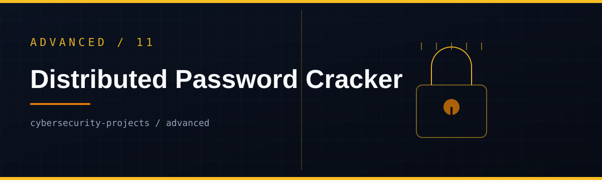 | Workload partitioning simulation, digest checks only. |
| [Kernel Rootkit Detection](12-kernel-rootkit-detection/README.md) | 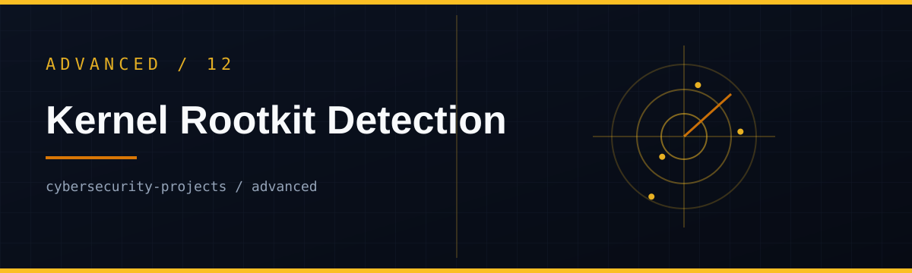 | Syscall-table anomaly checks over a snapshot. |
| [Blockchain Smart Contract Auditor](13-blockchain-smart-contract-auditor/README.md) | 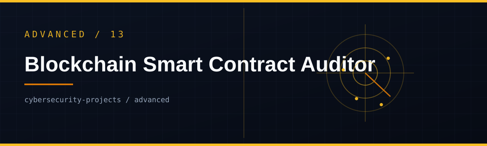 | Static Solidity pattern checks, no chain access. |
| [Adversarial Ml Detector](14-adversarial-ml-detector/README.md) | 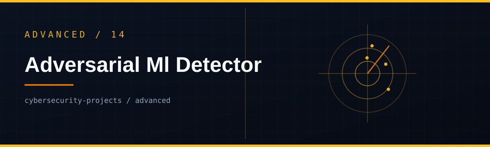 | Distribution drift and perturbation scoring. |
| [Reverse Engineering Platform](15-reverse-engineering-platform/README.md) | 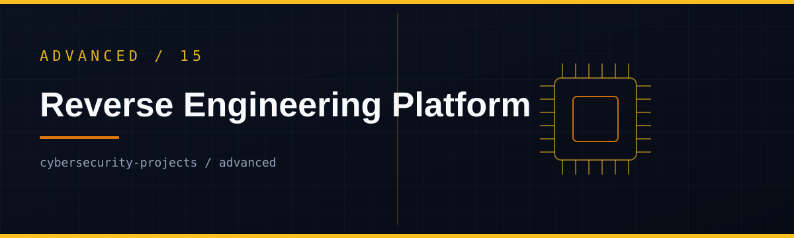 | Headers, strings and imports from synthetic blobs. |
| [Hsm Emulator](16-hsm-emulator/README.md) | 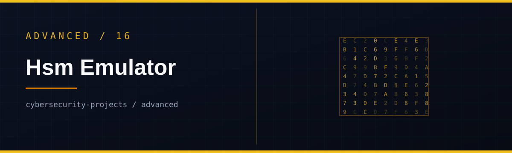 | Software enclave with wrapped keys and HMAC signing. |
| [Network Covert Channel Detector](17-network-covert-channel-detector/README.md) | 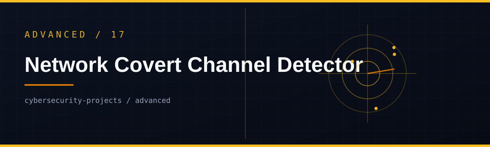 | Timing and size anomaly scoring over packet logs. |
| [Automated Penetration Testing Pl…](18-automated-penetration-testing-planner/README.md) | 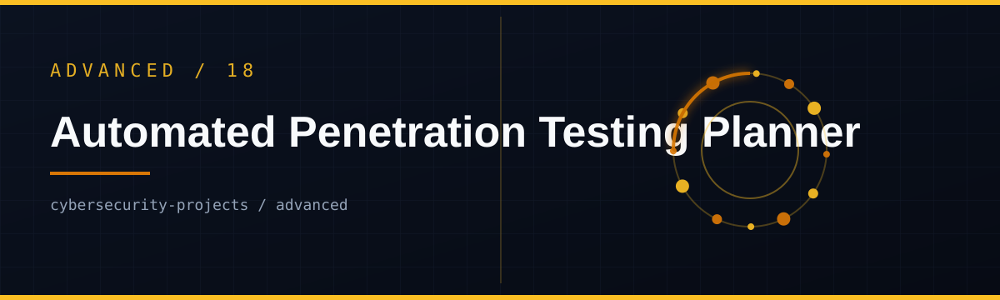 | Scope-aware lab checklists — executes nothing. |
| [Haskell Reverse Proxy](19-haskell-reverse-proxy/README.md) | 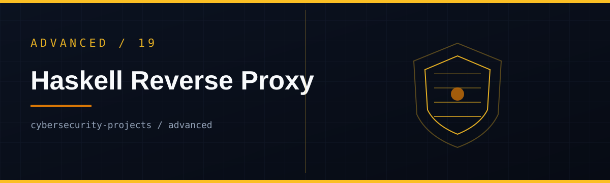 | First-match route evaluation without a server. |
| [Monitor the Situation Dashboard](20-monitor-the-situation-dashboard/README.md) | 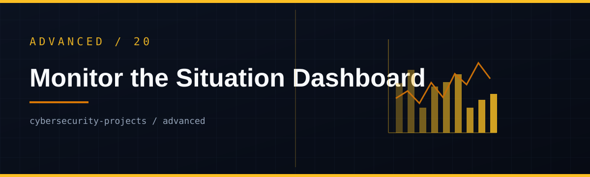 | Console aggregation of synthetic event feeds. |
| [Honeypot Network](21-honeypot-network/README.md) | 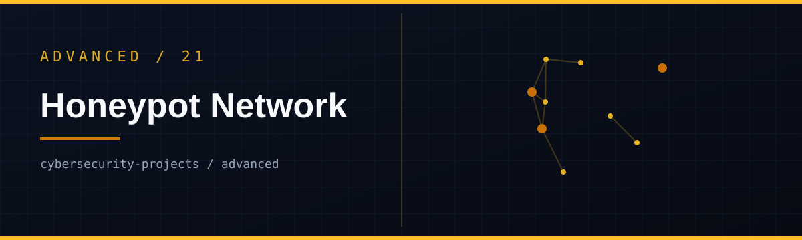 | Synthetic events and attacker-pattern analysis. |
| [Supply Chain Security Analyzer](22-supply-chain-security-analyzer/README.md) | 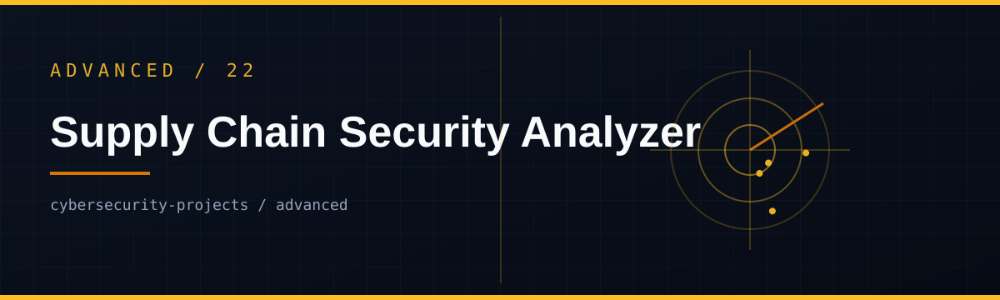 | SBOM provenance, integrity and license policies. |

---

[← Back to the full gallery](../README.md)

