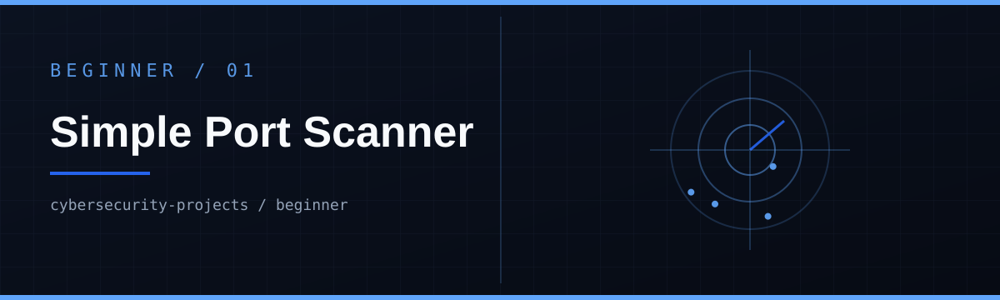
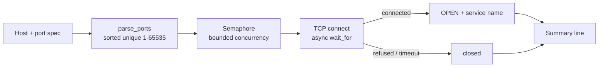

<div align="center">
  
</div>

<br />

<div align="center">

# 🚪 Simple Port Scanner


> **Open, or not open.** A bounded async connect scan that answers one question — on hosts you own.

</div>

---

## 🎯 What it does

It connects to a list of TCP ports and prints the ones that accept a connection, with a best-effort service name. A port spec can be a single port, a range, or a comma-separated list.

**Upstream specifies C++; this build uses Python `asyncio` because no C++ compiler is available on the host. Behaviour and learning goals are preserved.**

## 🧠 How it works



Only TCP connect scanning is implemented. No SYN scans, no OS fingerprinting, no raw sockets.

## 🚀 Quick start

```powershell
python port_scanner.py 127.0.0.1 -p 1-1024
python port_scanner.py localhost -p 22,80,443 -c 50 -t 0.5
```

**Safety:** Scan only hosts you own or have explicit written permission to test. The default target is not set; the host is always a required argument.

### Real output

A listener was opened on `127.0.0.1` on an ephemeral port, and one adjacent closed port was included for comparison (port numbers change per run):

```text
$ python -c "import socket; from port_scanner import main; s=socket.socket(socket.AF_INET,socket.SOCK_STREAM); s.bind(('127.0.0.1',0)); s.listen(5); port=s.getsockname()[1]; p=socket.socket(socket.AF_INET,socket.SOCK_STREAM); p.bind(('127.0.0.1',0)); closed=p.getsockname()[1]; p.close(); rc=main(['127.0.0.1','-p',f'{port},{closed}','-t','0.5','-c','4']); s.close(); print('exit code:', rc)"
52206/tcp open  unknown
scanned 2 ports; 1 open
exit code: 0
```

## 📂 Project structure

```text
01-simple-port-scanner/
├── assets/hero.svg             # generated visual identity
├── port_scanner.py             # parser, async scan, CLI
├── learn/README.md             # the concepts behind connect scanning
└── tests/test_port_scanner.py  # 8 deterministic tests
```

## 🔍 Why it matters

- **Concurrency has a ceiling.** A semaphore keeps a large port list from opening unbounded connections.
- **A timeout is an answer too.** Refused and timed-out connections are reported as closed rather than hanging.
- **Scope stays tight:** no raw packets, no fingerprinting, no implicit target.

## 🧪 Tests

```powershell
python -m unittest discover -s tests -v
```

8 tests covering port specs and invalid ranges, open and closed ports against a real listener, batch scanning, and frozen result records. The tests open a real listener on `127.0.0.1` on an ephemeral port — no external network is used.

## 📚 Learn more

Read [the concept notes](learn/README.md) for TCP connect semantics, port notation, and why rate limits matter.

---

<div align="center">
  <sub>Part of <b>cybersecurity-projects</b> · Beginner tier · Built from a synopsis, original implementation.</sub>
</div>
