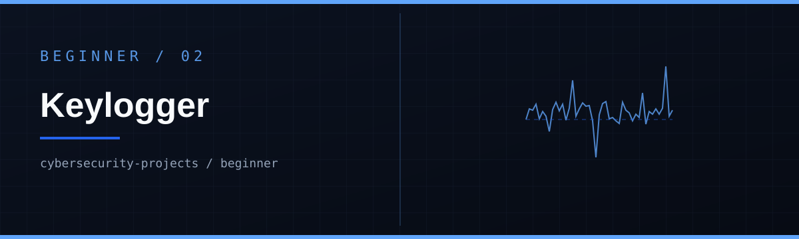
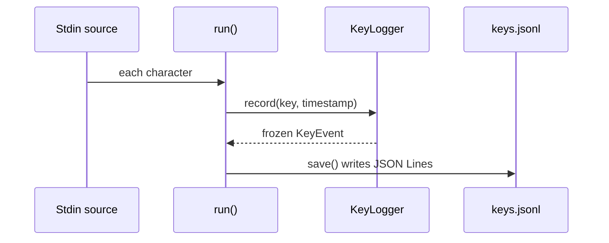

<div align="center">
  
</div>

<br />

<div align="center">

# ⌨️ Keylogger


> **Events, not surveillance.** A visible stdin recorder that teaches the shape of key logging without ever hiding.

</div>

---

## 🎯 What it does

A deliberately non-stealthy key-event recorder that demonstrates event handling, timestamps, and JSON Lines output. It records characters into memory, then saves them with `key` and `timestamp` fields.

### Safety boundary

- **No global keyboard hook.** The demo source reads stdin only.
- **No persistence, no hiding, no network, no exfiltration.**
- The CLI refuses to start without `--i-understand`.
- Use only on your own machine, with informed consent of anyone involved.

## 🧠 How it works



`run()` also accepts any iterable of strings, which is how the tests inject synthetic events without capturing real keystrokes.

## 🚀 Quick start

```powershell
python keylogger.py --i-understand -o keys.jsonl
```

Type normally, then press Ctrl+C. Output stays in the file you name.

### Real output

The public API was driven with a synthetic `iter('abc')` source under a temp directory; the CLI's refusal path was also run:

```text
$ python -c "import tempfile, pathlib; from keylogger import run; d=pathlib.Path(tempfile.mkdtemp()); p=d/'keys.jsonl'; n=run(iter('abc'), p); print('events written:', n); print(p.read_text(encoding='utf-8').strip())"
events written: 3
{"key": "a", "timestamp": 1795210430.3127923}
{"key": "b", "timestamp": 1795210430.312804}
{"key": "c", "timestamp": 1795210430.3128078}

$ python keylogger.py
refusing to start: pass --i-understand after reading the safety notes in README.md
```

## 📂 Project structure

```text
02-keylogger/
├── assets/hero.svg         # generated visual identity
├── keylogger.py            # event model, recorder, stdin source, CLI
├── learn/README.md         # the concepts behind event recording
└── tests/test_keylogger.py # 7 deterministic tests
```

## 🔍 Why it matters

- **A real global hook would make the tests non-deterministic** and turn the repository into dual-use tooling with no educational benefit. Separating the recorder from the event source keeps the concept intact while making it safe to run in CI.
- **Explicit consent is a gate, not a footnote** — the CLI will not start without confirmation.
- **Every event is visible** in the output file; nothing runs in the background.

## 🧪 Tests

```powershell
python -m unittest discover -s tests -v
```

7 tests, standard library only — covering recording and event freezing, the running-state and empty-key guards, JSON Lines output, clearing, injected event sources, and the CLI confirmation gate.

## 📚 Learn more

Read [the concept notes](learn/README.md) for event sources, timestamping, and why consent belongs in the design.

---

<div align="center">
  <sub>Part of <b>cybersecurity-projects</b> · Beginner tier · Built from a synopsis, original implementation.</sub>
</div>
