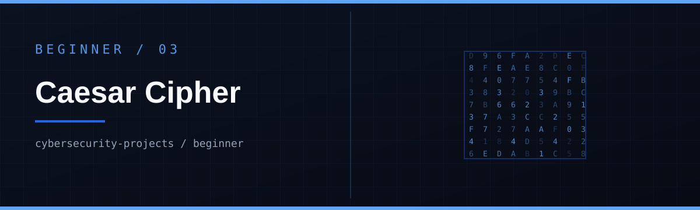
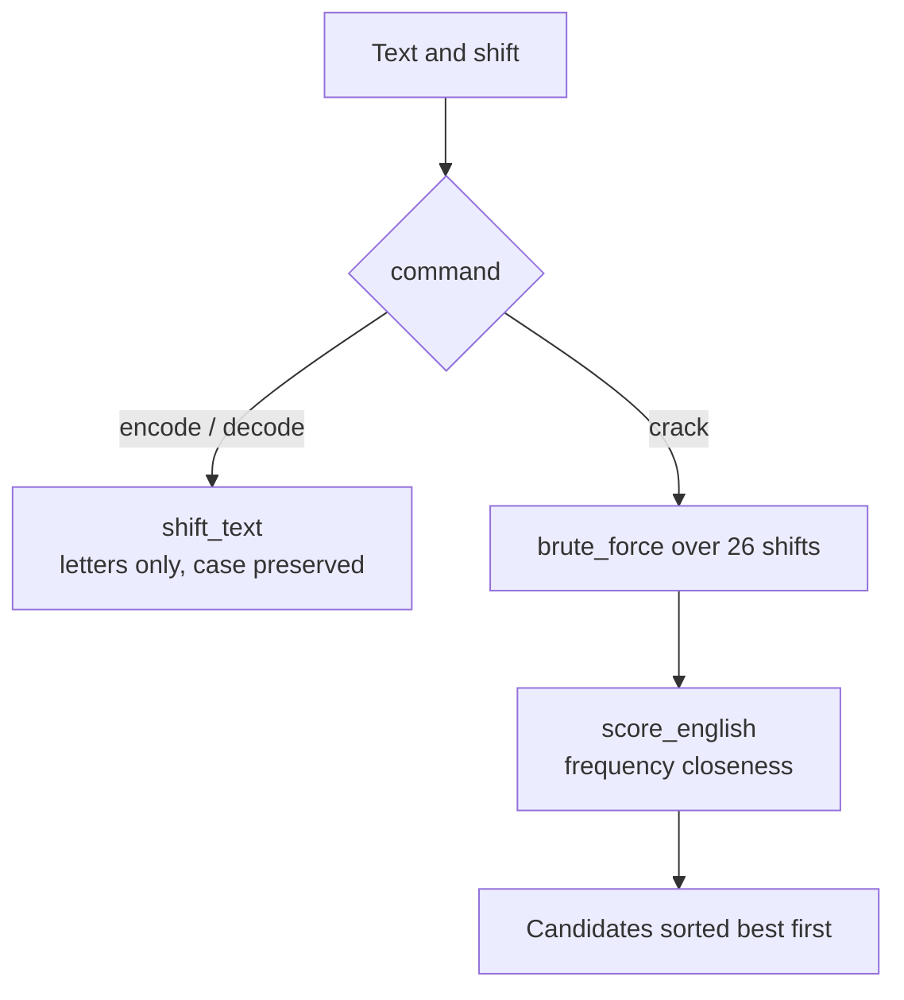

<div align="center">
  
</div>

<br />

<div align="center">

# 🔤 Caesar Cipher


> **Twenty-six tries is enough.** Encode, decode, then let letter frequency pick the likely winner.

</div>

---

## 🎯 What it does

A CLI encryption/decryption tool with brute-force and English-frequency scoring. Only alphabetic characters move; spaces, punctuation, digits, and letter case pass through unchanged.

## 🧠 How it works



Scoring divides the sum of approximate English letter frequencies by the number of letters — a heuristic, not a guarantee.

## 🚀 Quick start

```powershell
python caesar.py encode "Attack at dawn" -s 3
python caesar.py decode "Dwwdfn dw gdzq" -s 3
python caesar.py crack "Dwwdfn dw gdzq" -n 5
```

### Real output

```text
$ python caesar.py encode "Attack at dawn" -s 3
Dwwdfn dw gdzq

$ python caesar.py decode "Dwwdfn dw gdzq" -s 3
Attack at dawn

$ python caesar.py crack "Dwwdfn dw gdzq" -n 3
[25]  6.75  Exxego ex hear
[18]  6.45  Leelnv le olhy
[ 3]  6.42  Attack at dawn
```

Short ciphertexts can fool the scorer — the true shift is third here, not first. That is the point of seeing all candidates.

## 📂 Project structure

```text
03-caesar-cipher/
├── assets/hero.svg          # generated visual identity
├── caesar.py                # shifting, scoring, brute force, CLI
├── learn/README.md          # the concepts behind substitution ciphers
└── tests/test_caesar.py     # 12 deterministic tests
```

## 🔍 Why it matters

- **The key space is tiny.** 26 shifts means brute force is instant — this is a teaching cipher, not protection.
- **Preserving structure leaks information.** Word boundaries and punctuation survive, making recognition easy.
- **Scoring is evidence, not truth.** Showing ranked candidates keeps the human in the loop.

## 🧪 Tests

```powershell
python -m unittest discover -s tests -v
```

12 tests, standard library only — covering encoding and decoding, wraparound, case preservation, non-alpha passthrough, large shifts, round-trips, English scoring, brute-force ranking and count, and the CLI subcommands.

## 📚 Learn more

Read [the concept notes](learn/README.md) for modular arithmetic, substitution ciphers, and frequency analysis.

---

<div align="center">
  <sub>Part of <b>cybersecurity-projects</b> · Beginner tier · Built from a synopsis, original implementation.</sub>
</div>
