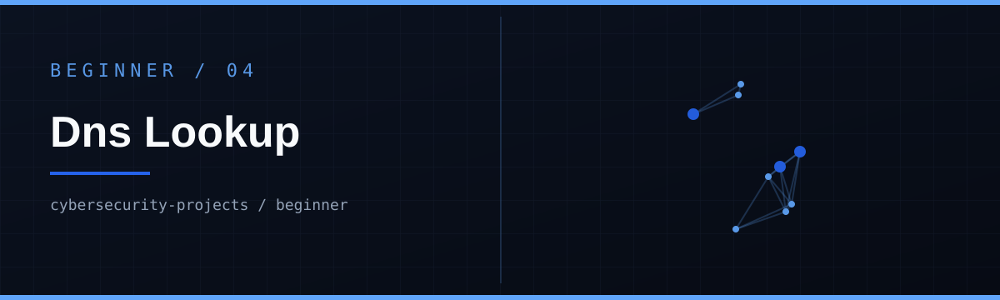
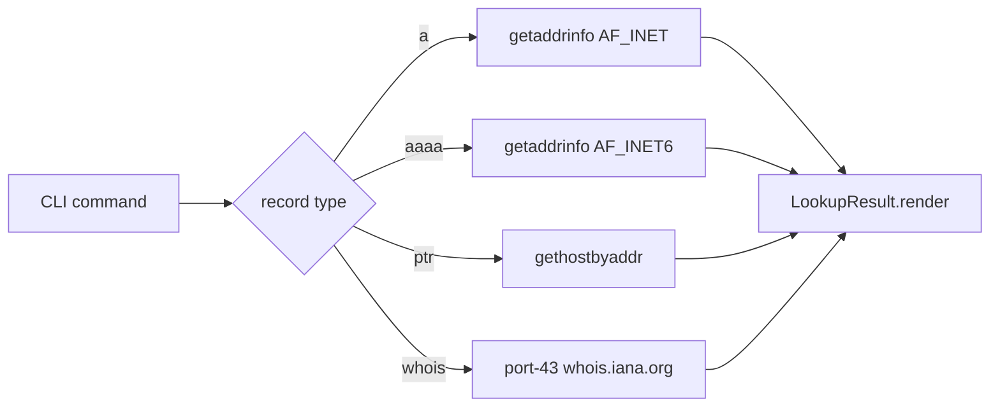

<div align="center">
  
</div>

<br />

<div align="center">

# 🌐 DNS Lookup


> **Name to number and back.** Forward, reverse, and IANA WHOIS — with the network kept behind the CLI.

</div>

---

## 🎯 What it does

Query A, AAAA, PTR, and basic IANA WHOIS records. Results are deduplicated where appropriate and rendered as a simple labelled block.

## 🧠 How it works



The resolver functions are injected into `DnsResolver`, so the core logic can be exercised with fakes. Network access only happens when the CLI is used.

## 🚀 Quick start

```powershell
python dns_lookup.py a example.com
python dns_lookup.py aaaa example.com
python dns_lookup.py ptr 8.8.8.8
python dns_lookup.py whois example.com
```

### Real output

Local, loopback-only queries (no external target):

```text
$ python dns_lookup.py a localhost
A localhost
  127.0.0.1

$ python dns_lookup.py aaaa localhost
AAAA localhost
  ::1

$ python dns_lookup.py ptr 127.0.0.1
PTR 127.0.0.1
  Melinaki
```

The PTR value is this machine's own local reverse name; on your host it will differ.

## 📂 Project structure

```text
04-dns-lookup/
├── assets/hero.svg           # generated visual identity
├── dns_lookup.py             # resolver wrapper, system lookups, CLI
├── learn/README.md           # the concepts behind DNS records
└── tests/test_dns_lookup.py  # 8 deterministic tests
```

## 🔍 Why it matters

- **Forward and reverse are different questions.** An A record maps a name to addresses; PTR maps an address back to a name.
- **WHOIS uses a direct port-43 connection to `whois.iana.org`, not a third-party API. Results are raw text and may be an IANA referral rather than the full registration record.**
- **Injection keeps tests honest:** deterministic results without depending on the network.

## 🧪 Tests

```powershell
python -m unittest discover -s tests -v
```

8 tests using injected resolver functions; only the CLI performs real network calls. They cover deduplication, IPv6, reverse lookup, WHOIS, empty rendering, resolver wiring, and the CLI `a` / `ptr` paths.

## 📚 Learn more

Read [the concept notes](learn/README.md) for record types, reverse DNS, and how WHOIS referrals work.

---

<div align="center">
  <sub>Part of <b>cybersecurity-projects</b> · Beginner tier · Built from a synopsis, original implementation.</sub>
</div>
