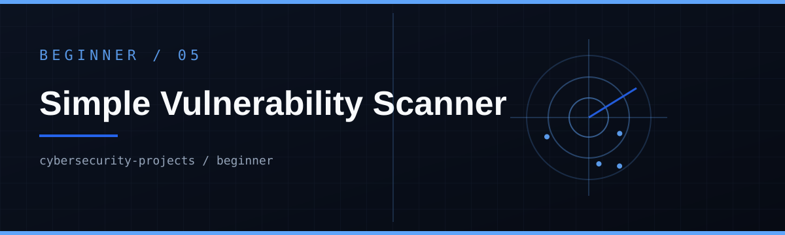
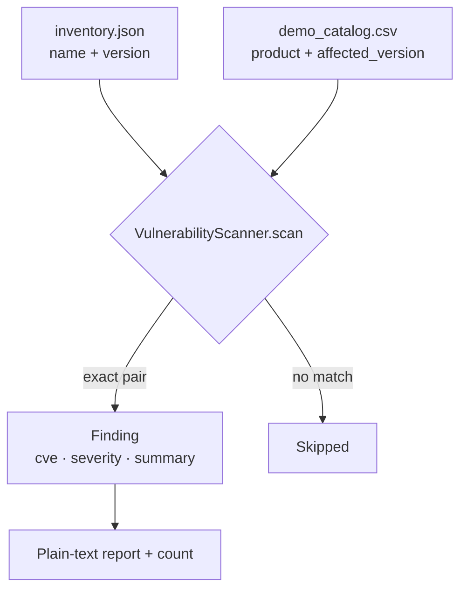

<div align="center">
  
</div>

<br />

<div align="center">

# 🩺 Simple Vulnerability Scanner


> **Match, don't guess.** A local inventory meets a local catalog; exact version pairs produce findings, never probes.

</div>

---

## 🎯 What it does

It matches a local software inventory against a local CVE catalog and prints one line per exact product/version match.

**Upstream specifies Go; this build uses Python. It matches a local software inventory against a local CVE catalog — no network calls.**

## 🧠 How it works



Product names are compared case-insensitively and trimmed; versions must match exactly as written.

## 🚀 Quick start

```powershell
python scanner.py inventory.json
python scanner.py inventory.json --catalog my_catalog.csv
```

Inventory format:

```json
[{"name": "demo-web", "version": "1.0.0"}]
```

Catalog CSV columns: `product, affected_version, cve, severity, summary`.

### Real output

An inventory fixture was written under the temp directory and scanned against the bundled catalog:

```text
$ python -c "import tempfile,pathlib,json; p=pathlib.Path(tempfile.gettempdir())/'demo_inventory.json'; p.write_text(json.dumps([{'name':'demo-web','version':'1.0.0'},{'name':'demo-web','version':'1.2.0'},{'name':'demo-lib','version':'2.1'},{'name':'demo-web','version':'9.9.9'}]), encoding='utf-8'); print(p)"
$env:TEMP\demo_inventory.json

$ python scanner.py $env:TEMP\demo_inventory.json
HIGH   CVE-DEMO-0001 demo-web 1.0.0 — Example remote code execution in demo-web 1.0.0
MEDIUM CVE-DEMO-0002 demo-web 1.2.0 — Example authentication bypass in demo-web 1.2.0
LOW    CVE-DEMO-0003 demo-lib 2.1 — Example information disclosure in demo-lib 2.1
3 finding(s)
```

The `demo-web 9.9.9` item produced no finding — matching is exact.

## 📂 Project structure

```text
05-simple-vulnerability-scanner/
├── assets/hero.svg          # generated visual identity
├── scanner.py               # catalog/inventory loaders, matcher, CLI
├── demo_catalog.csv         # fictional sample catalog
├── learn/README.md          # the concepts behind version matching
└── tests/test_scanner.py    # 8 deterministic tests
```

## 🔍 Why it matters

- **Inventory first.** You cannot triage what you have not listed.
- **Exact versions reduce noise** — but a catalog is only as current as its data.
- **The bundled `demo_catalog.csv` uses fictional `CVE-DEMO-*` identifiers — it is a format example, not real vulnerability data.** Supply a real catalog with `--catalog`.

## 🧪 Tests

```powershell
python -m unittest discover -s tests -v
```

8 tests covering catalog loading, matched and unmatched versions, case-insensitive names, whitespace trimming, inventory validation, the CLI, and the demo catalog's contents.

## 📚 Learn more

Read [the concept notes](learn/README.md) for inventory formats, version matching, and how to read a finding.

---

<div align="center">
  <sub>Part of <b>cybersecurity-projects</b> · Beginner tier · Built from a synopsis, original implementation.</sub>
</div>
