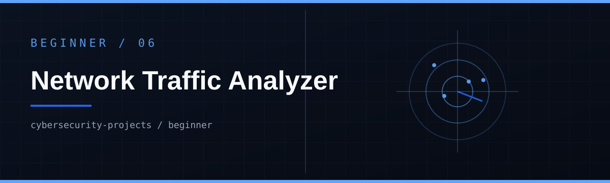
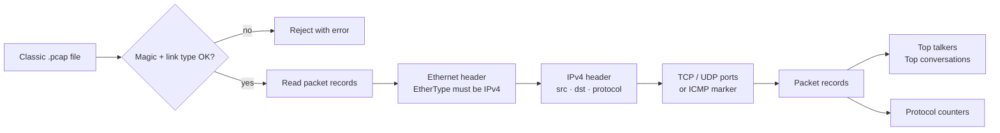

<div align="center">
  
</div>

<br />

<div align="center">

# 🔬 Network Traffic Analyzer


> **Packets become evidence.** Feed it a classic libpcap file and it tells you who talked, which protocols they used, and how often — with zero network access.

</div>

---

## 🎯 What it does

It reads a saved libpcap capture and walks every Ethernet frame, decoding IPv4 TCP, UDP, and ICMP headers. The result is a compact traffic report: protocol counts, the busiest source addresses, and the most repeated conversations.

Upstream provides C++ and Python variants; this is a pure-Python offline PCAP parser. No live capture, no admin rights, no dependencies.

## 🧠 How it works



The parser uses `struct` for byte-level decoding and `collections.Counter` for aggregation. It accepts little-endian libpcap files with Ethernet link type only.

## 🚀 Quick start

```powershell
python pcap_analyzer.py capture.pcap
python pcap_analyzer.py capture.pcap --json --top 10
```

Use `--json` for machine-readable output and `--top` to control how many talkers and conversations are listed.

### Real output

```text
$ python pcap_analyzer.py demo_capture.pcap --top 5
packets: 4
protocols:
  ICMP: 1
  TCP: 2
  UDP: 1
top talkers:
  10.0.0.1: 3
  10.0.0.3: 1
top conversations:
  10.0.0.1:12345 -> 10.0.0.2:443: 2
  10.0.0.1:53000 -> 8.8.8.8:53: 1
  10.0.0.3:- -> 10.0.0.2:-: 1
```

## 📂 Project structure

```text
06-network-traffic-analyzer/
├── assets/hero.svg             # generated visual identity
├── pcap_analyzer.py            # byte parser + summarizer + CLI
├── learn/README.md             # the concepts behind offline capture analysis
└── tests/test_pcap_analyzer.py # 6 deterministic tests
```

## 🔍 Why it matters

- **Offline by design.** Analysis happens on a file you already own — nothing is captured, and nothing leaves the machine.
- **Metadata is enough.** Even without payload inspection, addresses, ports, and protocol mix reveal the shape of a conversation.
- **Known limits are a feature.** No reassembly, no application-layer parsing, no IPv6, no pcapng. Those are deliberate omissions to keep the parser readable.

## 🧪 Tests

```powershell
python -m unittest discover -s tests -v
```

6 tests. Tests synthesize pcap bytes in memory — no capture file or network access needed. They cover TCP/UDP decoding, summaries, malformed file rejection, and both CLI output modes.

## 📚 Learn more

Read [the concept notes](learn/README.md) for libpcap structure, protocol identification, and why header-only analysis is a safe starting point.

---

<div align="center">
  <sub>Part of <b>cybersecurity-projects</b> · Beginner tier · Built from a synopsis, original implementation.</sub>
</div>
