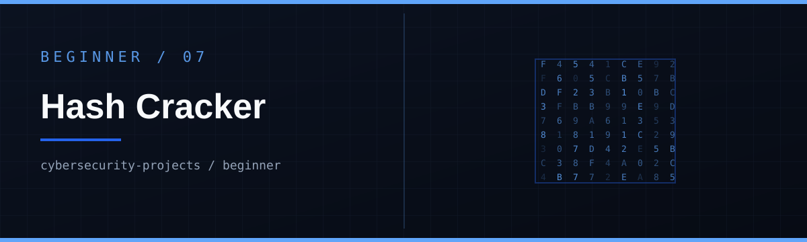
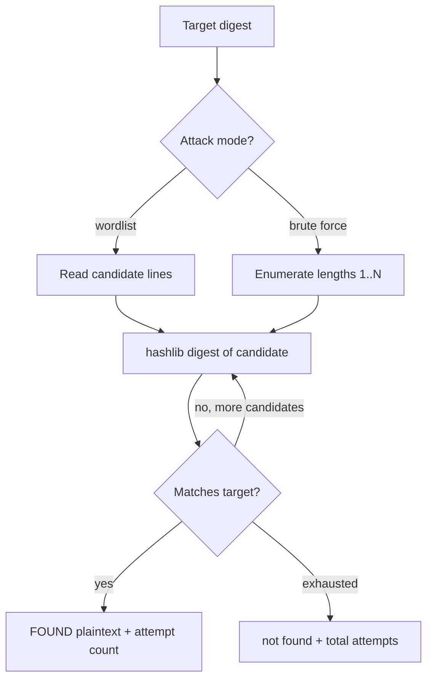

<div align="center">
  
</div>

<br />

<div align="center">

# 🔓 Hash Cracker


> **Know the plaintext, prove the digest.** Two local attack modes — dictionary and deliberately bounded brute force — for hashes you generated yourself.

</div>

---

## 🎯 What it does

It tries candidate strings against a digest and reports the first match, along with how many attempts it took. Choose from MD5, SHA-1, SHA-256, or SHA-512; supply a wordlist or a character set plus a maximum length.

Educational cracking of unsalted digests you generated yourself. Dictionary and bounded brute-force modes.

## 🧠 How it works



Candidate hashing happens locally with `hashlib`. The brute-force search grows as `len(charset) ** max_length`, which is why the maximum-length bound is mandatory.

## 🚀 Quick start

```powershell
python hash_cracker.py 5e884898da28047151d0e56f8dc6292773603d0d6aabbdd62a11ef721d1542d8 -w words.txt
python hash_cracker.py <sha256> -b 4 --charset abc123
```

Use `-a md5` (or `sha1`, `sha512`) to switch algorithms. A match exits with code `0`; a miss exits with `1`.

### Real output

```text
$ python hash_cracker.py 1ec1c26b... -w words.txt
FOUND s3cret (sha256, 3 attempts)

$ python hash_cracker.py ca978112... -b 1 --charset a
FOUND a (sha256, 1 attempts)
```

## 📂 Project structure

```text
07-hash-cracker/
├── assets/hero.svg            # generated visual identity
├── hash_cracker.py            # digest helpers + attacks + CLI
├── learn/README.md            # the concepts behind one-way hashes
└── tests/test_hash_cracker.py # 10 deterministic tests
```

## 🔍 Why it matters

- **Failure is instructive.** Watching attempt counts grow makes the cost of password complexity concrete.
- **Unsalted is the point.** These digests are reproducible teaching artifacts, not stolen credential material.
- **Bounds keep it honest.** Brute force is explicitly bounded by maximum length.

Use only on hashes you created in a lab. No rainbow tables, no network requests, no real credential stores, no bcrypt/Argon2 attacks.

## 🧪 Tests

```powershell
python -m unittest discover -s tests -v
```

10 tests, standard library only — covering all four algorithms, uppercase targets, dictionary hits and misses, brute-force bounds, invalid input, and the CLI.

## 📚 Learn more

Read [the concept notes](learn/README.md) for how salted, slow hashes differ from the fast general-purpose digests used here.

---

<div align="center">
  <sub>Part of <b>cybersecurity-projects</b> · Beginner tier · Built from a synopsis, original implementation.</sub>
</div>
