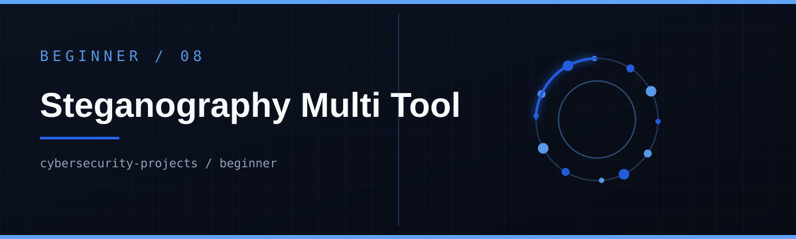
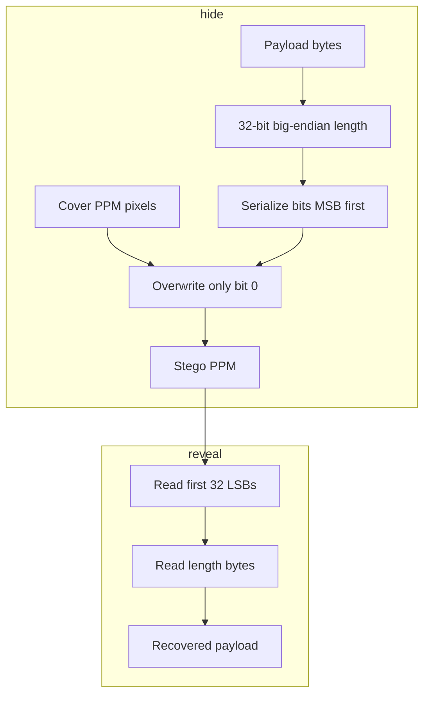

<div align="center">
  
</div>

<br />

<div align="center">

# 🖼️ Steganography Multi-Tool


> **Secrets in the noise.** Flip the least significant bits of an uncompressed image and the picture looks identical — until you run the decoder.

</div>

---

## 🎯 What it does

It hides a raw byte payload in the least significant bit (LSB) of every RGB channel in a P6 PPM image, then extracts it again. A 32-bit big-endian length prefix makes decoding unambiguous.

Upstream specifies Go; this build uses Python. Hides text in the least significant bit (LSB) of uncompressed P6 PPM images.

## 🧠 How it works



Only the LSB of each channel changes, so visual impact is negligible. Capacity is `width * height * 3 - 32` bytes.

Format details:

- 32-bit big-endian length prefix, then raw payload bytes.
- One payload bit per RGB channel byte, MSB first.
- Only the LSB of each channel changes, so visual impact is negligible.

## 🚀 Quick start

```powershell
python stego.py hide cover.ppm secret.txt -o stego.ppm
python stego.py reveal stego.ppm
python stego.py reveal stego.ppm -o recovered.txt
```

### Real output

```text
$ python stego.py hide cover.ppm secret.txt -o stego.ppm
hid 11 bytes in stego.ppm

$ python stego.py reveal stego.ppm
hidden text
```

## 📂 Project structure

```text
08-steganography-multi-tool/
├── assets/hero.svg        # generated visual identity
├── stego.py               # PPM parser + LSB codec + CLI
├── learn/README.md        # the concepts behind LSB embedding
└── tests/test_stego.py    # 9 deterministic tests
```

## 🔍 Why it matters

- **Parsing beats guessing.** P6 PPM is simple enough to parse exactly, which keeps the implementation auditable and the tests deterministic.
- **Round trips must be perfect.** The tests assert every non-LSB bit is untouched — that is the whole trick.
- **Scope is explicit.** Supports 8-bit binary PPM (P6) only. No PNG/JPEG codecs, no compression, no encryption. For real images, convert to PPM first. Do not use steganography to exfiltrate data from systems you do not own.

## 🧪 Tests

```powershell
python -m unittest discover -s tests -v
```

9 tests, standard library only. Tests generate PPM images in memory and cover round trips, bit preservation, capacity, malformed headers, oversized and empty payloads, and the CLI.

## 📚 Learn more

Read [the concept notes](learn/README.md) for why uncompressed formats make clean teaching targets and how LSB capacity is calculated.

---

<div align="center">
  <sub>Part of <b>cybersecurity-projects</b> · Beginner tier · Built from a synopsis, original implementation.</sub>
</div>
