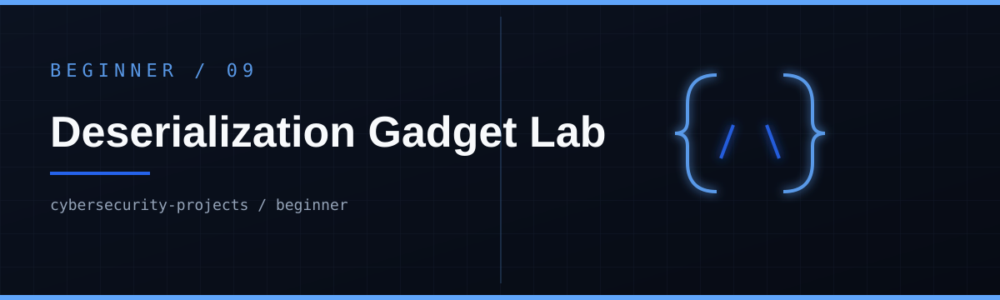
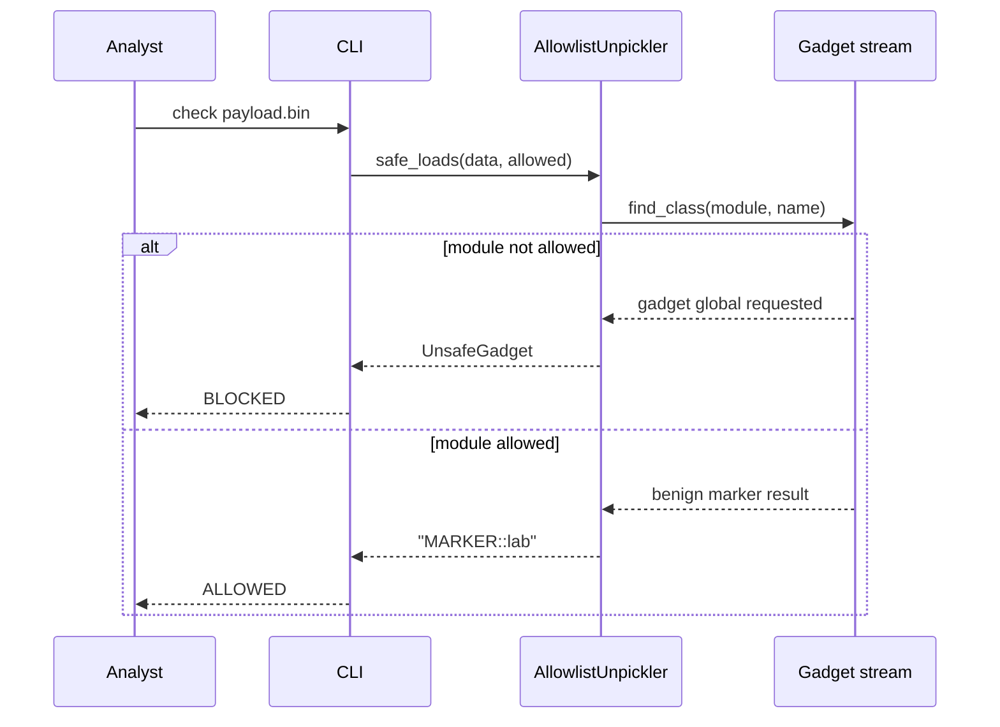

<div align="center">
  
</div>

<br />

<div align="center">

# 🧪 Deserialization Gadget Lab


> **Unpickling is execution.** Watch a harmless gadget fire during load — then see an allowlisted unpickler slam the door.

</div>

---

## 🎯 What it does

It demonstrates unsafe deserialization and its defence side by side. A lab payload carries a `__reduce__` instruction that calls a harmless in-repo function; `unsafe_loads` executes it, while `safe_loads` refuses any global outside an explicit module allowlist.

Upstream specifies Ruby; this build uses Python `pickle` to show the same class of risk: deserialization can execute code embedded in a stream.

## 🧠 How it works



The payload calls only `_benign_marker`, a harmless in-repo function. It performs no system commands and no network access.

## 🚀 Quick start

```powershell
python gadget_lab.py payload > lab.bin
python gadget_lab.py check lab.bin
python gadget_lab.py check lab.bin --allow-main
```

The `payload` subcommand writes raw pickle bytes to stdout. `check` loads with an empty allowlist unless `--allow-main` is supplied.

### Real output

```text
$ python gadget_lab.py check lab_payload.bin
BLOCKED: blocked global: gadget_lab._benign_marker

$ python gadget_lab.py check lab_payload.bin --allow-main
BLOCKED: blocked global: gadget_lab._benign_marker

$ python gadget_lab.py check plain_data.bin
ALLOWED: {'a': [1, 2, 3]}
```

## 📂 Project structure

```text
09-deserialization-gadget-lab/
├── assets/hero.svg             # generated visual identity
├── gadget_lab.py               # gadget, unpicklers, and CLI
├── learn/README.md             # the concepts behind unsafe deserialization
└── tests/test_gadget_lab.py    # 5 deterministic tests
```

## 🔍 Why it matters

- **Loading is not neutral.** A deserializer can invoke callables embedded in the stream before you ever inspect the result.
- **Allowlists flip the default.** `find_class` rejects unknown module/name pairs instead of trusting the payload.
- **Plain data still works.** The allowlist has no effect on dictionaries and lists, which is exactly what a data-only format should look like.

This is a teaching lab. The gadget is deliberately harmless and the CLI blocks unknown globals by default. Do not point `unsafe_loads` at data from outside this repository. The real-world lesson is to avoid pickle for untrusted input and use a data-only format such as JSON.

## 🧪 Tests

```powershell
python -m unittest discover -s tests -v
```

5 tests covering plain-data round trips, harmless gadget execution, blocking with an empty allowlist, explicit module approval, and the CLI block path.

## 📚 Learn more

Read [the concept notes](learn/README.md) for why `__reduce__` is dangerous and how data-only formats remove the attack surface entirely.

---

<div align="center">
  <sub>Part of <b>cybersecurity-projects</b> · Beginner tier · Built from a synopsis, original implementation.</sub>
</div>
