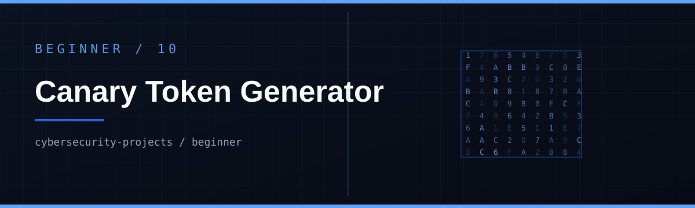
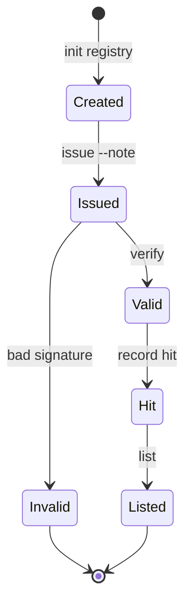

<div align="center">
  
</div>

<br />

<div align="center">

# 🪤 Canary Token Generator


> **A marker that should never be touched.** Issue signed lab tokens, store only their digests, and watch for the moment one unexpectedly shows up.

</div>

---

## 🎯 What it does

It maintains a local JSON registry of canary tokens. Each token is a random 18-byte payload with an HMAC-SHA256 signature; issuing, verifying, and recording simulated hits are all CLI commands.

Upstream specifies Go/React; this build is a Python CLI with a local JSON registry.

A canary token is a unique marker that should never be touched in normal use. If it appears in a log or request, that is a signal worth investigating.

## 🧠 How it works



Design details:

- Random 18-byte payload with an HMAC-SHA256 signature.
- Registry stores the SHA-256 digest of the full token, not the token.
- Hits are appended with timestamp, source, and user agent.

## 🚀 Quick start

```powershell
python canary.py tokens.json init
python canary.py tokens.json issue --note "lab document"
python canary.py tokens.json verify <token>
python canary.py tokens.json hit <token> --source 192.0.2.10
python canary.py tokens.json list
```

### Real output

```text
$ python canary.py demo_registry.json init
created demo_registry.json

$ python canary.py demo_registry.json issue --note "lab document"
ct1_6vOtYKsMsACAfNw0nu2Z6hcx.6a4b5177650554ac9184411e1340be64

$ python canary.py demo_registry.json verify ct1_6vOtYKsMsACAfNw0nu2Z6hcx.6a4b5177650554ac9184411e1340be64
valid

$ python canary.py demo_registry.json hit ct1_6vOtYKsMsACAfNw0nu2Z6hcx.6a4b5177650554ac9184411e1340be64 --source 192.0.2.10
recorded hit for 9ea42feee594

$ python canary.py demo_registry.json list
9ea42feee594  hits=1  lab document
```

## 📂 Project structure

```text
10-canary-token-generator/
├── assets/hero.svg         # generated visual identity
├── canary.py               # registry model + token crypto + CLI
├── learn/README.md         # the concepts behind tripwire markers
└── tests/test_canary.py    # 7 deterministic tests
```

## 🔍 Why it matters

- **Digest-only storage.** The registry cannot leak a working token because it never keeps one.
- **Signature before lookup.** `verify` checks the HMAC with a constant-time comparison before consulting the registry.
- **Low-noise signal.** A hit on a marker with no legitimate purpose is an unambiguous event.

Tokens are local lab markers only. This tool does not create files, beacons, or network callbacks. Never use canary tokens to track people without authorisation.

## 🧪 Tests

```powershell
python -m unittest discover -s tests -v
```

7 tests, standard library only — covering issue/verify, digest-only storage, tampered and malformed tokens, hit recording, unknown hits, and the CLI flow.

## 📚 Learn more

Read [the concept notes](learn/README.md) for how signed markers differ from tracking technologies and why authorisation matters.

---

<div align="center">
  <sub>Part of <b>cybersecurity-projects</b> · Beginner tier · Built from a synopsis, original implementation.</sub>
</div>
