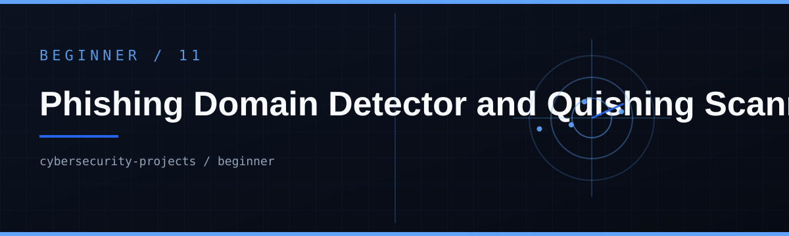
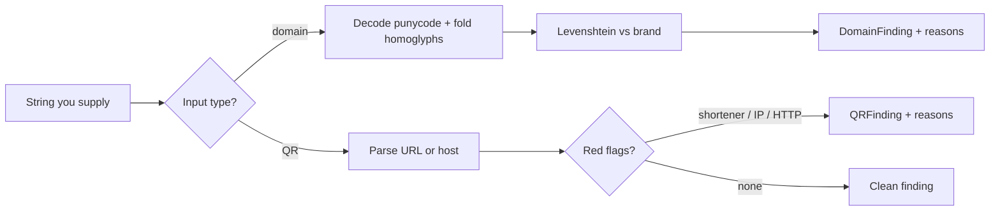

<div align="center">
  
</div>

<br />

<div align="center">

# 🎣 Phishing Domain Detector & Quishing Scanner


> **Spot the impersonation, never create it.** A defensive scorer for lookalike domains and QR-payload red flags — classification only, no lure generation.

</div>

---

## 🎯 What it does

It scores a domain name or QR payload for impersonation indicators and prints the evidence as JSON. Domain checks normalize Unicode homoglyphs and punycode, then compare the label against configured brands; QR checks flag shorteners, raw IPs, plain HTTP, and credential-themed paths.

Defensive-only reimplementation of the synopsis. The upstream goal of *generating* phishing domains is intentionally replaced with detection: this tool scores domains and QR payloads for lookalike indicators.

## 🧠 How it works



Signals it watches for:

- Unicode homoglyphs, punycode, and hyphen insertion (normalization changes the name).
- Edit distance ≤ 2 from a configured brand.
- Brand name embedded in a longer label.
- QR payloads using shorteners, punycode, raw IPs, plain HTTP, or credential-themed paths.

## 🚀 Quick start

```powershell
python detector.py domain examp1e.com
python detector.py domain exаmple.com --brand acme
python detector.py qr "https://bit.ly/abc"
```

Use `--brand` more than once to check against multiple brands. A domain finding is flagged at score ≥ 3; a QR finding at score ≥ 2.

### Real output

```text
$ python detector.py domain examp1e.com
{
  "domain": "examp1e.com",
  "normalized": "examp1e.com",
  "score": 3,
  "reasons": [
    "near-match to brand 'example' (edit distance 1)"
  ]
}

$ python detector.py qr "https://bit.ly/abc"
{
  "payload": "https://bit.ly/abc",
  "score": 2,
  "reasons": [
    "URL shortener hides the final destination"
  ]
}

$ python detector.py domain example.com
{
  "domain": "example.com",
  "normalized": "example.com",
  "score": 0,
  "reasons": []
}
```

## 📂 Project structure

```text
11-phishing-domain-detector-and-quishing-scanner/
├── assets/hero.svg         # generated visual identity
├── detector.py             # normalization, heuristics, and CLI
├── learn/README.md         # the concepts behind lookalike detection
└── tests/test_detector.py  # 9 deterministic tests
```

## 🔍 Why it matters

- **Normalization exposes tricks.** A name that changes when Unicode is folded is already a strong signal.
- **Reasons beat verdicts.** Every score comes with the specific indicator, so an analyst can judge false positives.
- **Defensive substitution.** No lookalike domains, QR codes, or lure content are generated. The tool only classifies strings you supply. Detection is heuristic: a low score is not proof of safety.

## 🧪 Tests

```powershell
python -m unittest discover -s tests -v
```

9 tests, standard library only — covering clean domains, homoglyphs, typos, hyphens, custom brands, QR shorteners, raw-IP login URLs, clean HTTPS payloads, and the CLI.

## 📚 Learn more

Read [the concept notes](learn/README.md) for homoglyph attacks, edit distance, and why heuristic scoring is only one layer of defence.

---

<div align="center">
  <sub>Part of <b>cybersecurity-projects</b> · Beginner tier · Built from a synopsis, original implementation.</sub>
</div>
