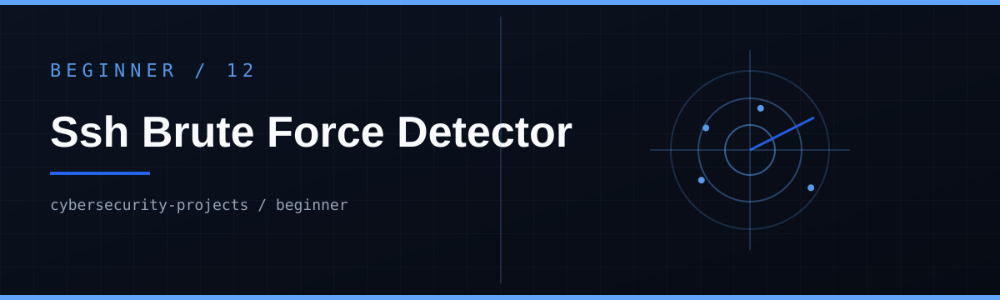
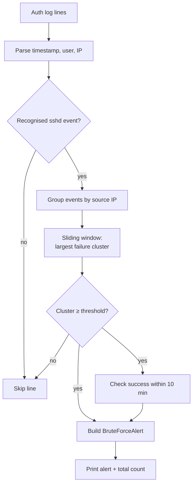

<div align="center">
  
</div>

<br />

<div align="center">

# 🚨 SSH Brute Force Detector


> **The log already knows.** Repeated failures cluster in time — and a success right after them is the detail that turns noise into an alert.

</div>

---

## 🎯 What it does

It reads syslog-style sshd lines, groups authentication events by source IP, and finds the largest cluster of failures inside a sliding time window. When that cluster reaches the threshold, it emits an alert and notes whether a successful login followed within ten minutes.

Offline detector for repeated `Failed password` events followed by a possible compromise.

## 🧠 How it works



Logic summary:

- Parse standard syslog-style sshd lines.
- Group failures by source IP.
- Find the largest cluster inside the sliding time window.
- Alert when the cluster reaches the threshold and note a success within 10 minutes.

## 🚀 Quick start

```powershell
python detector.py auth.log --threshold 5 --window 300
```

`--window` is measured in seconds. The parser assumes a year for the syslog timestamp; log lines are synthetic.

### Real output

```text
$ python detector.py lab_auth.log --threshold 5 --window 300
192.0.2.10: 6 failures / 300s, 1 user(s) then SUCCESS
1 alert(s)
```

## 📂 Project structure

```text
12-ssh-brute-force-detector/
├── assets/hero.svg          # generated visual identity
├── detector.py              # log parser + cluster detector + CLI
├── learn/README.md          # the concepts behind brute-force signals
└── tests/test_detector.py   # 8 deterministic tests
```

## 🔍 Why it matters

- **Clusters, not totals.** Six failures spread over an hour are very different from six in five minutes.
- **Success changes the stakes.** A `then SUCCESS` suffix is the strongest signal in the report.
- **Zero side effects.** This is a defensive log parser. It does not attempt logins, open sockets, or modify system state.

## 🧪 Tests

```powershell
python -m unittest discover -s tests -v
```

8 tests. Log lines are synthetic; no live auth log is read. Coverage includes fail/success parsing, `invalid user` lines, unrelated-line rejection, threshold and window behaviour, post-attack success, and the CLI.

## 📚 Learn more

Read [the concept notes](learn/README.md) for syslog patterns, sliding windows, and why correlated signals beat raw counters.

---

<div align="center">
  <sub>Part of <b>cybersecurity-projects</b> · Beginner tier · Built from a synopsis, original implementation.</sub>
</div>
