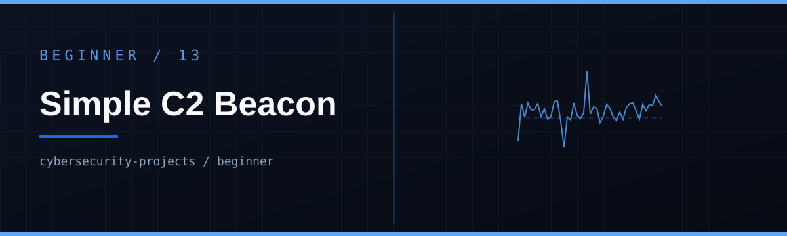
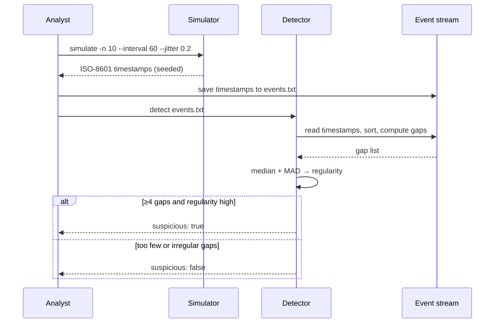

<div align="center">
  
</div>

<br />

<div align="center">

# 📡 Simple C2 Beacon


> **Machine rhythm gives it away.** No payloads to inspect — just a sequence of timestamps and a score for how suspiciously regular they are.

</div>

---

## 🎯 What it does

It generates synthetic check-in times with bounded jitter, then analyses a list of timestamps for the steady cadence that beacons tend to produce. The detector uses median absolute deviation to separate a stable interval from irregular human traffic.

The upstream beacon is reimplemented as a timing simulator and detector. No sockets, callbacks, or host control are present.

## 🧠 How it works



Detection uses the median absolute deviation. A stable interval with low variation is scored as suspicious when there are at least five gaps.

## 🚀 Quick start

```powershell
python beacon_lab.py simulate -n 10 --interval 60 --jitter 0.2
python beacon_lab.py detect events.txt
```

`events.txt` contains one ISO-8601 timestamp per line. Add `--seed` for reproducible simulations and `--tolerance` to tune the regularity threshold.

### Real output

```text
$ python beacon_lab.py simulate -n 6 --interval 60 --jitter 0.02 --seed 3
[
  "2026-11-20T00:00:00+00:00",
  "2026-11-20T00:00:59.371115+00:00",
  "2026-11-20T00:01:59.477265+00:00",
  "2026-11-20T00:02:59.165157+00:00",
  "2026-11-20T00:03:59.414565+00:00",
  "2026-11-20T00:04:59.716294+00:00"
]

$ python beacon_lab.py detect events.txt
{
  "events": 6,
  "interval_seconds": 60.10615,
  "regularity": 0.9967461066795993,
  "suspicious": true
}
```

## 📂 Project structure

```text
13-simple-c2-beacon/
├── assets/hero.svg           # generated visual identity
├── beacon_lab.py             # timing model + MAD detector + CLI
├── learn/README.md           # the concepts behind beacon periodicity
└── tests/test_beacon_lab.py  # 7 deterministic tests
```

## 🔍 Why it matters

- **Timing is a signal.** Regular intervals survive even when the content of a communication is unavailable.
- **MAD resists outliers.** A single delayed check-in does not destroy the score the way a mean-based measure would.
- **Safe by construction.** All events are synthetic, and there is no network component to misconfigure.

## 🧪 Tests

```powershell
python -m unittest discover -s tests -v
```

7 tests, standard library only. All events are synthetic. Coverage includes ordering, bounded jitter, invalid parameters, regular-beacon detection, random-event rejection, too-few-events handling, and both CLI commands.

## 📚 Learn more

Read [the concept notes](learn/README.md) for jitter, periodicity, and why median-based statistics are robust for timing analysis.

---

<div align="center">
  <sub>Part of <b>cybersecurity-projects</b> · Beginner tier · Built from a synopsis, original implementation.</sub>
</div>
