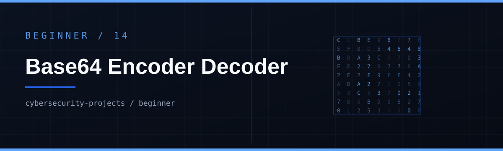
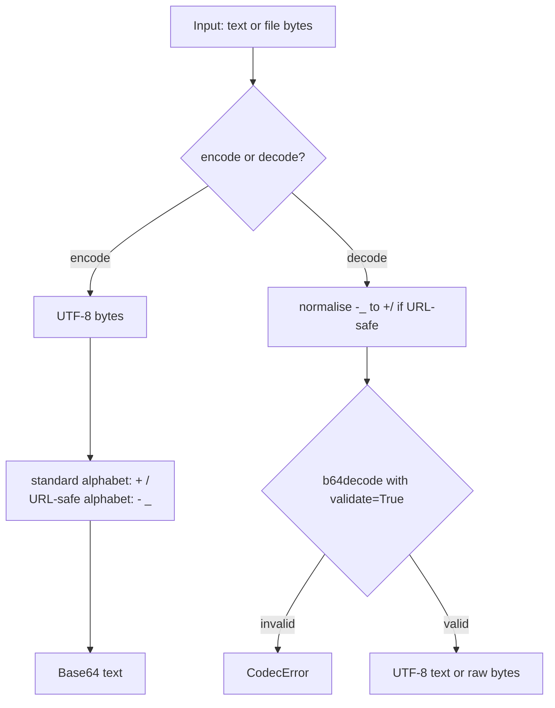

<div align="center">
  
</div>

<br />

<div align="center">

# 🔤 Base64 Encoder / Decoder


> **Encoding is not encryption.** Move bytes safely through text-only channels — and reject malformed input instead of silently guessing.

</div>

---

## 🎯 What it does

A strict base64 codec for text and files, with both the standard and URL-safe alphabets. Text helpers return an `Encoded(value, urlsafe)` record; file helpers read and write raw bytes. Decoding uses `validate=True`, so stray characters are rejected instead of silently ignored — bad alphabet characters or non-UTF-8 output raise `CodecError` and the CLI reports `error: invalid base64 or UTF-8 input`.

## 🧠 How it works



The two alphabets are normalised into one code path before strict validation. Padding stays intact, URL-safe values need no escaping in URLs, and binary round-trips are byte-for-byte exact.

## 🚀 Quick start

```powershell
python base64_tool.py encode "hello world"
python base64_tool.py decode "aGVsbG8gd29ybGQ="
python base64_tool.py --urlsafe encode "café ☕"
python base64_tool.py encode --file input.bin
python base64_tool.py decode --file-in encoded.txt --file-out output.bin
```

The `--file` / `--file-in` variants work on arbitrary binary data; `decode --file-out` prints the number of bytes written.

### Real output

```text
$ python base64_tool.py encode "hello world"
aGVsbG8gd29ybGQ=

$ python base64_tool.py --urlsafe encode "café ☕"
Y2Fmw6kg4piV

$ python base64_tool.py decode "aGVsbG8gd29ybGQ="
hello world

$ python base64_tool.py decode "not!base64"
error: invalid base64 or UTF-8 input
```

## 📂 Project structure

```text
14-base64-encoder-decoder/
├── assets/hero.svg              # generated visual identity
├── base64_tool.py               # codec functions + argparse CLI
├── learn/README.md              # alphabets, padding, why validate
└── tests/test_base64_tool.py    # 6 deterministic tests
```

## 🔍 Why it matters

- **Base64 is transport, not secrecy.** Anything encoded this way is trivially reversible by anyone who sees it.
- **Strict decoding is a boundary control.** Python's permissive default decoder skips junk characters; `validate=True` makes corrupted or crafted input fail loudly.
- **URL-safe mode prevents silent breakage** when encoded bytes end up in paths, query strings, or tokens.

## 🧪 Tests

```powershell
python -m unittest discover -s tests -v
```

6 tests: text round-trip, Unicode, URL-safe binary round-trip, invalid-input rejection, non-UTF-8 rejection, and CLI dispatch.

## 📚 Learn more

Read [the concept notes](learn/README.md) for the 3-to-4 byte mapping, padding rules, the standard vs URL-safe alphabets, and why strict validation matters at trust boundaries.

---

<div align="center">
  <sub>Part of <b>cybersecurity-projects</b> · Beginner tier · Built from a synopsis, original implementation.</sub>
</div>
