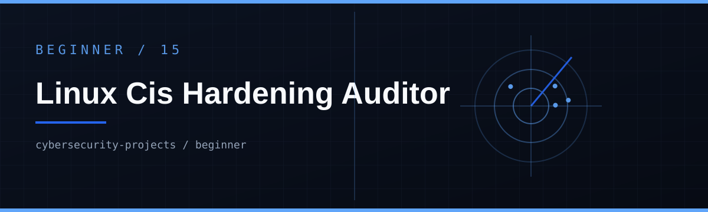
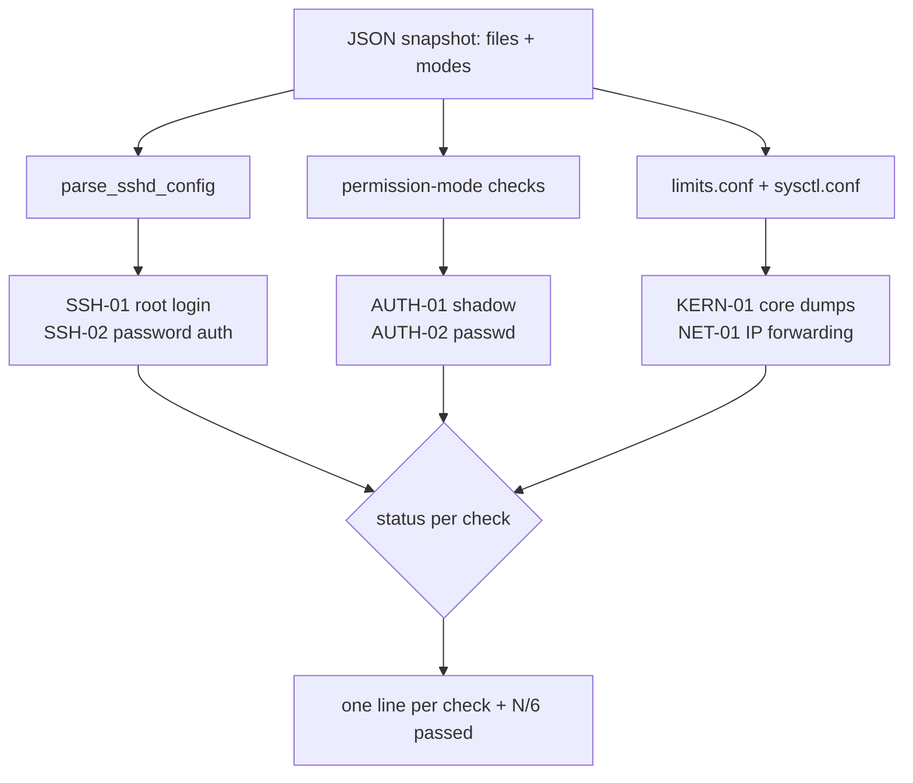

<div align="center">
  
</div>

<br />

<div align="center">

# 🛡️ Linux CIS Hardening Auditor


> **A baseline you can actually measure.** Six CIS-inspired checks against a file snapshot — read-only, deterministic, and honest about what it could not see.

</div>

---

## 🎯 What it does

Upstream specifies Bash; this build is Python. It audits a JSON snapshot read-only. The snapshot supplies file contents and permission modes, and the auditor emits one `Check` per control with a `pass`, `warn`, or `fail` status plus supporting detail. It checks SSH root login and password authentication, `/etc/shadow` and `/etc/passwd` permissions, the core dump limit, and IPv4 forwarding.

The auditor never writes to the snapshot or to a live system.

## 🧠 How it works



`pass` means the setting is correct, `fail` means it is present and wrong, and `warn` means the data was missing or the setting is risky but not conclusive — so "not measured" is never silently reported as "bad".

## 🚀 Quick start

Create a snapshot (a local JSON file, fixture kept under `$env:TEMP`):

```json
{
  "files": {
    "/etc/ssh/sshd_config": "PermitRootLogin no\nPasswordAuthentication no\n",
    "/etc/security/limits.conf": "* hard core 0\n",
    "/etc/sysctl.conf": "net.ipv4.ip_forward=0\n"
  },
  "modes": {"/etc/shadow": 0, "/etc/passwd": 420}
}
```

Mode values are decimal integers: `420` is `0o644`.

```powershell
python cis_audit.py snapshot.json
```

### Real output

```text
$ python cis_audit.py snapshot.json
[PASS] SSH-01 Root login disabled: PermitRootLogin=no
[PASS] SSH-02 Password authentication disabled: PasswordAuthentication=no
[PASS] AUTH-01 Shadow file permissions: mode=0000
[PASS] AUTH-02 Passwd file permissions: mode=0644
[PASS] KERN-01 Core dumps disabled: hard core limit
[PASS] NET-01 IP forwarding disabled: net.ipv4.ip_forward
6/6 passed
```

## 📂 Project structure

```text
15-linux-cis-hardening-auditor/
├── assets/hero.svg             # generated visual identity
├── cis_audit.py                # snapshot parser + checks + CLI
├── learn/README.md             # CIS benchmarks and status semantics
└── tests/test_cis_audit.py     # 5 deterministic tests
```

## 🔍 Why it matters

- **Hardening without side effects.** The engine reads structured input; it cannot mutate the system it describes.
- **Snapshot input makes security logic testable.** Host, privileges, and distro layout stop being variables in the result.
- **Explicit statuses preserve uncertainty.** A missing `stat` value becomes `warn`, not a false `pass`.

## 🧪 Tests

```powershell
python -m unittest discover -s tests -v
```

5 tests covering SSH config parsing, a fully hardened snapshot, a weak snapshot, missing-mode warnings, and the CLI.

## 📚 Learn more

Read [the concept notes](learn/README.md) for CIS benchmarks, why snapshot-based auditing is deterministic, and the `pass` / `warn` / `fail` semantics.

---

<div align="center">
  <sub>Part of <b>cybersecurity-projects</b> · Beginner tier · Built from a synopsis, original implementation.</sub>
</div>
