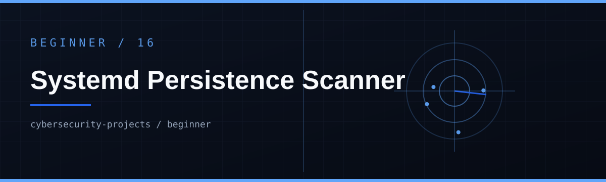
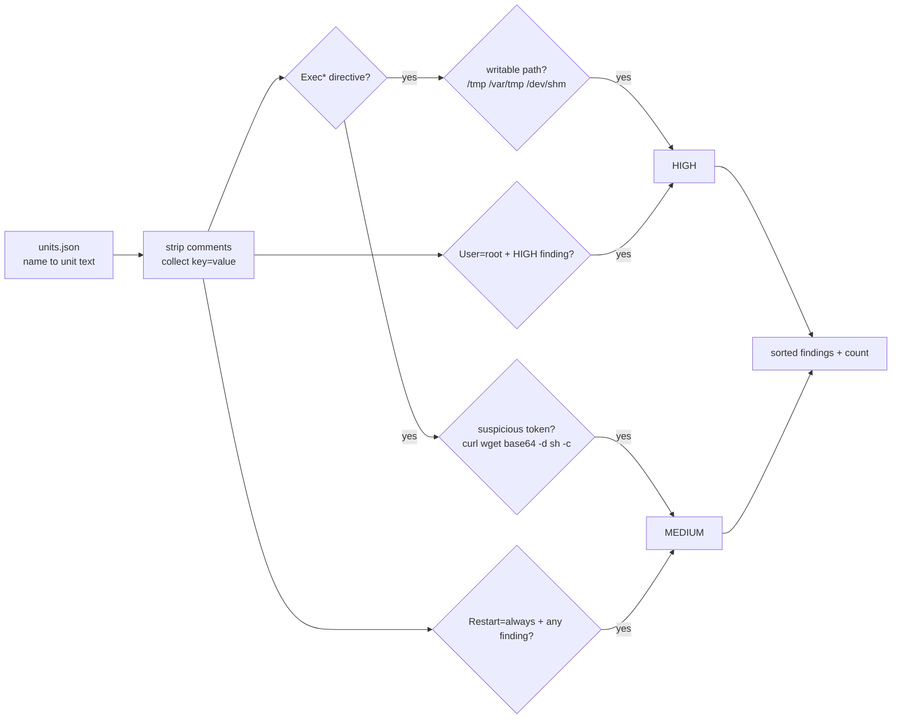

<div align="center">
  
</div>

<br />

<div align="center">

# ⚙️ Systemd Persistence Scanner


> **Boot Survival, Under a Microscope.** A read-only lens on unit definitions — the writable paths and download-and-execute habits that turn a service into a foothold.

</div>

---

## 🎯 What it does

Upstream specifies Go; this build is a read-only Python scanner for systemd unit definitions. It reads a JSON snapshot mapping unit names to unit text, then flags suspicious `Exec*` directives and context that raises impact. Signals include executable paths under `/tmp`, `/var/tmp`, or `/dev/shm`; `curl`, `wget`, `base64 -d`, inline interpreters, or shell `-c`; root user combined with a writable-path executable; and `Restart=always` on a unit that already has findings.

No live unit files are read or modified.

## 🧠 How it works



Each rule emits its own `Finding(unit, severity, reason, evidence)`. Units are scanned in sorted name order, so the report is reproducible across runs.

## 🚀 Quick start

Snapshot format: `{"name.service": "[Service]\nExecStart=...\n"}`. Feed it a local JSON file (fixture kept under `$env:TEMP`):

```powershell
python systemd_scan.py units.json
```

### Real output

```text
$ python systemd_scan.py units.json
[MEDIUM] updater.service: uses suspicious command 'curl'
[HIGH  ] updater.service: executes from writable path /tmp/
[HIGH  ] updater.service: runs as root with a writable-path executable
[MEDIUM] updater.service: persistent restart increases impact of suspicious command
4 finding(s)
```

## 📂 Project structure

```text
16-systemd-persistence-scanner/
├── assets/hero.svg               # generated visual identity
├── systemd_scan.py               # directive parser + signals + CLI
├── learn/README.md               # units as persistence, high-signal paths
└── tests/test_systemd_scan.py    # 6 deterministic tests
```

## 🔍 Why it matters

- **Persistence is the objective.** An attacker who survives reboot has converted a foothold into residency.
- **Context upgrades a signal.** A writable-path executable is already suspicious; adding `User=root` and `Restart=always` makes it materially worse.
- **Offline evidence analysis.** Snapshot input keeps the scanner deterministic and usable on collected artifacts without touching the host.

## 🧪 Tests

```powershell
python -m unittest discover -s tests -v
```

6 tests: clean unit, writable path, suspicious command, root/restart escalation, sorted multi-unit output, and CLI behavior.

## 📚 Learn more

Read [the concept notes](learn/README.md) for how units enable persistence, why `/tmp` and `/dev/shm` are high-signal paths, and why snapshot input matters.

---

<div align="center">
  <sub>Part of <b>cybersecurity-projects</b> · Beginner tier · Built from a synopsis, original implementation.</sub>
</div>
