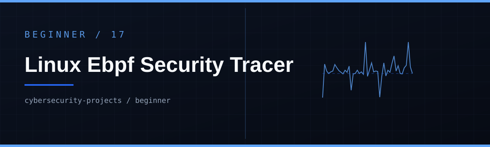
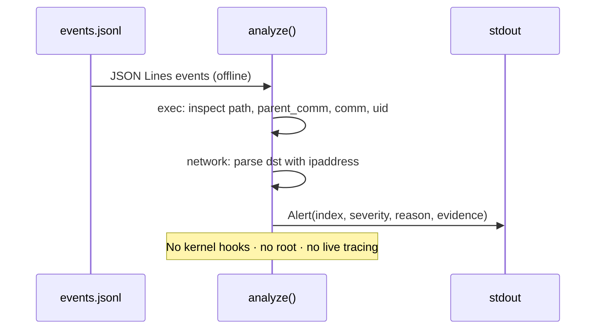

<div align="center">
  
</div>

<br />

<div align="center">

# 📡 Linux eBPF Security Tracer


> **The tracer records; the analyzer decides.** Four behavioral rules over recorded events — no kernel, no privileges, no live endpoint required.

</div>

---

## 🎯 What it does

Upstream uses eBPF/C to trace live events. This build analyzes synthetic JSON Lines events offline. No kernel hooks, no root, no live tracing. Each event is classified as an `exec` or `network` record, and the analyzer emits `Alert(event_index, severity, reason, evidence)` objects for suspicious context.

Detections: execution from `/tmp`, `/var/tmp`, or `/dev/shm`; a web server spawning a shell or interpreter; root spawning curl/wget/shell; and outbound connection to a public IP.

## 🧠 How it works



A private or loopback destination is deliberately ignored; only public IPs raise the low-severity network alert. Because the rules consume plain dicts, the same analyzer could later be fed by eBPF, auditd, or an EDR agent.

## 🚀 Quick start

One JSON object per line (fixture kept under `$env:TEMP`):

```json
{"type":"exec","comm":"bash","path":"/bin/bash","parent_comm":"nginx","uid":33}
```

```powershell
python tracer.py events.jsonl
```

### Real output

```text
$ python tracer.py events.jsonl
[HIGH  ] event#1: web server spawned a shell/interpreter — nginx -> bash
[HIGH  ] event#2: execution from writable path — /tmp/payload
[MEDIUM] event#3: root spawned network/shell utility — curl
[LOW   ] event#4: outbound connection to public IP — 8.8.8.8
4 alert(s)
```

## 📂 Project structure

```text
17-linux-ebpf-security-tracer/
├── assets/hero.svg             # generated visual identity
├── tracer.py                   # event analyzer + argparse CLI
├── learn/README.md             # eBPF overview and detection thinking
└── tests/test_tracer.py        # 7 deterministic tests
```

## 🔍 Why it matters

- **Context beats isolated events.** A shell is ordinary; a shell spawned by a web server is a signal.
- **Separating detection from collection makes rules testable.** Recorded events are reproducible, unlike a live host.
- **Low-privilege design.** The offline analyzer needs nothing beyond the Python standard library.

## 🧪 Tests

```powershell
python -m unittest discover -s tests -v
```

7 tests: clean exec, writable path, web-server shell, root network utility, public IP, private-IP suppression, and the CLI.

## 📚 Learn more

Read [the concept notes](learn/README.md) for how eBPF tracing works, why the analyzer is split out, and how combining signals reduces false positives.

---

<div align="center">
  <sub>Part of <b>cybersecurity-projects</b> · Beginner tier · Built from a synopsis, original implementation.</sub>
</div>
