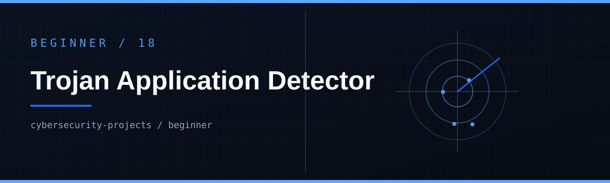
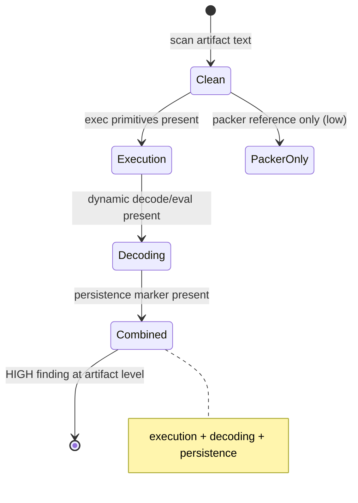

<div align="center">
  
</div>

<br />

<div align="center">

# 🧫 Trojan Application Detector


> **The combos give it away.** One suspicious string is noise; execution plus decoding plus persistence is a verdict.

</div>

---

## 🎯 What it does

The upstream synopsis requested a trojan application *builder*. That capability is intentionally not implemented. This project detects trojan-like indicators in a JSON artifact snapshot instead.

It reads a mapping of artifact name → file → text, then matches four pattern families: execution primitives (`subprocess`, `os.system`, `shell=True`), dynamic decoding/evaluation (`b64decode`, `eval`, `exec`), persistence markers (Run key, crontab, `systemctl enable`), and known packers (low confidence alone). When execution, decoding, and persistence all appear in one artifact, it adds a high-severity finding at `<artifact>` level.

The tool analyses text only; it does not build, pack, or execute artifacts.

## 🧠 How it works



Pattern families are scored independently, so each matching file gets its own `Finding`. The artifact-level combination is the only escalation — a lone packer mention stays low, and a single execution primitive stays medium.

## 🚀 Quick start

Snapshot format: `{"app-name": {"path": "file contents"}}`. Use a local JSON file (fixture kept under `$env:TEMP`):

```powershell
python detector.py apps.json
```

### Real output

```text
$ python detector.py apps.json
[HIGH  ] helper/install.sh: persistence marker: crontab
[MEDIUM] helper/loader.py: execution primitive: subprocess.
[MEDIUM] helper/loader.py: execution primitive: shell=True
[MEDIUM] helper/loader.py: dynamic decode/eval: b64decode
[MEDIUM] helper/loader.py: dynamic decode/eval: exec(
[HIGH  ] helper/<artifact>: execution + decoding + persistence indicators combined
6 finding(s)
```

## 📂 Project structure

```text
18-trojan-application-detector/
├── assets/hero.svg             # generated visual identity
├── detector.py                 # pattern families + CLI
├── learn/README.md             # indicator thinking and limitations
└── tests/test_detector.py      # 6 deterministic tests
```

## 🔍 Why it matters

- **Defensive substitution, deliberately.** A builder has almost no learning value on the blue-team side; the detector teaches the same indicators safely.
- **Combinations reduce noise.** Each signal is common in legitimate software; their convergence is what deserves escalation.
- **Static and inert.** Only text is read — nothing is assembled, packed, or run.

## 🧪 Tests

```powershell
python -m unittest discover -s tests -v
```

6 tests: clean app, execution marker, persistence marker, combination escalation, low-confidence packer, and the CLI.

## 📚 Learn more

Read [the concept notes](learn/README.md) for what makes a trojan suspicious, why only a detector was built, and the limits of text pattern matching.

---

<div align="center">
  <sub>Part of <b>cybersecurity-projects</b> · Beginner tier · Built from a synopsis, original implementation.</sub>
</div>
