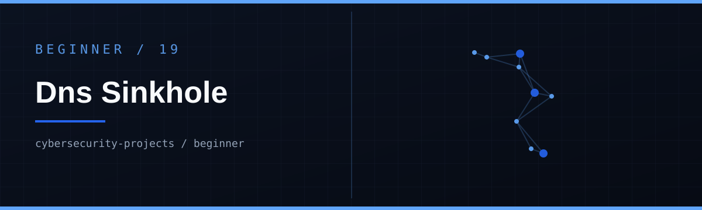
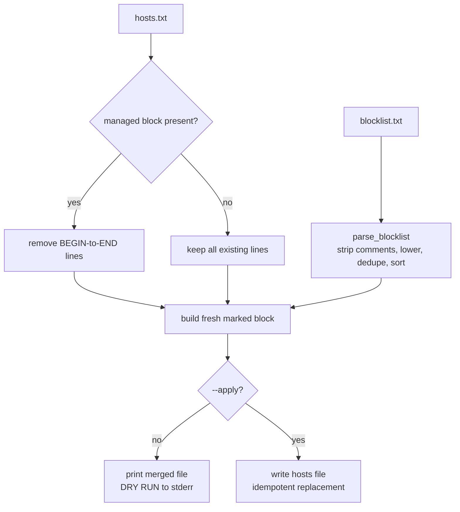

<div align="center">
  
</div>

<br />

<div align="center">

# 🕳️ DNS Sinkhole


> **One marked block, endlessly replaceable.** A hosts-file blocklist manager that shows you the diff first and never starts a DNS server.

</div>

---

## 🎯 What it does

Upstream specifies Go; this build is a Python hosts-file blocklist manager. No DNS server is started. It reads a plain list of domains (inline comments allowed), maintains one marked block delimited by `BEGIN` / `END` comments, and re-running replaces the old block instead of appending duplicates. Without `--apply`, the merged file is printed as a dry run. Writes are in-place text writes with no partial config generation.

Use temporary files for both inputs and outputs — never a real hosts file.

## 🧠 How it works



Because the managed region is replaced wholesale, repeats are idempotent and edits outside the markers survive untouched. The default sinkhole address is `0.0.0.0`; `--ip` overrides it (for example, `127.0.0.1`).

## 🚀 Quick start

Use throwaway files under `$env:TEMP`:

```powershell
python sinkhole.py hosts.txt blocklist.txt
python sinkhole.py hosts.txt blocklist.txt --apply
python sinkhole.py hosts.txt blocklist.txt --ip 127.0.0.1 --apply
```

### Real output

```text
$ python sinkhole.py hosts.txt blocklist.txt
# DRY RUN: 3 domains, 0 old lines would be removed
127.0.0.1 localhost
::1 localhost
# BEGIN cybersecurity-projects sinkhole
0.0.0.0 ads.example.com
0.0.0.0 malware.example.org
0.0.0.0 tracker.example.net
# END cybersecurity-projects sinkhole

$ python sinkhole.py hosts.txt blocklist.txt --ip 127.0.0.1 --apply
applied: 3 domains, 0 old lines removed

$ python sinkhole.py hosts.txt blocklist.txt --ip 127.0.0.1 --apply
applied: 3 domains, 3 old lines removed
```

The second `--apply` demonstrates idempotence: the previous three managed lines are removed rather than duplicated. All paths above were temporary fixtures; no real hosts file was touched.

## 📂 Project structure

```text
19-dns-sinkhole/
├── assets/hero.svg             # generated visual identity
├── sinkhole.py                 # blocklist parser + merger + CLI
├── learn/README.md             # sinkholing, hosts vs DNS, idempotence
└── tests/test_sinkhole.py      # 6 deterministic tests
```

## 🔍 Why it matters

- **Dry run by default.** The tool prints what it would do before it changes anything.
- **Idempotence prevents config rot.** Reapplying a blocklist cannot accumulate duplicate entries.
- **A hosts file is a local, reversible control.** No resolver, daemon, or network change is introduced.

## 🧪 Tests

```powershell
python -m unittest discover -s tests -v
```

6 tests: blocklist parsing, block insertion, old-block replacement, custom IP, CLI dry run, and CLI apply. Tests use temporary files; no real hosts file is touched.

## 📚 Learn more

Read [the concept notes](learn/README.md) for the sinkhole principle, hosts file vs DNS server trade-offs, and why marking a managed block makes the operation idempotent.

---

<div align="center">
  <sub>Part of <b>cybersecurity-projects</b> · Beginner tier · Built from a synopsis, original implementation.</sub>
</div>
