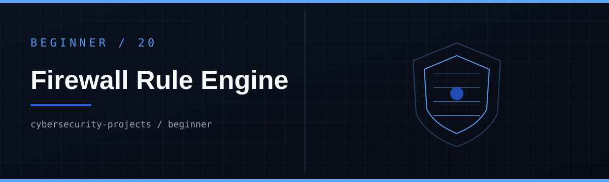
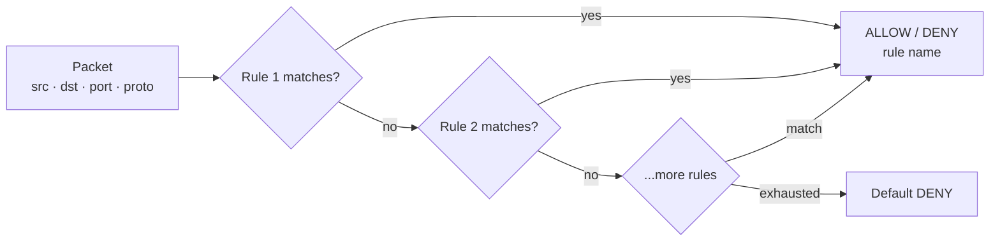

<div align="center">
  
</div>

<br />

<div align="center">

# 🧱 Firewall Rule Engine


> **First match wins.** A tiny policy engine that decides whether a packet is allowed — and tells you exactly which rule made the call.

</div>

---

## 🎯 What it does

It reads an ordered list of JSON rules and evaluates one synthetic packet against them. Each rule can constrain source subnet, destination subnet, port, port range, port list, and protocol. The first matching rule decides the outcome; if nothing matches, the packet is denied.

This is the decision core of a firewall, stripped down to something you can read in one sitting.

## 🧠 How it works



Matching rules use `ipaddress` for CIDR checks and a small port parser that accepts `443`, `80-443`, or `80,443`.

## 🚀 Quick start

```powershell
python firewall.py rules.json --src 8.8.8.8 --dst 10.2.3.4 --port 443
```

Example `rules.json`:

```json
[
  {"name": "allow-web",   "action": "allow", "dst": "10.0.0.0/8",     "port": "80,443", "protocol": "tcp"},
  {"name": "allow-admin", "action": "allow", "src": "192.168.1.0/24", "port": "22",     "protocol": "tcp"},
  {"name": "deny-all",    "action": "deny"}
]
```

### Real output

```text
$ python firewall.py rules.json --src 8.8.8.8 --dst 10.2.3.4 --port 443
ALLOW (allow-web)

$ python firewall.py rules.json --src 203.0.113.9 --dst 10.2.3.4 --port 3389
DENY (deny-all)

$ python firewall.py rules.json --src 192.168.1.25 --dst 10.0.0.1 --port 22
ALLOW (allow-admin)
```

## 📂 Project structure

```text
20-firewall-rule-engine/
├── assets/hero.svg          # generated visual identity
├── firewall.py              # rule model + evaluator + CLI
├── learn/README.md          # the concepts behind first-match policies
└── tests/test_firewall.py   # 7 deterministic tests
```

## 🔍 Why it matters

- **Order is security.** A broad `allow` placed above a specific `deny` silently defeats the deny rule.
- **Default deny** turns an accidental omission into a safe outcome.
- **Attribution** matters: returning the *rule name* makes policy debugging possible.

## 🧪 Tests

```powershell
python -m unittest discover -s tests -v
```

7 tests covering CIDR matching, port lists and ranges, protocol filtering, first-match precedence, default deny, rule loading, and the CLI.

## 📚 Learn more

Read [the concept notes](learn/README.md) for first-match semantics, default-deny baselines, and how matching dimensions combine.

---

<div align="center">
  <sub>Part of <b>cybersecurity-projects</b> · Beginner tier · Built from a synopsis, original implementation.</sub>
</div>
