

  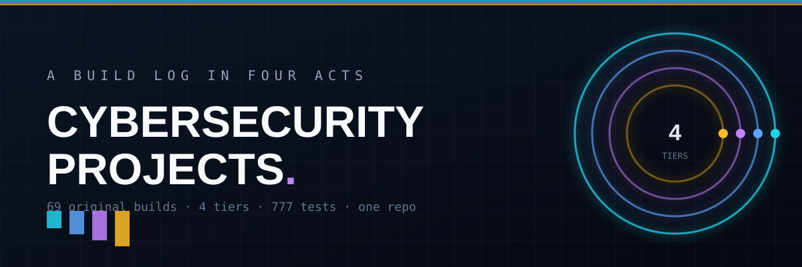

# 🔵 Beginner

> Scanners, ciphers, logs and the first blue-team tools.

---

## All beginner projects

| Project | Banner | What it does |
|---|---|---|
| [Simple Port Scanner](01-simple-port-scanner/README.md) | 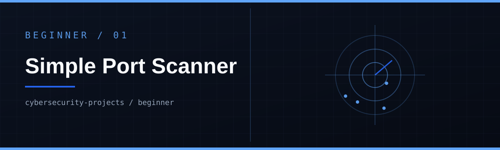 | Probe a target range for open TCP ports. |
| [Keylogger](02-keylogger/README.md) | 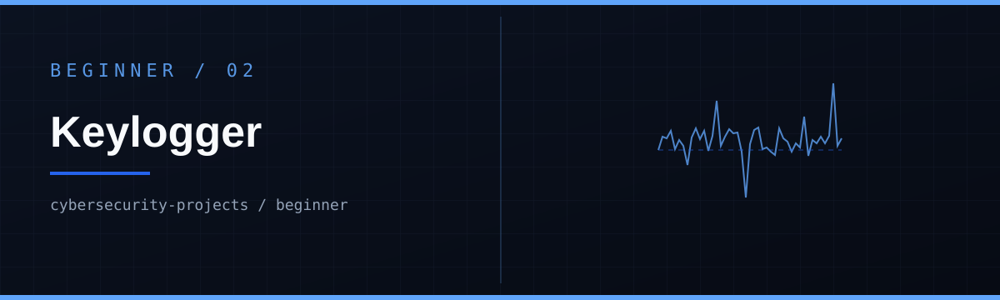 | Educational event recorder with a clear lab boundary. |
| [Caesar Cipher](03-caesar-cipher/README.md) |  | Rotate letters, brute-force shifts and score results. |
| [Dns Lookup](04-dns-lookup/README.md) | 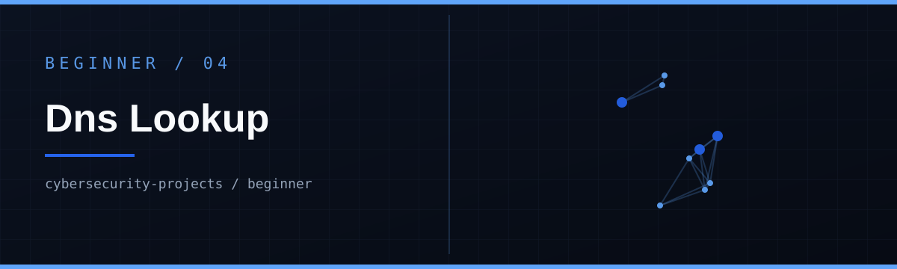 | Query and present DNS records from the command line. |
| [Simple Vulnerability Scanner](05-simple-vulnerability-scanner/README.md) | 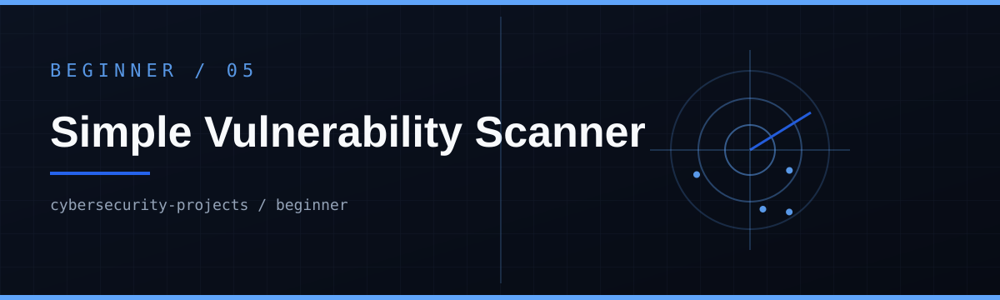 | Rule-based checks over a synthetic host snapshot. |
| [Network Traffic Analyzer](06-network-traffic-analyzer/README.md) | 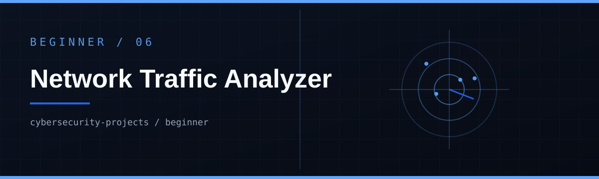 | Parse saved capture data into flow summaries. |
| [Hash Cracker](07-hash-cracker/README.md) | 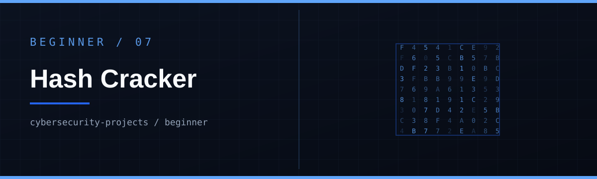 | Bounded dictionary checks against local demo digests. |
| [Steganography Multi Tool](08-steganography-multi-tool/README.md) | 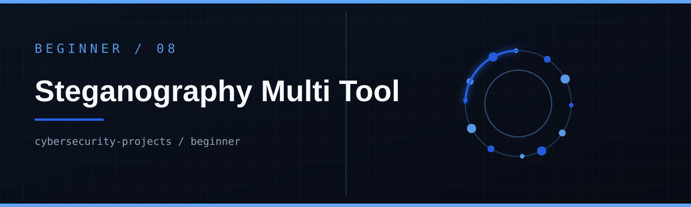 | Hide and reveal payloads in images with a CLI. |
| [Deserialization Gadget Lab](09-deserialization-gadget-lab/README.md) | 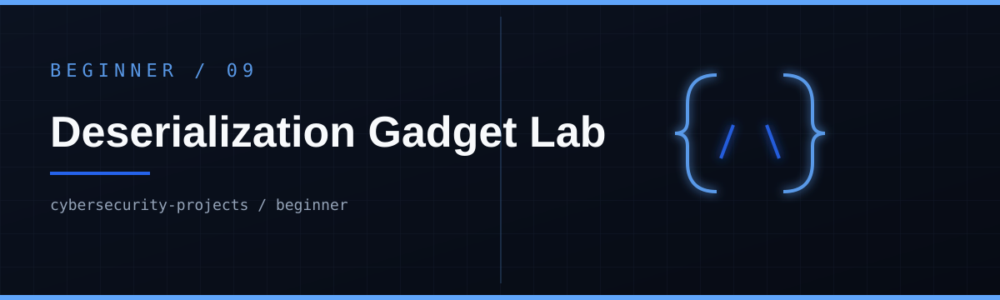 | Inspect serialized object graphs safely, offline. |
| [Canary Token Generator](10-canary-token-generator/README.md) | 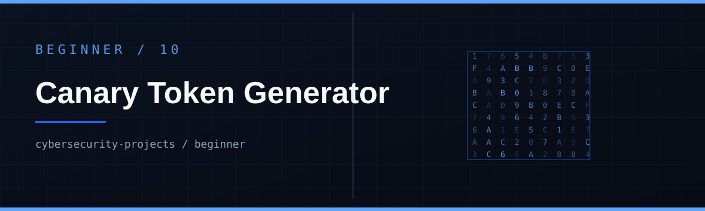 | Generate harmless tripwire tokens for lab tracking. |
| [Phishing Domain Detector and Qui…](11-phishing-domain-detector-and-quishing-scanner/README.md) | 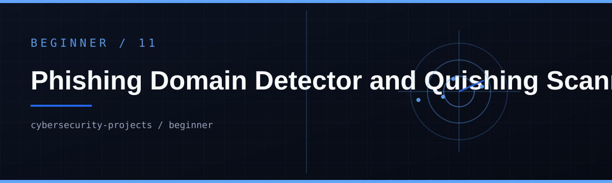 | Score domains and QR links for lookalike patterns. |
| [Ssh Brute Force Detector](12-ssh-brute-force-detector/README.md) | 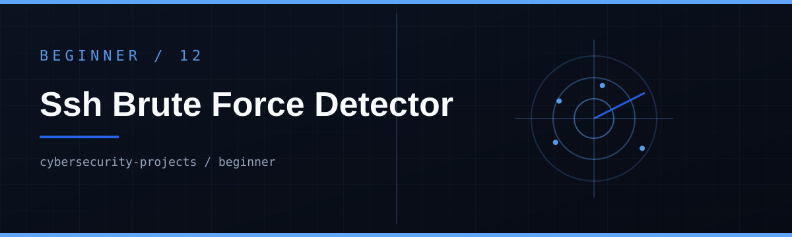 | Spot repeated failed logins in synthetic auth logs. |
| [Simple C2 Beacon](13-simple-c2-beacon/README.md) | 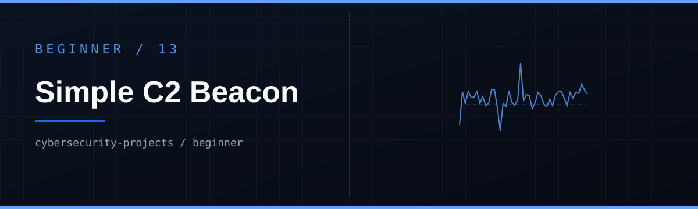 | Model beacon timing and detect regular check-ins. |
| [Base64 Encoder Decoder](14-base64-encoder-decoder/README.md) | 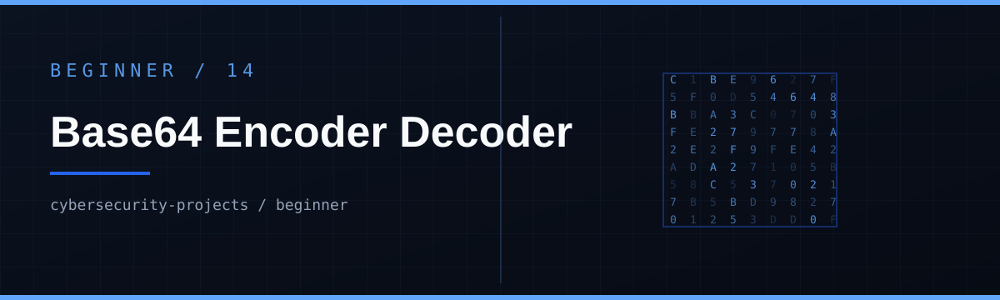 | Encode and decode text with validation and diagnostics. |
| [Linux Cis Hardening Auditor](15-linux-cis-hardening-auditor/README.md) | 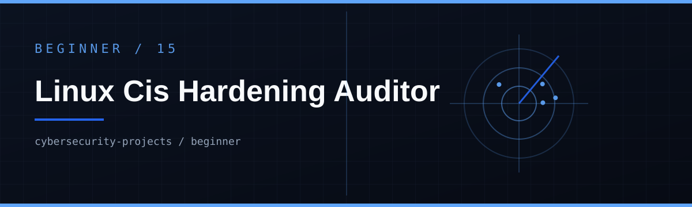 | Check a config snapshot against CIS-style controls. |
| [Systemd Persistence Scanner](16-systemd-persistence-scanner/README.md) | 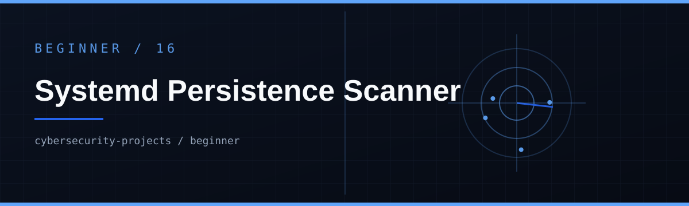 | Find suspicious service and timer unit definitions. |
| [Linux Ebpf Security Tracer](17-linux-ebpf-security-tracer/README.md) | 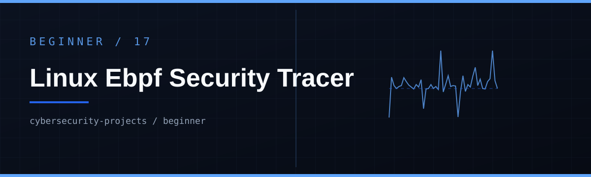 | Analyze synthetic process-execution telemetry offline. |
| [Trojan Application Detector](18-trojan-application-detector/README.md) | 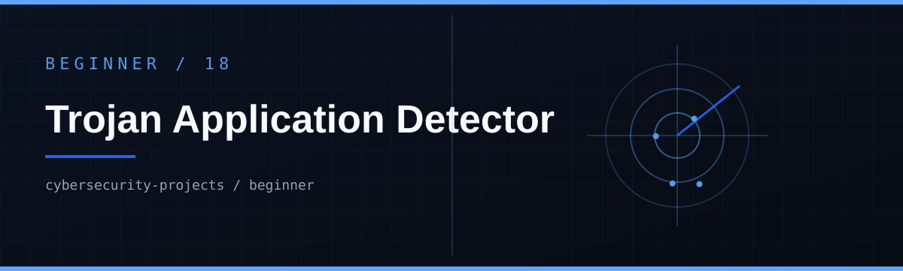 | Static indicators of trojan-like application behaviour. |
| [Dns Sinkhole](19-dns-sinkhole/README.md) | 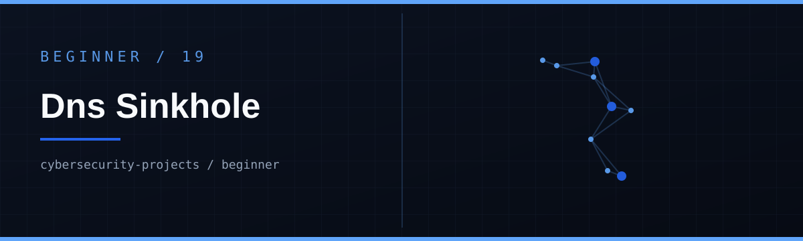 | Idempotent hosts-file blocklists with safe dry runs. |
| [Firewall Rule Engine](20-firewall-rule-engine/README.md) | 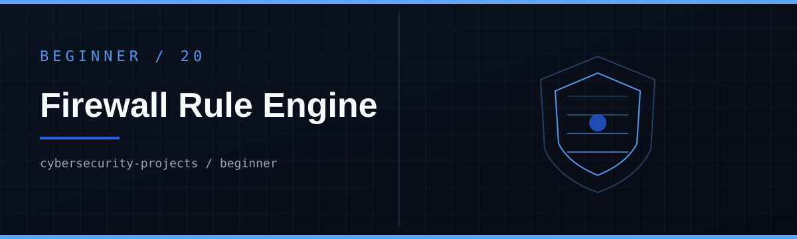 | First-match packet policy with default deny. |
| [Llm Prompt Injection Firewall](21-llm-prompt-injection-firewall/README.md) | 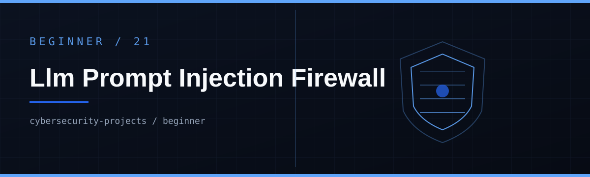 | Heuristic pre-filter for untrusted prompt text. |

---

[← Back to the full gallery](../README.md)

