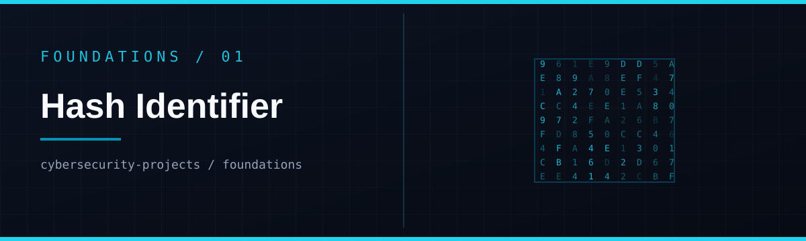
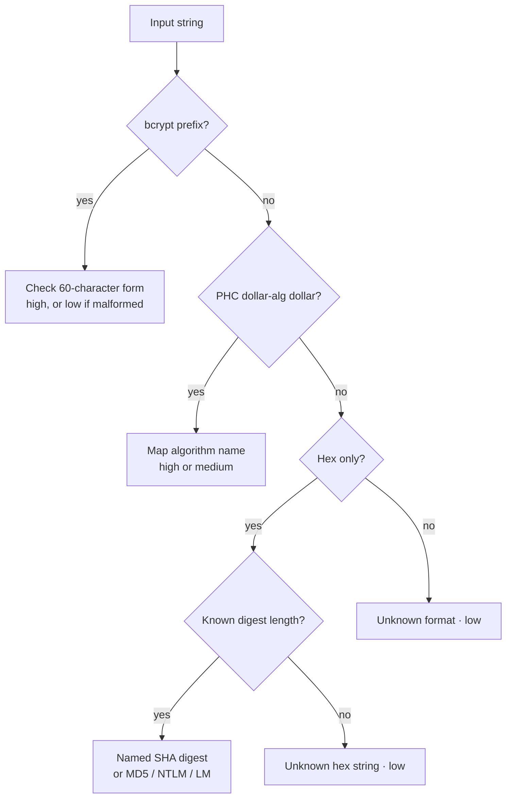

<div align="center">
  
</div>

<br />

<div align="center">

# 🔎 Hash Identifier


> **Shape before substance.** A hash's prefix, length, and charset tell you what it *might* be — this tool reports candidates instead of pretending to know.

</div>

---

## 🎯 What it does

It reads one string (or a file of strings) and reports plausible hash formats with an explicit confidence level. Pure static analysis — nothing is hashed, cracked, or sent anywhere.

| Format | Signal | Confidence |
|---|---|---|
| bcrypt | `$2a$` / `$2b$` / `$2y$` + 60 chars | high |
| Argon2, scrypt, PBKDF2 | PHC `$alg$v=N$...` string | high |
| SHA-1 / 224 / 256 / 384 / 512 | 40 / 56 / 64 / 96 / 128 hex chars | high |
| MD5 / NTLM / LM | 32 hex chars | medium — length alone is ambiguous |
| Malformed bcrypt | bcrypt prefix, wrong length | low |
| Unknown hex / text | no matching signature | low |

## 🧠 How it works



No hashing, no cracking, no network access — just regular expressions over the text you supply.

## 🚀 Quick start

```powershell
python hash_identifier.py d41d8cd98f00b204e9800998ecf8427e
python hash_identifier.py --file samples.txt
```

With `--file`, each non-empty line is treated as a separate candidate.

### Real output

```text
$ python hash_identifier.py d41d8cd98f00b204e9800998ecf8427e
d41d8cd98f00b204e9800998ecf8427e
  [medium] MD5 / NTLM / LM — 32 hex characters; length alone cannot separate them

$ python hash_identifier.py $("a" * 64)
aaaaaaaaaaaaaaaaaaaaaaaaaaaaaaaaaaaaaaaaaaaaaaaaaaaaaaaaaaaaaaaa
  [high  ] SHA-256 — 64 hex characters

$ python hash_identifier.py '$argon2id$v=19$m=65536,t=3,p=4$c29tZXNhbHQ$YWJjZA'
$argon2id$v=19$m=65536,t=3,p=4$c29tZXNhbHQ$YWJjZA
  [high  ] Argon2id — PHC prefix $argon2id$
```

## 📂 Project structure

```text
01-hash-identifier/
├── assets/hero.svg                # generated visual identity
├── hash_identifier.py             # signatures, identify(), report, CLI
├── learn/README.md                # the concepts behind hash signatures
└── tests/test_hash_identifier.py  # 13 deterministic tests
```

## 🔍 Why it matters

- **Length and charset are weak signals.** 32 hex characters could be MD5, NTLM, or LM — the tool reports all three rather than guessing, and labels the confidence accordingly.
- **Full identification needs context:** which application produced the value, its salt format, and so on.
- **Honest labels beat false certainty** in triage notes and reports.

## 🧪 Tests

```powershell
python -m unittest discover -s tests -v
```

13 tests covering SHA lengths, ambiguous 32-hex values, bcrypt variants and malformed bcrypt, PHC names, hex oddities, non-hex input, whitespace handling, report truncation, and both CLI input modes.

## 📚 Learn more

Read [the concept notes](learn/README.md) for hash signatures, PHC strings, and why confidence levels matter.

---

<div align="center">
  <sub>Part of <b>cybersecurity-projects</b> · Foundations tier · Built from a synopsis, original implementation.</sub>
</div>
