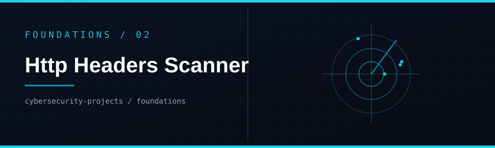
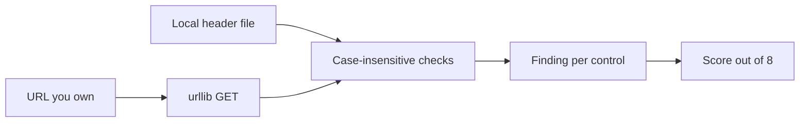

<div align="center">
  
</div>

<br />

<div align="center">

# 🛡️ HTTP Headers Scanner


> **Eight checks, one score.** Audit security response headers offline from a file — or online against a target you own.

</div>

---

## 🎯 What it does

It checks a response's headers against eight common browser-side controls and prints a PASS / WARN / FAIL finding for each, plus a score out of eight.

| Control | PASS | WARN | FAIL |
|---|---|---|---|
| Content-Security-Policy | present | — | missing |
| Strict-Transport-Security | max-age ≥ 1 year | weak/invalid max-age | missing |
| X-Content-Type-Options | `nosniff` | — | missing/other |
| X-Frame-Options | DENY/SAMEORIGIN or CSP frame-ancestors | unexpected value | missing |
| Referrer-Policy | no-referrer or strict-origin-when-cross-origin | other value | missing |
| Permissions-Policy | present | missing | — |
| Server / X-Powered-By | not exposed | exposed | — |

Score: pass = 1, warn = 0.5, fail = 0. Maximum 8.

## 🧠 How it works



A CSP with `frame-ancestors` also satisfies the X-Frame-Options check. Header-name lookups ignore case.

## 🚀 Quick start

```powershell
python headers_scanner.py --file headers.txt
python headers_scanner.py https://your-lab.local
```

Header file format: one `Name: value` pair per line. Blank lines and `#` comments are ignored.

**Safety:** The online mode only fetches headers from a URL you supply. Do not scan systems you do not own or have written permission to test.

### Real output

Two header fixtures were written under the temp directory and scanned:

```text
$ python headers_scanner.py --file $env:TEMP\hdr_hardened_demo.txt
Target: $env:TEMP\hdr_hardened_demo.txt
Score: 8/8

  [PASS] Content-Security-Policy: present
  [PASS] Strict-Transport-Security: max-age=31536000
  [PASS] X-Content-Type-Options: nosniff
  [PASS] X-Frame-Options: DENY
  [PASS] Referrer-Policy: no-referrer
  [PASS] Permissions-Policy: present
  [PASS] Server banner: not exposed
  [PASS] X-Powered-By: not exposed

$ python headers_scanner.py --file $env:TEMP\hdr_weak_demo.txt
Target: $env:TEMP\hdr_weak_demo.txt
Score: 2/8

  [FAIL] Content-Security-Policy: missing
  [WARN] Strict-Transport-Security: present but max-age is under one year
  [FAIL] X-Content-Type-Options: missing or not nosniff
  [FAIL] X-Frame-Options: missing
  [FAIL] Referrer-Policy: missing
  [WARN] Permissions-Policy: missing
  [WARN] Server banner: exposes nginx/1.24
  [WARN] X-Powered-By: exposes PHP/8.2
```

## 📂 Project structure

```text
02-http-headers-scanner/
├── assets/hero.svg             # generated visual identity
├── headers_scanner.py          # checks, scoring, parser, CLI
├── learn/README.md             # the concepts behind the headers
└── tests/test_headers_scanner.py  # 14 deterministic tests
```

## 🔍 Why it matters

- **Small headers, large consequences.** CSP and HSTS decide what a browser will and won't do.
- **Banners leak shape.** `Server` and `X-Powered-By` hand attackers a version to match against known issues.
- **Offline-first auditing** means you can review saved captures without touching a live system.

## 🧪 Tests

```powershell
python -m unittest discover -s tests -v
```

14 tests, standard library only, no network calls — covering hardened and empty header sets, case-insensitive lookup, weak and malformed HSTS, CSP frame-ancestors, unexpected XFO, weak referrer, banner exposure, half-point scoring, report shape, file parsing, CLI, and offline-safe defaults.

## 📚 Learn more

Read [the concept notes](learn/README.md) for what each security header does and how to read a score.

---

<div align="center">
  <sub>Part of <b>cybersecurity-projects</b> · Foundations tier · Built from a synopsis, original implementation.</sub>
</div>
