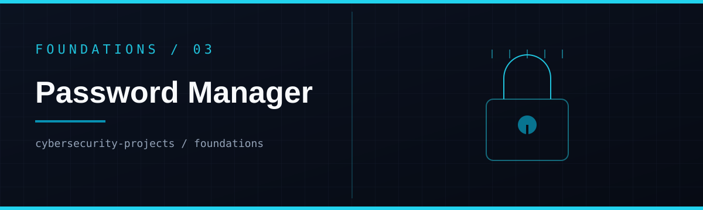
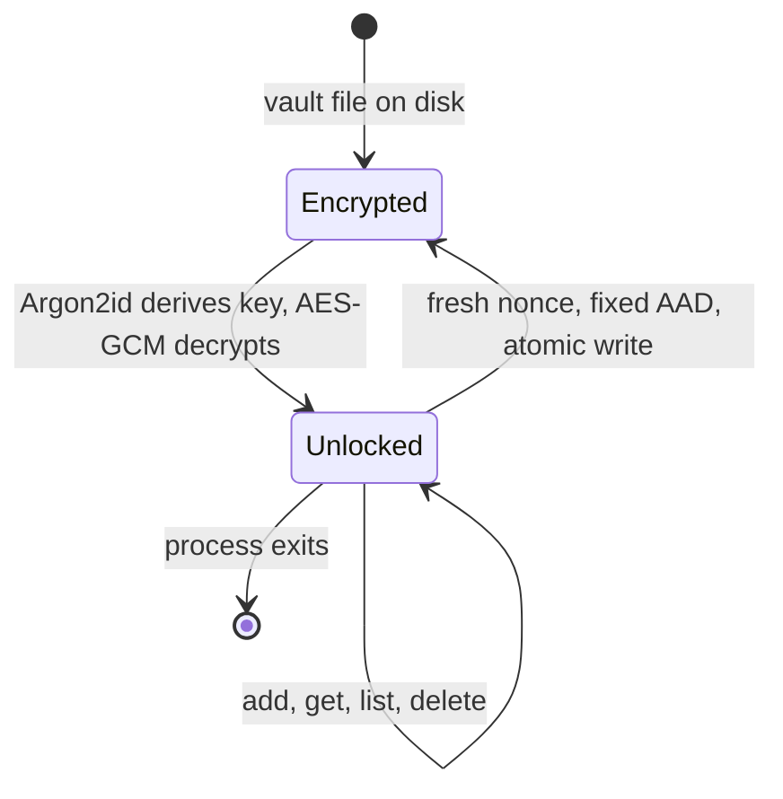

<div align="center">
  
</div>

<br />

<div align="center">

# 🔐 Password Manager


> **Only ciphertext on disk.** A master password derives the key, AES-256-GCM protects the entries, and no plaintext credential is ever written.

</div>

---

## 🎯 What it does

A local encrypted vault: create it, store credentials by service and username, list what's inside, retrieve a secret, and delete entries.

- **KDF:** Argon2id (32 MiB, 3 iterations, 4 lanes) with a fresh 16-byte salt
- **Cipher:** AES-256-GCM with a fresh 12-byte nonce per write and a fixed AAD
- **Storage:** one JSON file containing salt, nonce, and ciphertext only

The master password is prompted for with `getpass` and is never stored or logged.

## 🧠 How it works



A wrong password (or a single flipped ciphertext byte) fails authentication instead of returning garbage. Writes go to a `.tmp` file and are moved into place with `os.replace`.

## 🚀 Quick start

```powershell
python vault.py vault.json init
python vault.py vault.json add mail alice 'S3cret!'
python vault.py vault.json list
python vault.py vault.json get mail alice
python vault.py vault.json delete mail alice
```

The CLI prompts for the master password on every command; `init` asks for confirmation too. The snippet below drives the same public API non-interactively so its result can be shown verbatim.

### Real output

```text
$ python -c "import tempfile, pathlib, json; from vault import create_vault, Vault; d=pathlib.Path(tempfile.mkdtemp()); p=d/'vault.json'; v=create_vault(p,'correct horse battery staple'); v.add('mail','alice','S3cret!'); v.add('vpn','alice','openvpn-token'); u=Vault.unlock(p,'correct horse battery staple'); print('services:', u.list_services()); print('get mail/alice:', u.get('mail','alice')); print('plaintext present:', 'S3cret!' in p.read_text(encoding='utf-8')); print('file keys:', sorted(json.loads(p.read_text(encoding='utf-8')).keys()))"
services: {'mail': ['alice'], 'vpn': ['alice']}
get mail/alice: {'alice': 'S3cret!'}
plaintext present: False
file keys: ['ciphertext', 'format', 'nonce', 'salt']
```

## 📂 Project structure

```text
03-password-manager/
├── assets/hero.svg        # generated visual identity
├── vault.py               # KDF, AEAD, vault model, CLI
├── learn/README.md        # the concepts behind the vault
└── tests/test_vault.py    # 12 deterministic tests
```

## 🔍 Why it matters

- **Authenticated encryption** means tampering is detected, not silently accepted.
- **A fresh salt and nonce** stop identical inputs from producing identical stored bytes.
- **Limitations:** This is a learning implementation, not a production password manager. It has no recovery flow, no hardware-key support, no secure memory wiping, and no multi-user sharing. Do not store real credentials in it.

## 🧪 Tests

```powershell
python -m unittest discover -s tests -v
```

12 tests covering no-plaintext storage, unlock round-trips, wrong passwords, case-insensitive services, listing, both delete modes, missing services, duplicate creation, tampered ciphertext, unknown formats, and cleanup of temp files. Requires `cryptography>=45` for `Argon2id`; verified with 50.0.2.

## 📚 Learn more

Read [the concept notes](learn/README.md) for key derivation, AEAD, and why nonce reuse matters.

---

<div align="center">
  <sub>Part of <b>cybersecurity-projects</b> · Foundations tier · Built from a synopsis, original implementation.</sub>
</div>
