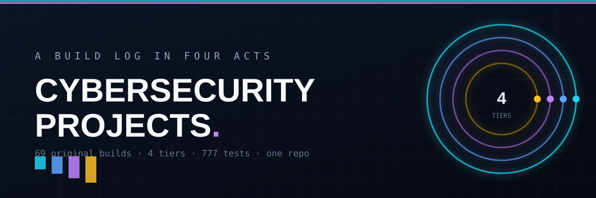
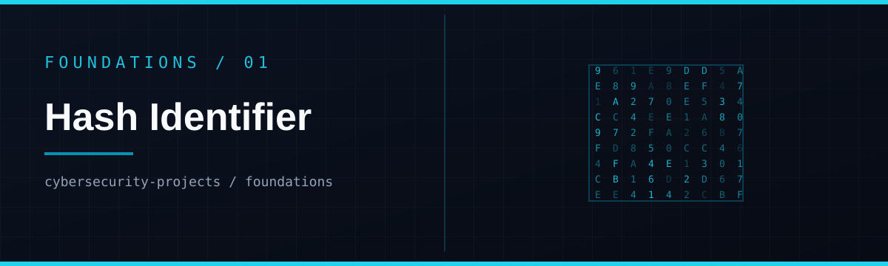
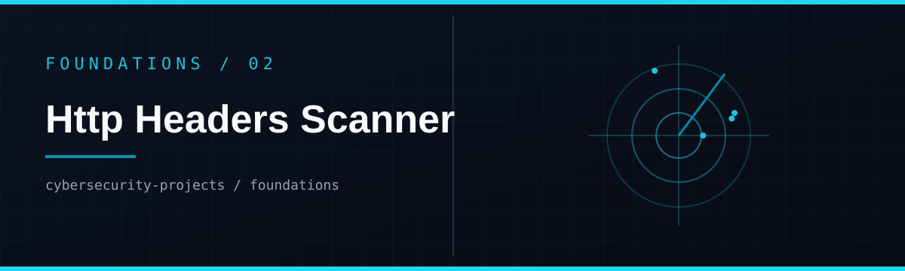
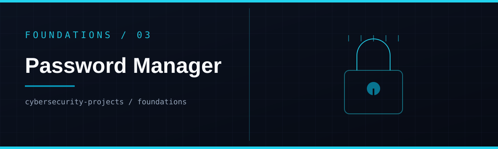

  

# 🟦 Foundations

> Core primitives — hashing, headers, secrets.

---

## All foundations projects

| Project | Banner | What it does |
|---|---|---|
| [Hash Identifier](01-hash-identifier/README.md) |  | Identify hash formats from length and character patterns. |
| [Http Headers Scanner](02-http-headers-scanner/README.md) |  | Audit response headers for missing security controls. |
| [Password Manager](03-password-manager/README.md) |  | Encrypted local vault with Argon2id key derivation. |

---

[← Back to the full gallery](../README.md)

