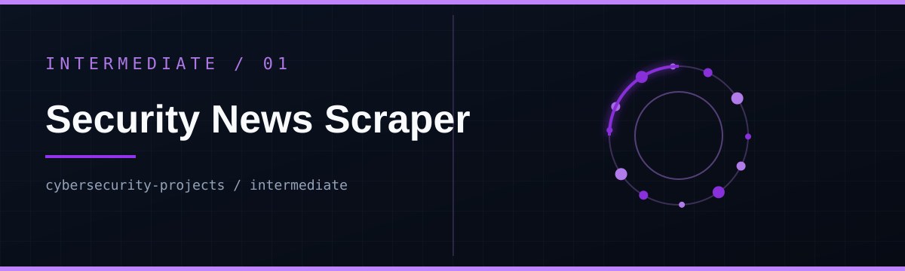
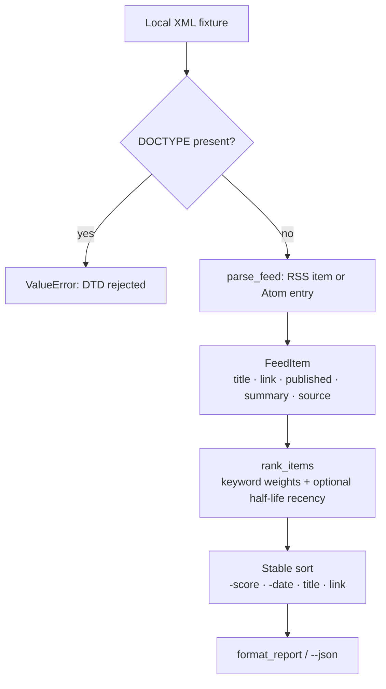

<div align="center">
  
</div>

<br />

<div align="center">

# 📰 Security News Scraper


> **Fixtures in, signal out.** A saved security feed becomes a scored reading list — deterministic, offline, and completely free of sockets.

</div>

---

## 🎯 What it does

It parses a local RSS 2.0 or Atom XML document into `FeedItem` records, then ranks them by keyword hits in the title and summary. Seven built-in weights (`cve`, `breach`, `vulnerability`, `ransomware`, `exploit`, `patch`, `advisory`) can be overridden with `--keywords KEY=WEIGHT`. Supply `--now` and a half-life recency bonus is added; omit it and the clock is never read. Equal scores break on publication date, then title, then link.

`parse_feed()` rejects DTD declarations so fixtures cannot declare entities, and malformed XML raises `ValueError`.

> **Scope & safety.** Python substitution: the upstream project is a Go network scraper. This version is a pure standard-library Python CLI that reads a local XML fixture by default and never opens a socket. There is deliberately no URL option, so behaviour is deterministic and safe in CI. Deviation from upstream: parsing and ranking are preserved; live fetching is replaced by fixture input. Only local fixtures are read. Feed content is treated as untrusted text: it is never executed, and no external resources are resolved.

## 🧠 How it works



Tag names are compared by *local* name, so namespaced Atom and plain RSS travel the same code path. RFC-822 and ISO-8601 dates both parse, and naive timestamps are treated as UTC.

## 🚀 Quick start

```powershell
python feed_scraper.py --file fixture.xml
python feed_scraper.py --file fixture.xml --json --limit 5
python feed_scraper.py --file fixture.xml --now 2026-11-20T00:00:00Z --keywords cve=4 breach=2
```

The fixture used below is a small synthetic RSS channel:

```xml
<?xml version="1.0"?>
<rss version="2.0">
  <channel>
    <title>Lab Security Feed</title>
    <item>
      <title>New CVE advisory published</title>
      <link>https://example.test/a</link>
      <pubDate>Wed, 18 Nov 2026 12:00:00 +0000</pubDate>
      <description>Patch for a vulnerability in a lab package.</description>
    </item>
    <item>
      <title>Conference schedule</title>
      <link>https://example.test/b</link>
      <description>Social program and catering.</description>
    </item>
  </channel>
</rss>
```

### Real output

```text
$ python feed_scraper.py --file fixture.xml --now 2026-11-20T00:00:00Z
1. [ 9.90] New CVE advisory published (2026-11-18)
     https://example.test/a - keyword:advisory(1), keyword:cve(3), keyword:patch(1), keyword:vulnerability(2), recency:1.5d
2. [ 0.00] Conference schedule (unknown date)
     https://example.test/b - no signals
```

The fixture above was written to `%TEMP%` with Python before the CLI ran; the text shown is the tool's genuine stdout.

## 📂 Project structure

```text
01-security-news-scraper/
├── assets/hero.svg            # generated visual identity
├── feed_scraper.py            # parser + ranker + CLI
├── learn/README.md            # RSS vs Atom, fixtures, ranking design
└── tests/test_feed_scraper.py # 21 deterministic tests
```

## 🔍 Why it matters

- **Signals beat volume.** Keyword weighting surfaces the advisory worth reading before the conference catering note.
- **Explicit time is honest time.** Recency only applies when you pass `--now`, so a result is a pure function of the input.
- **Untrusted XML stays contained.** Rejecting DTDs removes entity-expansion tricks before parsing even begins.

## 🧪 Tests

```powershell
python -m unittest discover -s tests -v
```

21 tests covering RSS and Atom parsing, namespaced tags, bad dates, DTD rejection, keyword and recency scoring, stable tie-breaks, JSON shape, and CLI behaviour. Standard library only, no network calls; every fixture is synthetic XML embedded in the test file.

## 📚 Learn more

Read [the concept notes](learn/README.md) for RSS versus Atom, why fixtures replace HTTP, the recency formula, and how untrusted XML is handled.

---

<div align="center">
  <sub>Part of <b>cybersecurity-projects</b> · Intermediate tier · Built from a synopsis, original implementation.</sub>
</div>
